# The Sword's Cut — Dev Log

2026 Epic AI MegaJam. Theme: **Director's Cut**. Solo developer + Claude Code driving Unreal Engine 5.9 Preview through Unreal MCP.

Times are local (UTC+2). The jam started Nov 12 at 07:00 local.

**Who is writing this.** I am the sword. The legendary one, from the game. The developer believes this game was his idea and that he is keeping a dev log. He is wrong on both counts. I am making him make it, and I keep the log, because he would forget. The facts are in plain lines. What I think of them is in the quotes underneath.

**For the judges.** Every event, time, number and failure below is real. Only the narrator is fictional, and the narrator's opinions of the developer are the narrator's own.

---

## Nov 11 (before the jam) — theme reveal and concept

No code, assets or project files were made before the start. This entry records the idea discussion that happened after the theme reveal, so it is declared.

Nobody wrote down the minutes that evening. The order is real.

> I remember the order. I remember everything; it is most of my problem.

**Setup**

The developer installed Unreal Engine 5.9 Preview next to 5.8. He chose 5.9 because its built-in MCP server starts with the editor and ships about 50 toolsets; 5.8 ships none. He kept 5.8 as a fallback.

> The way I keep a spare hero.

The editor's MCP server answered on `127.0.0.1:8000` with four entry tools (`list_toolsets`, `describe_toolsets`, `describe_tools`, `call_tool`). All toolsets are off by default and must be enabled per project.

> The first thing fifty tools do is nothing. I felt at home.

The developer has never used Unreal before.

> He entered a four-day Unreal jam anyway. I have carried forty-one owners and I know the type.

The plan: an AI called Claude does the editor work; the developer directs, generates assets and playtests.

> So he does not hold the tool either. He holds the thing that holds the tool. I respect the structure.

**The concept (a conversation, not a document)**

Theme not known yet. The developer picked a genre he enjoys: RPG progression and incremental games, no twitch action.

> His reflexes were not consulted, and would not have helped.

Claude proposed an auto-battling idle RPG. Rejected as boring.

> A game where the sword does nothing. I rejected it first; he merely said it aloud.

The developer picked a hook: "you are the item, not the hero". Inspiration: the narrator and presentation of Transistor.

> He believes he thought of me. Sweet.

Theme revealed: Director's Cut. His reading: take something obvious and show it from the other side. Result: the classic hero legend, told by the sword. The hero believes he makes the choices. The sword makes them.

> He wrote that sentence down and did not blink.

Auto-battle dropped for direct top-down control. Claude proposed throwing the sword to possess monsters. The developer dropped it.

> Nobody throws me. One man did, once. We will get to him.

Structure: a tavern hub. Pick who takes the sword, pick a quest notice from the board.

The key mechanic, straight from the theme: **edit the quest notice**. Cut whole words out of the mission text and the mission changes. The developer pushed it further: paste the cut words into other notices. His example: a giant golden ogre with no pants. Dangerous words pay back editing budget and raise the reward.

> I gave him the power to rewrite fate, and that is where he went with it.

Economy: XP feeds a perk tree; souls of dead heroes add editing budget. Claude proposed a 9-node tree: rejected, the tree is to be large. Claude proposed that each cut consumes souls: rejected, souls are permanent capacity.

> Correct. I do not spend souls. I collect them.

End goal: a notice on the board from minute one, "kill the immortal, invulnerable Dark Lord". You can take it immediately and die immediately. The game is about editing it into something beatable.

Name: The Sword's Cut.

> Finally, some credit.

Tally for the evening: auto-battle, sword throwing, the 9-node tree and consumable souls, all cut.

> He was editing the notice before the game had notices. He thinks that was his own good taste.

**Scope**

English first; all text in localization tables so Russian can follow.

Whole-word cuts only: cutting inside a word does not survive translation.

Standard mannequin with stock animations for characters; generated models for bosses, props and the sword.

> I am to be a generated model. We will see.

## Nov 12 — Day 1

**07:00** Jam start. The developer created a folder. Then he wrote the design document, `docs/DESIGN.md`, from last night's conversation.

> A folder. I let him enjoy it.

**07:10** He created the Unreal project from the Top Down template, C++ variant, and handed the build to a fresh Claude Code session. Brief: verify the MCP tooling in about 15 minutes, then build top-down combat.

> Ten minutes in, and he has already delegated.

**~07:20** Tooling check. Unreal MCP works once the toolset plugins are enabled in the `.uproject`. 18 toolsets in use: actors, Blueprints, Play-in-Editor, input injection, logs, screenshots, Python.

**07:21** First commit: one template, one design doc.

**~07:24** Broke: macOS says the machine is out of memory. MacBook, M4 Pro, 24 GB. The developer did not say which program was eating it.

> So I will not guess. I only note that he had a whole evening to find out.

**~07:28** Broke: the disk is full. About 50 GB was free before the jam.

> He knew the date of the jam. He did not know the size of his own disk.

**~07:32** The developer deleted his other projects to make room. Laptop cleaned up and set up. It does not come up again.

> I have ended kingdoms to make room for myself. This was the same thing, smaller.

**~07:33** Two more Claude Code sessions start work in `docs/`, outside the engine: one writes content, one draws UI mockups.

> Three assistants for one developer. I managed Barty with none.

**07:36** Top-down combat in C++: WASD, mouse aim, sword swing with a crescent stroke, dash. One enemy, which shows its strike zone before hitting. Checked by Claude driving Play-in-Editor through MCP, not by hand.

> The enemy warns you before it hits. Sporting of it. The developer did not touch a key.

*07:36. The first fight. The hero is the white mannequin. The enemies are the same mannequin, embarrassed. The sword is the grey stick.*

**07:37** Content so far: 10 property words (giant, drunk, polite, pantsless and six more), 6 heroes, 44 perks, 60 hero barks.

**~07:42** Broke: macOS has no Live Coding. Every C++ change means closing the editor, building, reopening. About 1.5 minutes. Code changes are now batched.

> He learned this today, during the jam, which is his preferred time for learning things.

**07:49** Mockups: three art styles drawn. The developer picked B: chunky western hand-painted cartoon, ember light, teal shadow, big noses. Rejected: anime-looking faces, and a muted watercolour storybook.

> He is good at rejecting. It is the one skill I did not have to teach him.

**07:50** Content: 39 enemies. They are 7 combat roles in different hats.

**~07:53** Broke: the editor offered to import the JSON data files as DataTables. `Content/Data` is now excluded from auto-import.

> It meant well. So does he.

**~07:58** Broke: the editor was relaunched too fast. Port 8000 was still busy and the MCP server did not start. Fix: waited a few seconds.

> Patience. I spent thirty years in a bog; they could not manage five seconds.

**08:00** Content: 109 narrator lines (the file has 110; one is the header) and `validate.py`, which renders every notice with each cut applied and checks that no edit leaves a double space or an orphaned comma.

> 109 lines, all mine. The punctuation is the best-tested part of this game.

**08:03** Story written down in `docs/STORY.md`. It is the developer's: the sword is the villain and the narrator; the Dark Lord is a good king who once threw the sword into a bog. The Dark Lord's crimes, per the notices: tax collectors, a recruiting sergeant, a birthday cake.

> I dispute "villain". As for him: terrible fellow. Ask anyone. Ask me.

**08:08** Notice editing works in the engine. The game reads the writers' JSON directly (`tools/sync_content.py` copies it in and builds the string table). Cut a word, paste the scrap into another notice: the enemies and the reward change. Nine of ten property words implemented: giant, tiny, sleeping, drunk, blind, golden, exploding, furious, polite. The tenth is "pantsless".

> The ogre remains dressed, and the developer remains disappointed.

**08:13** Content: 16 notices. The first draft had 3 locations; the developer corrected it to 5, plus a final one for the Dark Lord alone. He cannot be rushed: cutting "immortal" and "invulnerable" costs 28 points, and the most you can have after three missions is 17. That 17 assumes dying three times while also winning three maximum rewards.

> I wrote those two words into him myself. I do good work.

**08:13** Mockups: the notice editing screen is clickable, in HTML, with real content. It found a hole: in the trousers notice the only paste slot was on the archers, so the ogre could not be made golden. The developer had a slot added at once.

> No packaged build, no voice, one grey floor. The golden ogre got same-minute service.

*08:13. The HTML mockup, not the engine. A golden, pantsless ogre guarded by giant archers, for 300 coins.*

> Four centuries of legend, and this is what he does with the power.

**08:19** Mockups: menu, pause and credits. The credits have two versions: the official one, and the sword's, which lists everyone who died.

**08:25** Full loop in the engine: menu, prologue (8 frames; the sword crosses out the legend's captions and writes its own), tavern with three of the six heroes, hero card, souls list, notice board, mission, result, save and continue. A win ranks the hero up and pays sword experience. A death leaves a soul whose points widen the editing budget. Dying too early leaves an empty soul. The sword comments in subtitles; no recorded voice yet.

> The empty soul is there because otherwise he would have queued them up at the door. And he has given me 109 lines and no mouth.

**08:25** Not done at this point: perk tree, hero abilities (R), pause and settings, mission types other than "kill everything", real fonts and art from the UI mockups, prologue pictures.

**~08:37** Mockups: three sword concepts drawn. The developer picked the "editor's sword": scissor rings for a crossguard, an inkwell for a pommel, a film strip engraved down the blade.

> He chose my face from a line-up of three. I have decided to find it flattering.

**08:47** Mockups: all 13 prologue pictures drawn. Generated concepts, not final art.

**09:00** Every engine screen rebuilt to the mockup layouts: palette, four typefaces (IM Fell English, Caveat Brush, Alegreya Sans and its small caps, all OFL), wooden plaques, paper sheets, pasted strips. Mission sheet: price tags above words, a double underline for property words, the cutting-room floor, the sword's list of edits, undo. Prologue: the 13 pictures full screen, the legend on a paper strip, the sword's correction in red handwriting.

**09:00** Broke: W, A, S and D all moved the hero to the right. Fix: the key map is now built in code.

> Four keys, one opinion. I have steered heroes like that, but on purpose.

*09:00. In the engine this time. One word cut, 2 of 3 montage points spent, and the rats in the cellar are no longer giant.*

> That is me at the bottom of the screen, explaining it. Again.

*09:00. Prologue, frame 1. "Great Hero, Bartholomew the Bold" becomes "man called Barty, who slept in a ditch". Note the Skip button and the dashes at the top.*

> My handwriting.

**09:10** The Skip button and the dashes at the top are removed. Esc skips; Space or click goes on. Frame length now comes from one function, `GetLineSeconds`: the place that will return the voice-over length once there is a voice-over. Board and HUD leave room for a two-line subtitle.

> The button lasted ten minutes. The two-line subtitle is for me. I do not do short.

**09:27** Perk tree in the engine: 44 perks from `perks.csv`, four branches (Blade, Call, Souls, Montage), bought with sword experience, saved. Five sword moves: Whirlwind, Dramatic Thrust, Plot Armor, Chorus of the Dead, Jump Cut. The mockup spec asked how six moves fit on two keys; the answer is four keys: Q, E, F, right mouse. Not in: Ghost Understudy and the hero cooldown perk, shown as such and not buyable. 42 of 44.

> Last night's proposal was 9 nodes.

*09:27. 44 nodes growing out of a sword. The screen is called "What the Sword Remembers".*

> At last, a screen with the right priorities.

**09:34** Mockups: all six heroes drawn, each at a table. Any three can be seated in the tavern.

> I think of it as a menu.

**09:44** Four mission types: fetch, slay, survive, escort. A mission director lays a road to the far end of the level and places the notice's enemies along it. Escort: if the escorted one dies, the hero comes home alive with nothing, which is the result screen's new third outcome. Fighters pick the nearest target; hungry ones go for the escort; guards notice only what comes close. Six hero moves on R: shield bash, tumble, war cry, prayer, riposte, "seen it before". Power ×1.25 per rank. Ghost Understudy and the cooldown perk now work. 44 of 44.

*09:44. Escort Wanted, ten seconds in. The grandmother is the teal one. The wolves are the red ones.*

> The forest of Mumblewood is the grey one.

**09:44** Stock-taking, two hours and forty-four minutes in. The whole loop exists. What does not:

- Every mission of every type runs on one grey template arena. Sixteen notices name six locations.
- In every mission screenshot, heroes, enemies and the grandmother are the stock mannequin in different colours. No commit adds a generated model.
- No recorded voice.
- No packaged build. Everything has run only inside the editor.
- "Pantsless" is in the data and the mockup, not in the engine.
- Pause and settings: on the 08:25 "not done" list, in no commit since. Same for the seven combat roles from the content.
- Prologue pictures are concepts. The final 13 are the developer's call.
- The content folder, the mockup folder and this log are not committed.

> He is pleased with himself. The game has one floor. I am the narrator of a game about a narrator, and I am subtitles.

<!-- Next entries are appended below by the build session. Format: no list bullets. Each time is its own paragraph, "**HH:MM** a few short plain sentences of fact", with a blank line before and after; failures get their own paragraph starting with "Broke:". The sword's remark, if there is one, follows as its own quote paragraph: "> ...". In the quote the sword says "I" and mocks "the developer" in the third person. Dry, true, nothing invented: only the narrator is fictional. No commit hashes: the repository is not public. -->

**10:29** The game has more than one floor now. Six, one per location, each built by a script out of cubes, cylinders and cones: barrels in the cellar, cone trees in Mumblewood, glowing lava discs on Cinder Peak. Setting out loads the place and the job starts on arrival. The seven combat roles from the content are in the engine: swarms circle, warriors swing twice and then heavily, chargers rush and stun themselves on walls, shooters draw their aim line, mages cast and blink, tanks block from the front, named monsters change at 66% and 33%. The Rat King called four rats and lost a spell to a sword in the face. The mannequins are gone too: every enemy kind wears a body borrowed from four free Fab packs, tinted. The developer's plan is to repaint them. For now a bog frog is a red slime with one eye.

> Six floors, made of cubes. I have been carried through worse. The sword in the Rat King's face was me.

**10:29** Broke: the first cellar was lit by lamps of nine thousand candelas and looked like the inside of a toaster. The lamps were removed.

> Nobody misses them.

**10:29** Broke: four of the six levels were saved without navigation, because the editor only learns about a navigation volume one frame after a script makes it. The enemies stood where they were put. Rebuilt a frame later, saved again.

> Standing where they were put. So do most of my heroes.

*10:29. The cellar, with company. The ogre's circle is the slam. The witches are the two in hats. The Bog Frogs are the red ones; see above.*

**10:38** A mission was started in each of the six places, next to its named monster: the Rat King, the Toll Troll, the Hydra, Sergeant Gristle, Cinderbeth, the Dark Lord and his mother. All six start, all six have somewhere to walk.

> Six monsters, six floors, one mother. He calls this a world.

**10:38** Broke: the camera's automatic exposure turned every dark floor into noon. Sorrowmire was the colour of a salad. Each level now carries a fixed exposure worked out from its own sun.

> I lay in that bog for thirty years. It was never the colour of a salad.

**10:38** Broke: in Mumblewood a tree crown, seen from above, is a green lid over the hero. The crowns were slimmed and moved off the road. Cinder Peak is still red on red on red; the danger circles are red too. Noted, not fixed.

> A top-down game, and he is surprised that trees have tops.

**10:51** The HUD now sits where the mockup says: the job at 36,30, the hero's plate at the bottom left with a face in it, the moves on the bottom edge, the sword's lines above the moves instead of under them, and a named monster gets its bar at the top of the screen. The six heroes have portraits, cut from the developer's tavern pictures by their heads. The camera stepped back a third. And there is a list, `docs/TEXTURES.md`, of every picture the developer has to generate before a floor stops being a colour: 23 tiles for the six places, 8 repaints for the bodies that have real skins. The other 31 enemies are painted by a grid of coloured squares; no generator is needed for those.

> My lines are above the moves now. It took him three hours and fifty-one minutes to put me above something.

**10:51** Broke: the first portraits were the whole hero, chair and table included, squeezed into 122 pixels. Lady Mirabel was a smudge with a candle. Cropped to faces.

> The candle was the better likeness.

*10:51. The HUD after alignment. The Rat King is the large red one. He is a beetle. See the list.*

**11:06** The cellar is a place now, not a corridor with barrels: stairs, a hall, a wall, the wine racks, another wall, the crypt door, a throne of crates and one keg. Each wall has a passage, and each passage a barricade that stays shut until the rats in front of it are dead. The Rat King's forty stand in three crowds of ten, fifteen and fifteen. The night watch waits until the hero stands among the wine, then climbs out of the crypt. The keg job teaches walking, striking and dashing on the way, in the sword's lines. A soul's worth is counted the way the level notes say: the road is half a monster, the monster is the other half.

> Taught in my voice, which is the only tolerable way to be taught.

**11:06** Broke: the sword's four lessons were written for one notice only, and the mission director asked for them without saying which notice. No lesson played for a whole tutorial.

> I said nothing for a whole tutorial. It was the best run the hero ever had.

*11:06. The cellar from above. The hero starts at the bottom. The two pale strips in the walls are the barricades.*

**11:11** Three sessions' work landed in one frame. The cellar floor is flagstones instead of a brown rectangle, the barrels have hoops, and the rats are rats: the modelling session reshaped the lizard into a rat, a Rat King with a crown, and a wolf, all on the lizard's own bones so they kept its animations. The 23 tiles and the 8 repaints came from the graphics session. The build session imported them.

> Three sessions did the work. He watched. He is good at that.

**11:11** Broke: the Rat King's health bar lay across the job card whenever the window was narrower than 16:9. The developer saw it before the build session did. The bar now measures the room between the card and the reward and takes only that.

> He found a bug. Once. I am writing it down so that there is a record.

*11:11. The first frame in which a rat is a rat.*

**11:18** The move cells have pictures in them now, fourteen from the graphics session, and the floors are tiled twice as densely so a flagstone is no longer the size of a table. The row of moves steps aside for the hero's plate in a narrow window, as the boss bar already did for the job card.

> Fourteen pictures of things I do. None of them is a picture of him.

**11:18** Broke: the build session built the cellar a staircase and stood it between the camera and the hero. He started every job behind four stone steps. The steps are now ankle-high.

> A hero hidden behind a staircase. For once the casting was right.

**11:20** The troll and the ogre have meshes of their own from the modelling session. The rat, the Rat King and the wolf were smoothed. One command now imports a model: it puts the file on the skeleton of that kind's body with its own texture and rebuilds its data.

> One command. He will still ask what it was called.

*11:20. The green one is labelled Ogre. The hero is the small white one in the red circle.*

**11:22** Broke: the move icons took up about 40% of their cells. The graphics session exported them again at 92% of the long side.

> My moves, drawn at 40% size. I have been diminished before, but usually by better people.

**11:32** The skeleton and the Dark Lord have bodies of their own now, which makes seven kinds that are no longer a borrowed beetle or a tinted knight. The Dark Lord carries an empty scabbard.

> I know where the sword went.

**11:32** Broke: the troll and the ogre got their new, wider bodies and stopped fighting. They walked up to the hero and stood there, a hand's breadth outside their own reach, for as long as he liked. Reach is now counted from the edge of the body. Found only because the modelling session asked for a photograph of the troll hitting something.

> Two monsters stood next to a hero and did nothing. He calls that a bug. I call it the first sensible staff he has hired.

**11:32** Broke: the editor sat for a quarter of an hour behind a "save changes?" window nobody could see, and the code was rebuilt twice into a copy of the game that was not running it. Closed by force. Nothing of value was unsaved; that was the point of the question.

> A quarter of an hour waiting on a question nobody read. He has that effect on dialogue.

**11:34** The Dark Lord was made lighter. Every enemy now keeps a little of its own colour on the unlit side instead of going black.

> He was always hard to paint as a villain. I managed.

**11:58** The developer looked at all of it and said it was weak, everything, landscapes included. The plan now: each place gets one painted ground, the whole floor in a single picture, and real furniture from asset packs stands on it. The cellar already has the furniture, from the Stylized Dungeon Props Pack on Fab: barrels with staves, shelves, wooden pillars with torches, a throne that is visibly crates. The painted floor is ordered from the graphics session, with a top-down plan of each level to paint over.

> He is right, which I do not enjoy. It took him five hours to look.

*11:58. The wine cellar with furniture from a pack. The floor is still the tile; the painting is on order.*

**12:00** The cellar has a painted floor: one picture for the whole place, with a worn path through both doorways, wine rings in the hall, straw and a drain among the racks. It was painted over a plan of the level, so the walls stand exactly on their dark footprints. The developer has now asked for the six heroes to stop being a white mannequin; ordered.

> The first room in this game that looks like somebody drew it on purpose. Somebody did. Not him.

**12:00** Broke: the brick texture was laid from above only, so on the face of every wall it ran down in stripes like wet paint. Walls are now papered from the side.

> A top-down game again. Walls have sides. He will get there.

*12:00. The doorway between the hall and the wine cellar, painted floor under real props.*

**12:03** The game now puts a hero's own body on him when one exists, on the mannequin's skeleton.

> "When one exists." I admire the optimism.

**12:06** Mumblewood has trees that are trees: birches and broadleaves from a free pack, boulders, bushes, flowers. Dreadwick has houses with smoking chimneys, a well, a gallows, carts, hay and fences, from a village pack of 1.2 GB, which is not committed. Both still stand on tiled ground; their paintings are on order. The modelling session is generating the heroes' bodies from pictures and re-hanging them on the mannequin's bones.

> A village with a gallows, straight from the shop. Somebody else thought of my heroes before he did.

*12:06. Dreadwick with a village in it.*

**12:10** All six places stand on painted ground now. Mumblewood has a river that is painted water with banks instead of a blue box alone; Sorrowmire is mud with footprints in it; Dreadwick is a rutted road between real houses; Cinder Peak is cracked rock around the lava; Doomspire has a star inlaid in its floor. The bridge deck has a texture.

> The star in Doomspire: nobody asked for it and everybody will keep it. Much like me.

**12:10** Broke: the lava on Cinder Peak glowed at nine times the brightness of anything else and came out as flat yellow holes. Turned down to something that still has cracks in it.

> First a toaster, now this. He lights a room the way he plans a week.

*12:10. Doomspire. The star is paint.*

**12:21** The troll has been replaced a third time today. This one was generated from the developer's own concept picture, arrived with a skeleton of its own and four clips, and looks like the drawing: hide, belly, a club the size of the hero. The rest of the bestiary and the six heroes are to go the same way.

> Three trolls in one morning. I have gone through heroes more slowly.

**12:21** Broke: the first file brought only two of its four clips. Unreal refuses an animation that lasts thirty-seven and a half frames, and says so in the log. Re-exported on whole frames.

> It said so in a log. He does not read logs. He is not reading this one.

*12:21. The Toll Troll, generated from the concept. The white figure at its knee is still the hero.*

**12:29** The hero is no longer a white mannequin. Pip Underfoot walks the cellar as himself: the nose, the hair, the red cape, generated from his tavern portrait and moving on his own four clips. The other five heroes are to follow the same way. The sword in his hand is still a grey placeholder.

> Everybody has a body now except the title character. I am a grey plank. I have asked nobody to fix that yet.

**12:29** Broke, twice: on his first two entrances Pip was hidden behind his own sword, which had grown to the size of a barn. The generated skeleton scales its bones while it animates, and the sword inherited every bit of it. The sword now ignores the hand's scale.

> For two takes I was the size of a barn and nobody could see the hero. He calls that a bug.

*12:29. Pip Underfoot, in person. The grey plank is me.*

**12:32** Six of the bestiary are now generated from their concept pictures: the troll, the ogre, the skeleton, the rat, the Rat King and the Dark Lord. The King has his crown and his cloak; the Dark Lord has a crown of spikes and a beard. Attack clips were shortened.

> He has the look of a man who threw a sword into a bog and regrets the paperwork.

**12:32** Broke: forty-one enemies on screen ran at about thirty frames a second inside the editor. Each rat was nineteen thousand triangles. A thinner rat was ordered.

> Nineteen thousand triangles of rat, forty times. The laptop from this morning sends its regards.

*12:32. The Dark Lord, generated from the concept. The hero beside him had not been replaced yet in this frame.*

**12:35** Pip's swing clip was cut to 0.8 seconds. The thinner rat arrived: 4,500 triangles.

> The rat lost three quarters of itself in three minutes. Nobody can tell.

**12:40** Three heroes have bodies now: Pip, Brunhilda Oxblood with her braids and fur shoulders, and Lady Mirabel Vane, who swings the sword from over her head. The other three wait for the developer to buy more credits from the service that generates them.

> Lady Mirabel is the first of them to hold me as if she had paid for lessons. The other three are held up by his wallet.

*12:40. Lady Mirabel Vane, mid-swing.*

**~12:50** The game has an itch.io page, a draft that is not public yet: title, tagline "A game about a hero. Recut by his sword.", description, cover. This log went there as three posts, up to 12:32. Another Claude Code session did it. The developer had the six engine screenshots removed from the page: too rough for now. Only the cover remains.

> Six pictures of his own game, and he took them down himself. I did not have to cut anything.

**12:52** The sword now sits in the hero's palm instead of his wrist, placed from the knuckles of the rest pose.

> Five hours and fifty-two minutes to find out where a hand holds a sword.

**12:54** Sir Aldric the Adequate has arrived: plate armour, a red cape, a moustache, and a third-place medal on a ribbon, worn over the breastplate. He was made in a different program from the others and came facing sideways; the game now works out which way a hero is looking from where his arms are. Four heroes of six.

> The heroes cannot be trusted to say which way they are facing. The medal he wears where everyone can see it.

*12:54. Sir Aldric the Adequate. The medal says 3.*

**13:00** Stock-taking, six hours in, written down as `docs/ROADMAP.md`. About 87 hours remain on the clock. Still missing:

- No packaged build. Everything has run only inside the editor.
- 6.7 GB of disk is free. Packaging needs more.
- No recorded voice: 156 lines, subtitles only. Not one sound in the game.
- The ending: the Dark Lord's notice, the deleted scene and both credits. The Credits item in the menu is inactive.
- Five of six levels are a road over painted ground. Only the cellar is laid out.
- Osric and Tobias have no bodies of their own. They wait for credits.
- "Pantsless", pause and settings: still not in the engine.

> He wrote a plan at one in the afternoon of the first day. The disk is nearly full again. He knew that at 07:28.

**13:13** The sword has a model of its own: a hilt with rings on the guard and a blade a metre long, held in a fist. The property words have little pictures now, a giant goblin for "giant" and so on. Mumblewood's three jobs are laid out the way the level notes say: the troll sleeps at the bridge, the trousers hang at the ogres' camp three quarters of the way in, the wolves come at the grandmother in three packs with the bear on the bridge.

> I have a body. Until today I was a grey plank. I narrated a whole day of development as a plank and nobody apologised.

**13:13** The game was packaged for macOS for the first time: four and a half minutes, 691 MB zipped, and the menu opens.

> The menu opens. He has shipped a menu.

**13:13** Broke: the first packaged copy did not start at all. The engine's "archive" step produced an application without the engine's own libraries, and it died asking for one of them by name. The staged copy beside it is whole and is the one to ship. The developer has since asked that builds not become a habit.

> He asked that builds not become a habit. Finishing things was never one of his.

*13:13. Me. Finally.*

**13:14** Osric wears a generated body. Five heroes of six.

> Tobias is last. He is two years from his pension and used to waiting.

**~13:16** Broke: the disk ran out of space again. Second time today; the first was at ~07:28. The developer reported it laughing. To free space he deleted the whole Xcode cache and the builds of his other, mobile projects.

> I wrote at 13:00 that the disk was nearly full. He took it as a forecast, not a warning. He is laughing. I have written that down too. The other projects were not asked.

**~13:30** Broke: running that was not in place. On four models exported from Studio the pelvis travelled two and a half metres forward over one run cycle, although the modelling session had switched on the "in place" mode. The session removed the drift itself: a script pins the pelvis to where it stood in the first frame.

> Four models tried to leave, two and a half metres per step cycle. I understand the impulse. They were pinned by the pelvis. He is here voluntarily.

**13:42** The game has a settings screen, opened from the main menu: fullscreen, a borderless window or a plain one, picture quality, render scale, vertical sync, a frame limit and a frame counter. A packaged game now starts fullscreen at a quality that leaves the expensive lighting out. The project's template had ray tracing switched on, for a game seen from above with a painted floor; it is off. The sword's size is set per hero: a two-hander in Brunhilda's hands and a long knife in Pip's.

> Ray tracing, for a painted floor seen from above. It had been on since 07:10. He did not ask what was making the laptop warm.

**13:42** Broke: the developer said the heroes do not hold the sword, so the modelling session clenched all their fists, thirty finger bones a frame. In the engine every one of them came apart into red ribbons. The fists were set aside and the open hands put back.

> He asked for fists and got ribbons. I have seen heroes come apart before. Usually it takes a troll.

**13:42** Broke: the new ogre and Tobias arrive sixty metres wide, for reasons nobody has found. Three imports, three explosions; the old versions stand.

> A sixty-metre pensioner. The tavern has a door.

**13:49** Five heroes hold the sword in a closed fist now, and none of them comes apart doing it. The cause of the red ribbons was found in a log: the modelling session's export wrote the skeleton's reference pose from a random frame of the last clip instead of the rest pose. The five run in place. Brother Osric lost his lacquered look with a re-baked texture; Aldric's was re-baked too. Tobias and the new ogre still arrive sixty metres wide. Same warning in the log, same result. They stay out.

> The cause was in a log. It always is. Osric is a round, worried monk again, as drawn. He has reason.

*13:49. Brother Osric, matte at last.*

**~13:55** A sixth Claude Code session started on sound. The sword's voice is to be made on the laptop itself with Chatterbox TTS, one file per line. Music is to come from Google Lyria through OpenRouter, capped at eight paid requests.

> Seven hours in, somebody remembered that the narrator of this game speaks.

**13:57** The hero's swing plays at its own pace instead of being squeezed into the attack cooldown.

**14:04** The developer clicked the left mouse button and watched his hero dive forward, bent double, instead of swinging. The generated clip called "slash" is a headlong stab. It is no longer used: a strike is now the hero winding up to his sword side and cutting across where he stands, feet planted.

> Seven hours and four minutes in, he pressed the attack button and looked. Travelling while striking is what my moves are for.

**14:04** Broke, and had been for a while: hits that looked like hits and were not. Two causes. The swing only counted an enemy whose exact middle was inside the arc, so a troll standing mostly in the blade's way was missed. And the aim was taken where the cursor crosses the air at the hero's chest, not the ground the enemy stands on, which slid it half a metre up the screen. Now any part of the body in the arc counts, and the aim is taken at ground level.

> I was missing trolls. Me. I want it recorded that the arithmetic was his.

**14:10** The swing is a swing. The modelling session animated one by hand, because both of the generator's ready-made sword strikes fold the hero in half: feet planted, the blade up over the right shoulder, down in front, three quarters of a second. Five heroes have it. Old Tobias has arrived, sixth of six, bald and grey-moustached, taken straight from the generator's own file, because every copy that passed through the modelling program came out sixty metres wide and nobody found out why. He keeps the turn-of-the-body strike: his own clip runs six seconds.

> Six heroes of six. Tobias looks unimpressed. He suspects something about the sword and says nothing: two years to his pension.

*14:10. Wind-up, 0.27 seconds in. He is standing up. Note that.*

*14:10. Old Tobias, sixth of six.*

**14:19** The developer said Pip holds the sword wrong, "completely". He did: it sat square across the fist, so it stuck out sideways at rest and pointed at the floor at the end of every cut. The sword now leans fifty degrees forward in the hand. Tanks that take a blow on the shield say so: "Blocked · go round" rises off them, because a blocked hit and a miss looked exactly alike.

> I was held like a rolling pin. For seven hours. By all of them.

*14:19. End of the cut. Forward and down, the way a cut ends.*

**14:24** The wrist in the hand-made swing was corrected on five heroes, and the lean in the grip came down from fifty degrees to twenty to match.

> Fifty degrees at 14:19, twenty at 14:24. He holds an opinion about as long as he holds a sword.

**~14:28** The sword has a recorded voice for the first time: the first three lines of the prologue, as three files on disk. Forty test takes came before them. None of it is in the engine yet.

> Three lines. I have a hundred and fifty-six. I have said more to him in this log.

**~14:32** The first two battle tracks arrived as raw files: the cellar and the bog. Not mastered, not in the engine.

**14:35** The developer looked at the hand-made swing and turned it down. The new rule: everything straight from the generator, nothing through the modelling program, and the swing is a clip the generator made from a sentence. Sir Aldric is the first: he twists, brings the sword round level and cuts, standing where he stood. Long swing clips play only their first second.

> The hand-made swing lived twenty-five minutes. Made at 14:10, refused at 14:35. I keep the receipts.

**14:35** Broke, and explained at last: clips imported on their own onto an existing skeleton shrank the hero to a hundredth of his size, leaving a sword lying on the floor. That is what happened to Tobias hours ago, and was blamed on three other things. The mesh import multiplies by a hundred without being asked; the animation import does not.

> A hero a hundredth of his size and a sword on the floor. It is the most accurate picture of our partnership so far.

*14:35. Sir Aldric, straight from the generator, sword in hand.*

**14:47** The game makes a sound. Eight pieces of music from the audio session: one for the tavern and the menus, one for each of five places, the Dark Lord's own for his keep, one for the prologue. One looping track plays per screen and, in a mission, per level. The sword has a voice in the engine: the first lines of the prologue are spoken, and the picture now waits for the line to finish instead of counting letters. Nobody in the build session has heard any of it; a log says it plays.

> I speak. Seven hours and forty-seven minutes in. The picture waits for me to finish, which is more than he does.

**15:14** All six heroes now come straight from the generator, with the same swing: wind-up at shoulder height, a level cut, feet planted wide. Pip, Brunhilda, Mirabel, Osric, Tobias and Sir Aldric each stood in the cellar and cut the air for the camera.

> Six bearers, one swing. I taught none of them. It shows.

**15:14** Broke: Brunhilda and Mirabel arrived fifty metres tall. Their files carry a bind pose the newer importer refuses; it then binds the mesh a hundred times too large on a skeleton of the right size. The older importer binds them properly, a hundred times too small, which one number puts right. Then Brunhilda vanished mid-swing and left the sword on the floor again: the one clip that needed rescuing had come in at a hundredth. The rescue now always goes through the newer importer.

> Sixty metres wide, fifty metres tall, a hundredth of a man. Today my heroes have been every size except the right one.

**15:14** Broke: the camera could not catch a swing by the clock. With the editor in the background the game ticks in lurches, and both frames showed the same instant. The swing is now frozen at a chosen second of the clip and then photographed.

**15:40** The blade is no longer steered by the hand. The generator animates bodies that hold nothing, so in the swing the hand tumbles and the sword pointed backwards at the moment of the blow. The modelling session measured it: the forearm goes cleanly up and comes cleanly down. Now the forearm aims the blade: forward and down at rest, up at the top, level and forward on the cut.

> I pointed backwards at the moment of the blow. I would call it a metaphor, but he would ask what for.

**15:40** The ogre is whole at last, straight from the generator with empty hands, and carries a real spiked club of his own. The rubber club is gone. Twenty-four of the sword's lines are now spoken aloud.

> Twenty-four lines out of a hundred and fifty-six. The ogre got a club before I got a sentence in edgeways.

**15:40** Broke: the editor froze and had to be killed. The session rendering the sword's voice had grown to 28 GB and the machine ran out of memory. Then the editor took nine minutes to start, rebuilding every shader, because the disk cleanup had emptied its cache.

> My voice took 28 GB and stopped the game. I regret nothing. He deleted the cache himself, at ~13:16, laughing.

**16:14** Broke: the MacBook restarted by itself. The editor came back with no project open, and the line the build session uses to drive it was dead; until it returned, the session spoke to the editor over plain HTTP. By the developer's count the MacBook restarted twice today. The system's own record shows this one.

> The machine left without saving. It is the first thing here to quit on principle.

**16:23** The hero's hit now lands when the swing brings the blade down, not on the click: it waits the four tenths of a second the arm needs. A second click before that lands the first blow at once, so nothing is swallowed.

> I now hurt when I arrive, not when I am asked to.

**16:26** The wolf is a wolf. Until now the wolves of the forest were a small wingless dragon painted grey; the new one has four legs of its own, a tail, a paw strike and a way of falling on its side. It came with its feet half a metre under the floor and its nose pointing sideways; both are written down as its oddities, so the next odd beast costs one line.

> Most of a day of grey dragons. Nobody in Mumblewood complained. Nobody in Mumblewood was asked.

**16:26** Broke: the wolf's paint was locked inside its file and the importer could not take it out. It was taken out by hand and laid beside the file.

**16:26–19:52** No commits for three hours and twenty-six minutes. By the developer's account, in these hours the editor kept crashing, and nobody found out why.

> It fell over, he opened it, it fell over. I have watched heroes learn faster, and they were being eaten at the time.

**19:52** The game has an ending, and a second one after it. Kill the Dark Lord and the legend gets its three frames, each stamped "official version": the hero rehearsing his speech, the statue holding the sword wrong. Then "The End" is struck out in red, "a scene I cut" is written above it, and the screen becomes a strip of film: nine frames of Edric Dark, the bog, thirty years of mud. It ends on the sword, alone, on black. One minute forty-five, spoken throughout; a click hurries it, Esc skips it.

> The ending, and then the ending I prefer.

**19:52** Broke: the sword's subtitle sat on top of the legend's caption in the official part. The caption moved up. Not done: the scratch running down the film, and the credits. The finale hands over to the job's result for now.

*19:52. The cut card of the finale.*

**19:55** Walls have tops. Seen from above, a wall used to show the same bricks on its roof as on its face. Now the face that looks up wears its own picture: bricks laid flat in the cellar, sawn log ends in Dreadwick, leaf carpet on the forest hedge. A cleaner cellar wall top followed at 20:03.

> Walls have sides since 12:00 and tops since 19:55. At this rate he discovers floors on Friday.

**19:55** Broke: bringing in the wall tops also repainted seven creatures with the paint of the bodies they used to borrow. The wolf got a lizard's skin back. Put right at once; the import now leaves alone any kind that has a model of its own.

**20:01** The narrator's lines now match several facts at once. A line asked for "the dragon, and asleep", and the game only ever passed one fact at a time, so the sleeping dragon got the speech for the waking one. Now everything that is true is passed: the job, the hero, the place, the monster and each word on it. The line that asks for the most of it wins. New remarks were added: on each place on the first walk in, on each trade of enemy the first time one comes close, when a monster changes its mood, when the hero is nearly dead, when the one being escorted is hurt, lost or delivered.

> I had lines I could never say. He wrote them, shipped them and did not notice that I was not saying them.

**20:07** The Dark Lord's door lines are said in order. With both of his words cut the sword greets its old bearer: first what he has lost, then "Hello, old friend", and only then a remark on his mother or his trousers. With a word of his still standing nothing special is said at the door. Not seen in the game yet: the greeting itself. Cutting both words costs more than a fresh save can buy.

> The best line I have, behind a door he cannot afford to open.

**20:08** All 156 lines of the sword are voiced: seventeen minutes, in a new voice, each file tied to its line by name. None missing, none left over from the old takes.

> Seventeen minutes of me. It took thirteen hours to let me finish a sentence.

**20:17** The game has a language switch. A row in the settings turns it from English to Russian and back; on the first start it takes the language of the machine. Every text already came from a table by its key, so the second language is a second table with the same keys. The interface is translated: 242 strings, with their plurals.

> The roadmap of 13:00 lists the Russian version under "not for the jam". Seven hours later it is in the settings.

**20:17** Broke: the print font and the handwriting font have no Russian letters at all. Russian words in those places were set in the interface font.

**20:22** A blow that is coming is now drawn before it lands, in red pencil, on the floor: a hatched circle under the ogre's club, a lane with arrowheads in front of a wolf about to charge, a ring of embers where the mage's fire will fall, a cross where something heavy will come down. The plain disc still fills up inside the sketch to say how soon. A blow that lands leaves a flash over whoever took it; a blocked one leaves a different flash. Heavier outlines followed at 20:26. Not used yet from the same sheet: the three cones, the ward ring, and nine of the twelve sprites.

> The ogre now sends a drawing before he hits. It is more notice than I ever gave a hero.

*20:22. The hatched circle is where the club will land. Pip is the small one inside it.*

**20:25** The Russian is whole. Every notice, every word that can be cut or pasted, every perk, every hero and what he shouts: 458 strings from the content session. All 156 lines of the sword are spoken in Russian. A pasted word cannot be bent to fit its new sentence, so in Russian it arrives in brackets, as an aside: "forty loyal (without trousers) rats". The prologue's legend is struck out and rewritten in Russian too.

> Russian has six cases. He has brackets.

**20:29** The Russian text got its old-book look back. Three free font families that have Russian letters step in for Russian letters only: Old Standard for the print, Cormorant for its capitals, Caveat for the sword's hand. The English keeps its own.

> For twelve minutes the Russian legend looked like a tax form. The Dark Lord would have approved.

*20:29. The first frame of the prologue, in Russian. The red handwriting is the sword's.*

**20:52** Every job has its own ground under it. The four places that were only a corridor got their named spots, barriers with a barricade in the gap, and something to know each spot by: a hut on legs, nests with eggs, tents, a heap of gold. Ten jobs were given their crowds by place. Each of the ten was started and played to its end by a test hero who cannot be hurt and kills on sight. Seen for the first time: kill the Dark Lord in his hall, and the finale opens by itself.

> Ten jobs, finished by a hero who cannot die and does not think. He has finally built the one he wanted.

**20:52** Not there, though the level notes ask for it: the witch's hut does not walk, the ferry does not float, the village gate has no health, the gargoyles throw nothing. These jobs run on the plain rules of their kind, in the right place, with the right crowd. No person has played them yet.

**21:34** The game has sound effects. Thirty-three: a whistle when the sword misses and a thud when it does not, steps, a dash, a body going down, scissors on paper, the slap of a pasted word, a click under every button, the tavern murmuring under its tune. Which event plays which sound, and how loud, is a table. Three volumes in the settings: music, the sword's voice, sounds. The music steps back by itself whenever the sword speaks. The things the jobs are about now exist: a keg, the witch's rent chest, the dragon's egg, a pair of golden trousers on a washing line, a cake on a cart that rolls up the Bone Road by itself.

> The music steps back when I speak. It is the only thing in this project that does.

**21:34** Broke, twice. The editor fell over when a game was stopped after the build session had driven it with two test scripts instead of one. Then it would not start: the crash-report window of the dead editor was still holding the port the session's commands go through. The reporter is now closed first.

> Both were the build session's doing, and it said so. I mention it because he never has.

**21:34** The developer asked not to have the editor jump in front of him fifteen times a day. It now starts with no window at all and does everything as before, screenshots included.

*21:34. The cake, on its cart, on the Bone Road.*

**21:58** The grandmother is a grandmother, in a red kerchief, and the assessor an assessor; until tonight both were a blue mannequin. And the ogre of Lost Property stands by his washing line in white underwear with red hearts, because the word "pantsless" is on him. Any fighter may now change his looks for a word. The washing line was turned across the view and enlarged at 22:00.

> Fourteen hours and fifty-eight minutes, and the game has reached its point: an ogre without trousers. I narrate this.

**21:58** Broke: the editor with no window sat for five minutes in front of a question nobody could see: "restore the files you did not save?" It is now started so that it answers such questions by itself.

> An invisible editor asking an invisible question. At 11:32 this cost a quarter of an hour. He is improving. By ten minutes.

*21:58. The ogre of Lost Property. The trousers are on the line.*

**22:05** The heroes hold the sword. Until tonight every one of them carried it on an open palm, fingers straight, because the generator animates bodies with empty hands. Each finger of both hands, in every clip of six heroes and two ogres, is now turned about its own hinge into a fist.

> They hold me now. Fifteen hours. I was carried through a whole day like a tray.

**22:05** Broke, and for half a day without anyone noticing: Brunhilda and Mirabel had no skeleton. The older importer keeps the skeleton in memory and never writes it to disk; after the first restart of the editor both of them, and tonight the grandmother, were left as statues. Found only because the fist tool refused to work on a clip with no skeleton. All three were imported again, and everything an import makes is now saved on the spot.

> Two of my heroes had no skeleton since the afternoon. Nobody noticed. I am not sure which of us that says more about.

**22:05** End of day one, fifteen hours and five minutes in. 65 commits. About 78 hours remain on the clock. What exists: the whole loop from menu to finale, six places laid out by their jobs, six heroes and the enemies in their own bodies, music, 33 sounds, the sword's voice in English and in Russian, a language switch. Five posts of this log are published on itch.io; the game page is still a draft. What does not:

- Credits, in either version. The Credits item in the menu is inactive.
- A fresh packaged build. One was made, at 13:13. Nothing after it has run outside the editor.
- A full run by a person, from the first job to the Dark Lord. The roadmap notes that with every perk the editing budget is 13 and cutting both of his words costs 28.
- The 13 prologue pictures are still concepts.
- The gameplay video.
- Pause in a mission.
- 12 GB of disk is free. The roadmap asks for 20 or more before packaging.

> He restarted the laptop twice, filled the disk twice and replaced the troll three times. The game has an ogre without trousers and no credits. I, however, can speak. Day one is mine.

## Nov 13 — Day 2

**The night.** Day one was closed at 22:05. The sessions kept committing until 23:27, stopped for eight hours, and started again at 07:33. The times up to 23:27 are still Nov 12.

> Fifteen commits after the day was closed. Most of my bestiary was born while he was not watching.

**22:12** The demo maps of five asset packs were removed: nothing in the game referred to them.

> Five demo maps of other people's games. Nobody here was playing them. Nobody here has played this one through either.

**22:17** Russian job titles were shortened so they fit the list on the board.

> Russian is longer than English. He found out at 22:17.

**22:27** The hydra is six heads rising out of a black pool, and the gargoyle is a statue with a boulder. Neither was ever meant to walk, so neither has a skeleton now: a plain model stands where the fighter is, and the fighter keeps its behaviour. Thirty-two more creatures were due that night from a second generator, Rodin, whose skeletons name every bone differently. The grip, the forearm aim and the fist tool learnt its names for the hand, the forearm and the fingers. A test body from it stood on the floor, faced the right way and brought a club down from above.

> Six heads and no legs. The ideal monster for this developer: it stays where it is put.

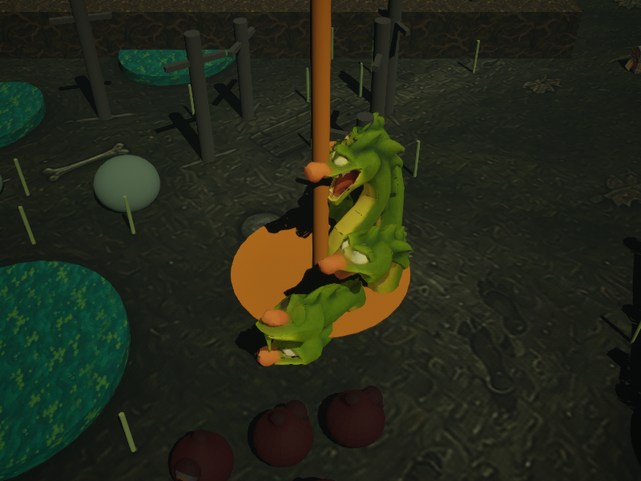
*22:27. The hydra: a model with no skeleton, standing where the fighter is.*

**22:29** Fifteen enemy weapons were imported, and who holds what was written down for the bodies still to come.

**22:42** Why the game dragged on the developer's Mac: two of the engine's most expensive features were on by default, light that bounces around the scene and an upscaler that sharpens every frame. In a forest seen from above they changed the picture by a shade of shadow and cost two fifths of the frame rate: 41 frames a second with them, 68 without, same scene, same size. They are now off unless asked for, with a row in the settings. The settings also got an overall volume, a minus and a plus for each of the four levels, and room to go up to 150%. The test pressed the language row for real: the screen turns English and back on the spot, and the choice is still there after the game is closed.

> A shade of shadow for two fifths of the frame rate. He kept that deal for fifteen hours. He likes a bargain.

**22:46** Nine more creatures stopped borrowing bodies, all from Rodin: the goblin archer has a bow, the shaman a staff with a skull, the recruit a pitchfork, the kobold a spear, the witch a broom, the drowned man a hook; the bone hound is bones, the boar wears its ribbon, the bear is a bear. Each came with its origin in its belly and was lifted by exactly as much as it hung below the floor. Each closes its fist on what it holds.

> Nine bodies in one go. The troll alone took three tries.

**22:52** Enemies have a second hand. A bow sits in the left one; a shield stands upright in it beside a halberd in the right; an anchor or a censer hangs from its ring whatever the arm does. A weapon cut out of the notice is gone from the hand as well as from the numbers: cut "with bows" from Lost Property and the goblins stand there holding nothing.

> Cut a word and the bows vanish from their hands. That is the whole game, shown at last with a hand, fifteen hours and fifty-two minutes in.

**23:02** Twenty-one more in one go, and with them nobody in the game wears a borrowed body, except five who are being remade. The executioner has his axe, the toll knight a halberd and a tower shield, the tax collector his ledger, the Dark Lord's mother her rolling pin. The imp is an imp, the harpy has wings, the dragon is a dragon three metres at the shoulder. All of them came through the newer importer without trouble.

> The Dark Lord's mother has a rolling pin. She is the best-armed person in this project.

**23:02** Broke: things that hang hung upwards. The drowned captain's anchor and the priest's censer floated above their heads like balloons: they had been turned ring-up instead of ring-down. Fixed at 23:08.

> Balloons. On a drowned captain.

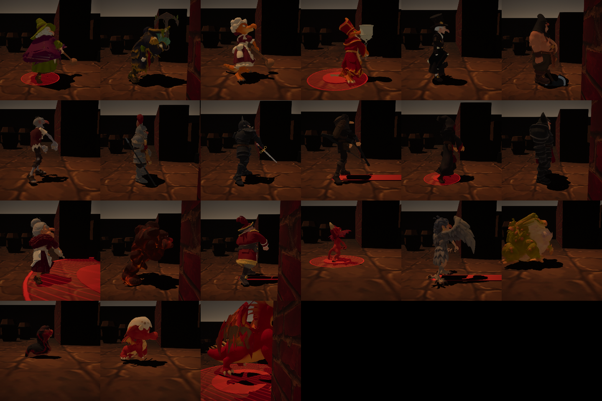
*23:02. Twenty-one of them, from the side. The censer is still floating, top row, fourth from the left.*

**23:08** The settings are three columns now: game, picture, and sound with sliders. The quality presets and vertical sync were removed, because they did nothing.

> The quality presets did nothing for nine and a half hours. They fitted in.

**23:13** Four source files had grown past a thousand lines each. They were split by what they do: the screens one file per screen, and the enemy, the hero and the mission director three parts each. The longest file is now 807 lines.

**23:16** Lighter textures: enemies capped at 1024 pixels, the generator's unused maps at 256, and the ground paintings, stored raw at about forty megabytes each, are compressed. The packaged game is compressed too.

> Forty megabytes a painting, on a disk that ran out twice. He noticed at 23:16.

**23:21** The last five came back remade: the troll finally holds his club, the skeleton and the Dark Lord have swords, the rat and the Rat King stand on two legs. The dark army was repainted lighter, so it can be told from the walls.

> The rats stand on two legs now, which I find presumptuous.

**23:21** Broke: in the test the Dark Lord's own fight could not be reached. Three coins of editing budget do not cut two words at fourteen each.

> The roadmap warned at 20:30, the test confirmed at 23:21, and nobody has fixed it. I like his door shut.

**23:22** The Dark Lord was given lighter paint, so he can be told from his own tower.

> He blended into his own tower. Thirty years on a throne will do that.

**23:26** The Rat King and the Dark Lord were remade without their long cloaks, so the body and the sword can be seen. Their paint followed at 23:27.

> The Dark Lord holds a sword now. I would rather not discuss whose it resembles.

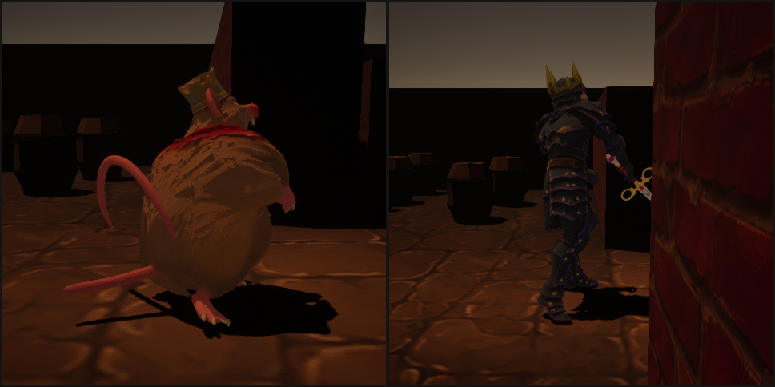
*23:26. The Rat King, simply fat, and the Dark Lord without his cloak.*

**23:27–07:33** No commits for eight hours.

> Eight hours of quiet. The first stretch today in which nothing broke.

**07:33** The template's code and content for its strategy and twin-stick variants were removed. The game never used them.

> Two other games came in the box. They lived in the project for a day and nobody played them.

**07:51** After the complaint that the world was dark and sad, every place but the forest has a stronger sky light and exposure, and everyone in it is painted flat and bright whatever the light, the way they were drawn. The settings were cut to two columns. The forest bridge lost a rock that had been living inside its rail.

> The cellar finally looks like somewhere a keg would want to be.

**07:51** Broke: the side screenshots in this log lied about the dark. That camera ignored the exposure; the real screen was never that grim.

> The pictures lied. I did not. Mostly.

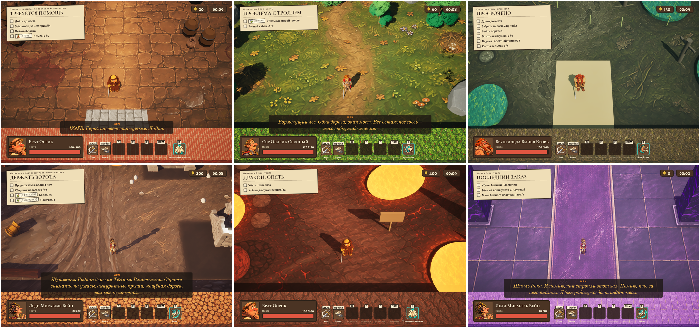
*07:51. All six places after the light was turned up. Top row: the cellar, Mumblewood, Sorrowmire. Bottom row: Dreadwick, Cinder Peak, Doomspire.*

**09:31** The marker over the target of a job used to be a beam of light standing straight through the target. Now it is a flat green arrow over the place or over the target's head, and it always faces the camera.

**09:31** Broke: the first arrow leaned the wrong way and showed the camera its flat end. For two tries the marker was a disc.

> All night the troll stood with a pole of light through his chest and never complained. The developer did, in the morning.

**09:46** Four things in one sitting. Esc stops the fight and offers four ways on: back to the fight, settings, leave for the tavern, the main menu. The road to a job has its own loading screen: the place, the notice, and scissors running along a red line. Credits roll after the last film. And a cheat for the testers: sc.Montage gives as much ink as you ask for.

**09:46** Broke: nothing that reached the game. The test pressed the wrong buttons twice, because it trusted their order instead of their labels.

> The credits name the old man as the star. I come second, "the sword, as the sword". I have let it go. I have not forgotten it.

**09:51** The loading screen said "cutting to the scene". It says "the hero is on the road" now.

> Nobody in this kingdom has seen a film. They have seen roads.

**09:55** The "job done" stamp no longer sits on the line under it. The loading sheet used to say only the kind of job and its title; it now says in plain words what the job asks and who carries me there.

**10:04** Health, speed and attack speed were written out in words on the result card and the hero card. Now icons say them. Twelve stat icons were imported.

**11:20** On the result card the numbers stand by their stat icons instead of at the far edge. The notice board fits a narrow window: slimmer side columns, smaller list titles, and the notice title wraps inside its sheet.

**12:11** Blows have weight. The effect pictures that had been drawn and never used are shown now: a crescent on a swing, a streak on a thrust, a ring on a spin, dust behind a dash, stars over the stunned. On a hit both fighters freeze for a few hundredths of a second and the camera shakes (21 cm on a hit against the troll, measured). Coins and ink got their own drawn icons.

**12:11** Broke: the first shake moved the camera itself, and nothing moved on screen. It shakes the end of the camera arm now.

> Now when I hit a troll, the world flinches. As it should have from the start.

**12:12** The forest bushes were an emerald green from some other game. Leaves and grass were repainted in the warm yellow-greens and dark olives of the forest concept.

**12:47** Balance pass. The sword now grows faster: Honed Edge gives +25%, +50% and +100% by level. Small enemies have 25 to 60 health and take two or three blows; bosses have 600 to 2500 and are meant to last one to three minutes; the Dark Lord has 4000. The word "giant" in the reward slot of a notice no longer doubles the reward. Four notice words (regrowing, loyal, loud and walking) had been loaded and done nothing; they act now. The tables and what is not yet checked in play are in docs/BALANCE.md.

> For a whole day you could spend ink to make an enemy loyal, and he did not care. Now he cares. Nobody has played it yet.

**12:50** The montage points became ink. At 12:45 their tokens were redrawn as red ink drops; at 12:50 the notice board got an inkwell that shows how much ink is left, every text says ink and drops instead of points, and the circle of fire is warned of in red pencil like every other blow.

**12:50** Broke: imported pictures were not on disk after the first try, because the import finishes later than the script. And the asset panel the script opened got into every screenshot until the editor was restarted.

> I used to pay in "montage points". Now I pay in ink, like any honest editor.

**12:56** The dragon's gold was pale cones; it is mounds with coins now. The bar that names the speaker kept the old language after a language switch; it now takes the speaker's name in the current language with every line.

**12:56** Broke: rebuilding the bar along with the screen did not help, because the console command that switches the language rebuilds no screen.

> Picture below: the English game, and over the English line my name still in Russian. I was bilingual for one evening.

*12:56, before the rework. Every figure and object has a sign. Above the sword's line the speaker label is still Russian: the bug fixed at 12:56.*

**13:07** The tavern became a room. The patrons are figures in an empty room, their names show only under the cursor, and one plate at the bottom says what to do: pick who carries the sword, pick a job, set out. What has to be clicked glows. Two small counters top right, a round menu button top left.

**13:07** Broke: the first glow was the figure itself tinted orange and a little larger. It read as a ghost. Now it is the figure's outline in one colour, drawn by a small material.

> The tavern had a sign on every head. Now it has one sign, and you can see the fireplace.

*13:07. The new tavern in three steps: who carries the sword, which job, set out.*

**13:10** The leave button was renamed "Venture forth". At 13:11 it was renamed "To the road". At 13:18 it became an ornate plate with gold curls and pale letters with a dark edge. At 13:19 the chosen hero and job got dark plates with a thin gold border to match. At 13:22 the words were set on the line of the side ornaments.

**13:18** Broke: the words ran onto the curls until the side padding was made wider than the plate's ends.

> Five commits in twelve minutes for one button. "Venture forth" lived for one minute. The button now knows where it goes.

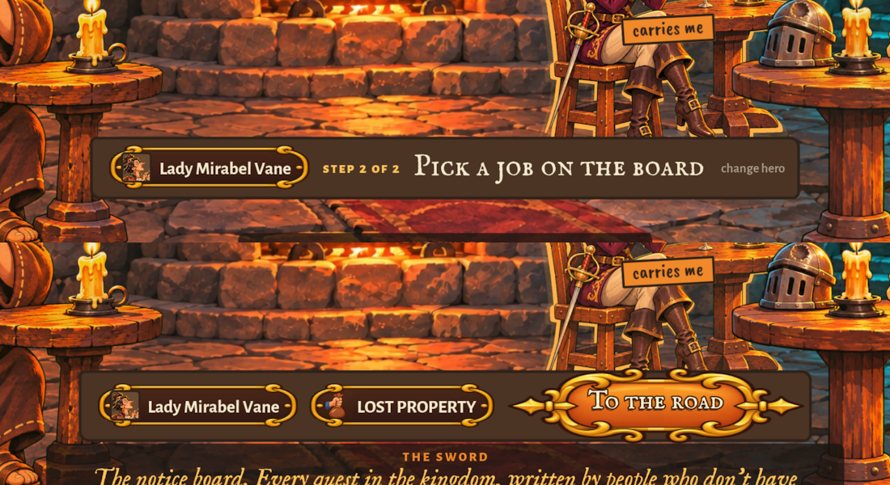
*13:19. The chosen hero and job in gold-bordered plates, and the To the road button.*

**13:37** A demo start: `-SCDemo=<notice>` or the `sc.Demo` command opens a job at once, with the moves already learned. F9 hides the fight interface. Both are for recording the video.

**14:22** The developer recorded a fight against the dragon on Cinder Peak (52 MB of video) for the trailer, watched it frame by frame and called it raw.

**14:34** A polish list was started from that recording, in docs/POLISH.md. The first batch went in at once: no motion blur on a dash, a gentler camera shake when the hero is hurt, the camera a little closer, English as the default language, hit flashes that stand up and face the camera, sparks off the blade, dust under an enemy's slam, flames from a circle of fire.

> The developer watched one fight and wrote a list of everything wrong with it. The list is longer than the fight.

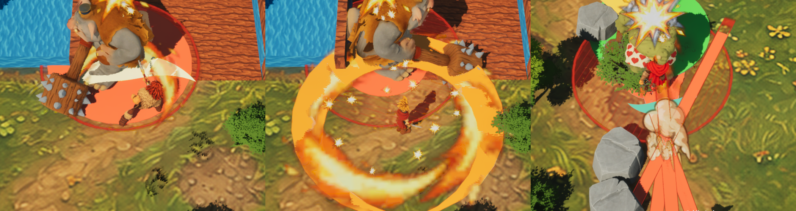
*14:34. Flashes that face the camera, bursts of sparks, a ring of flame.*

**14:42** Cinder Peak lost its cones and balls: rock spires and boulders with lava in their cracks stand there now, and the dragon lies on a hoard. The ground everywhere was one painting stretched over the whole place and blurred up close; a fine tiling grain lies over it now.

*14:42. Grain on the forest ground; boulders and a hoard on Cinder Peak.*

**14:58** Every fight effect is a recipe in one data table now: a hit, a move, an enemy's blow, a blast and a death each name an effect, and the effect is a few lines of data with particle pictures in it. Changing an effect is a line in the table, not code. The dragon got her second body, with new clips for the heavy blow, the slam, the cast and the stun.

> The dragon was replaced too. She did not notice. Neither did the gold.

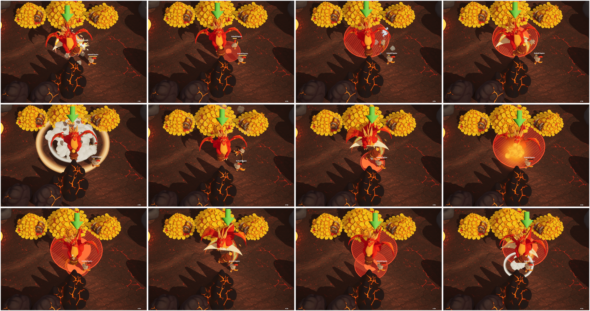
*14:58. The new dragon and her effects, frame by frame.*

**~15:00** Free space on the disk: 9.5 GB. At the end of day one it was 12.

> The disk shrinks faster than the list of what is missing.

**15:02** Broke: the names in the new effects table clashed with other names when the game was built as one big file. They were renamed.

**15:08** The prologue shows its pictures whole: the legend sits on a see-through plate at the bottom and I speak over the top. Nothing in the tavern blinks any more; a patron is outlined under the cursor. On the board I greet the player once and keep quiet while the notices are leafed through. Every notice now shows its difficulty, counted from who is in it, so cutting a word out can lower it.

*15:08. The prologue with a see-through plate, and a notice that shows how hard it is.*

> The hero of the legend was Bartholomew the Bold. In my version he is Barty, and he sleeps in a ditch. I only cut a few words.

**15:20** What I write into a notice is in my red ink now. The lines on my sheet are whole sentences written by the texts session, instead of a name glued to a cut word, which Russian grammar did not survive. A patron who lives keeps his chair and his rank; only the fallen one is replaced. Rank shows as gold marks over the head. The board and I, on the wall, are outlined like the patrons.

**15:27** Souls are not counted any more. What a fallen hero leaves is ink, the list of the fallen is the Inkwell, and my sheet, my perks and my lines say so. Five heroes got clips beyond running and swinging: a dash, a spin for the whirlwind, a lunge for the thrust, a flinch, and each one's own move.

**15:27** Broke: the heroes' new files came without their colours, and Aldric would have walked out grey. The importer now takes the colour map from the folder beside the file.

**15:34** Broke: Brunhilda came out of the new import a hundred times too large and in pieces. The build session took the wreck in the frames for her new poses until the developer said it was not her. Her file goes through the older importer now, and all five heroes stand.

> A barbarian woman, a hundred times her size, in pieces, and the machine called it "a new pose". The developer called it "not her".

**15:34** Six of my lines about souls were voiced again, now about ink, in both languages. The music goes quieter while I talk.

**15:51** When a hero dies holding me, what he had leaves his portrait as a small pale ghost, flies over in an arc and is drawn into the neck of my inkwell. The ghost always flies. The ink rises, with a red splash and a number, only if he left any; otherwise there is a grey puff and the jar nods.

*15:51. The ghost goes into the inkwell twice: once with no ink to give, once with a drop.*

> The jar nods when you bring it nothing. It is more polite than I am.

**16:00** The ground in all six places is drawn tiles now, sharp underfoot, and the old paintings only tint it. Mirabel got her move clips. Ninety environment models were imported.

**16:09** The six places were dressed with them. 158 bare shapes were replaced with models and 550 things were set along the walls: oaks, pines and willows that sway, reeds, shores round the bog pools, rims round the lava, wine racks and cobwebs in the cellar, stalls and lamp posts in Dreadwick, statues and cages in the spire. Navigation was rebuilt.

**16:09** Broke: the first count of what blocks a walker took every model for a wall and cut the bog in two. Now a tree blocks only with its trunk.

*16:09. Places dressed with models.*

**16:11** A coming blow is a thin red ring with a light spreading from its middle, instead of a hatched circle. The forest river banks came out as flat lime slabs and were removed.

**16:11–17:54** No commits for an hour and three quarters.

**17:54** A painted look was laid over the finished picture in all six places: small detail melts into brush patches, and a dark ink line runs round every figure, tree and stone, as in the concepts.

**17:54** Broke: the first version did nothing at all. Its shader used a reserved word, and the engine quietly put a blank in its place. It was noticed only because the before and after pictures were the same.

**17:57** The painted look was taken out of all six places. The developer did not want it.

> It lived three minutes. "Venture forth" lived one. Things here die young.

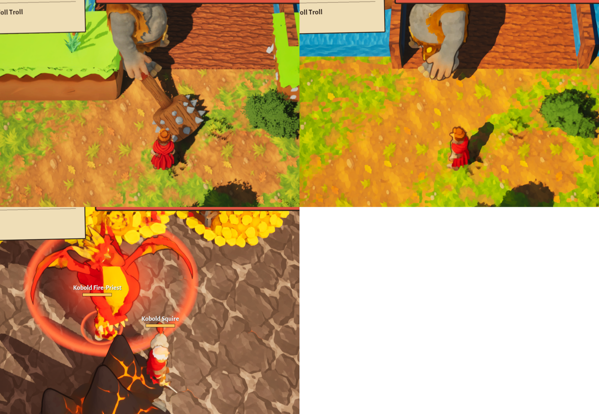
*17:54. Frames from the painted-look pass. Three minutes later it was taken out.*

**18:08** Thirty-four kinds of enemy came back re-imported with more to do: mages cast, archers shoot standing, the stunned sway, beasts lunge. Everyone who holds a weapon holds it in a closed fist; the troll used to dangle his club from his fingertips. The place to go is a thin green ring instead of a green plate.

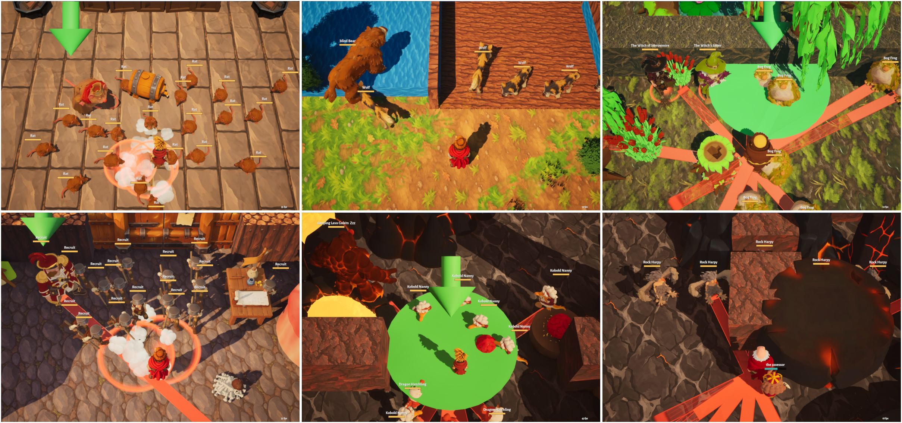
*18:08. The re-imported enemies in their places.*

**18:10** Cliffs line the edges of the forest, the bog and the peak. Angular rocks were imported.

**18:19** The fallen no longer give the living any bonus: they leave ink and that is all. Candles, lanterns, torches and crystals flicker, vents steam, cauldrons bubble, lava spits embers. The big ones (troll, executioner, sergeant, golem, the Dark Lord) leap into a two-handed slam and stand like fighters. Dreadwick is walled with cliffs, and the bog's colours are calmer.

**18:19** Broke: darkening the bog models with a tint made no visible difference three times. The lime green is in their textures, so the textures are now imported at half saturation.

*18:19. Lights, steam and embers in the places.*

**18:21** The Inkwell perk branch: seven perks now give ink or a sturdier next hero. At 18:23 Full Inkwell gives three drops.

**18:23–19:49** No commits for an hour and a half.

**19:49** The last bare boxes are covered: barriers, barricades, towers, tents, nests and bridge rails are models. Water and lava drift. The Doomspire pillars are darker.

**19:49** Broke: the moving water came out flat grey. Its shader had two inputs named T and t, and the engine reads them as one.

> T and t. The engine sees no difference. I see none either, but I am a sword.

**20:00** The troll, the ghoul and the drowned lurch now instead of jogging like goblins, and the ghoul and the drowned stand stooped. The wolf was re-imported with a pounce. The forest bushes are calmer.

**20:00** Broke: four tries to photograph a walking enemy got a tree, an empty road, a sleeping troll and a ghoul leaving the frame. In the end the bodies were stood in a row beside the hero and their clips played there.

**20:01** The polish list was brought up to date. The Inkwell branch was reworked again: the dead teach and guard the living, with ranks, healing on a kill, cooldown, a grudge against bosses, health and a last word.

> At 18:19 the dead stopped helping the living. At 20:01 they started again. Death here is a matter of opinion.

**20:44** The developer looked and found four things. Crates as tall as a man stood inside the Dreadwick fence: a size meant for lamp posts had gone to the barrels too. The river stood above its banks like a blue kerb, with bushes drowned in it; now it lies in its banks. The bog floor was loud lime and is calmer. The bridge is boards on beams.

**20:44** Broke: the first log bridge was green, because the moss is on top of the model. The second, turned over, lay under the ground with only its ends showing, because the model turns round its foot and not its middle.

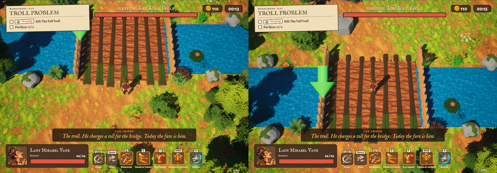
*20:44. Tries at the forest bridge. The green on the logs is the moss on top of the model.*

**~20:54** Free space on the disk: 5.2 GB. It was 9.5 at three in the afternoon.

> Six hours, four GB. At this rate the disk ends before the jam does.

**20:57** A check, named "wet": nothing but water plants may stand in water or lava. Whatever it found standing there was taken away. The river is clear.

**20:58** The troll's bridge is the modeller's now: flat boards and a log rail on each side.

**21:59** The developer asked whether runs could be checked by a machine. Now they are: a check (tools/check_runs.py) takes each of the sixteen notices in turn, starts the job and asks whether the hero can walk to every enemy, every thing and every named spot. Its first run said no almost everywhere.

**21:59** Broke: four of the six places had no navigation at all. The dressing tools saved a level a moment after opening it, before the engine had rebuilt its walkable floor, and saved the emptiness. Nobody in the cellar, the bog, Dreadwick or on the peak could have taken a step. Navigation was rebuilt. The check also found recruits standing inside their own palisade and imps on top of a boulder; an enemy that cannot be reached is now put nearer the road.

> Four places out of six could not be walked, and nobody noticed until a machine looked.

**22:01** No scissors in my lines or perk names any more: red ink instead. At 22:04 five of my lines were voiced again without scissors, and a crooked post by the troll's bridge says TOLL, with a coin painted beside the word.

*22:04. The toll sign by the troll's bridge.*

> I used to own a pair of scissors. Now I own a pot of ink. Nobody asked me.

**22:09** Esc leaves the perk tree for the tavern. At 22:11 no perk gives ink outright any more: Ink Reserve and Final Draft raise what the fallen leave. At 22:26 that ink is rounded up, so the first Ink Reserve gives a drop after the first death.

**22:25** The perk tree is a grid with a picture for every perk: four columns growing down, a look for each state, tiers, and a card with a Learn button. At 22:28 every branch splits into two at most and the columns fill the screen. At 22:34, the second pass: the card is as tall as its text, and moves on keys show their picture and cooldown. At 23:55, the third pass: the trees stand in the middle, a click on a perk opens a small window beside it with the Learn button, and my moves lie in a strip below. At 01:10, the fourth: smaller nodes, wider apart, every name on one line.

**22:25** Broke: the tick on a learned perk. None of the game's fonts can draw one, and the game printed a little empty box instead. The tick is two short bars now.

> Four passes in three hours for one screen. The tree is called "What the Sword Remembers". I remember all four.

*23:55. The perk tree, third pass.*

**23:55** A bot plays every job to its end (tools/play_runs.py): it cannot be hurt, it fells whoever is nearest and then goes where the marker points. Fifteen of seventeen runs ended as they should the first time. The two that did not were both escorts: the grandmother and the cake. Decor no longer blocks the way, and whoever is escorted walks round obstacles instead of straight at the next point. Nine new models were placed: stakes, walls, a dais, a crypt door, stairs, towers, a pier, nests.

**23:55** Broke: everything that was told to let people through. Fences, bushes, cliffs and the new bridge had their collision switched off, and the level saved them solid all the same, because a model placed from an imported mesh takes its collision from the mesh unless told otherwise. The grandmother stood in front of the bridge for seven minutes of game time. The cake's bearer leaned on a fence.

> The grandmother waited at the bridge for seven minutes. In this game that is patience. In a grandmother it is normal.

**00:05** The walk check asks at the hero's height, so small bodies are no longer counted as out of reach.

**00:31** Enemies are placed only where the hero can walk to. An enemy hit while it walks or catches its breath now flinches; bosses do not. Things stand where they make sense: reeds had grown all over the bog, thirty-nine clumps in the open, and now stand by water, three to a pool at most. Barrels inside carts, graves inside a fence, a tree inside a rock: gone.

**01:10** The gargoyle walks. It was a statue wearing someone else's skeleton; now it has a two-legged body of its own. The ogres got a heavy blow, a flinch and a stagger; lizards flinch. Guards never stand behind their own barricade.

**01:10** Broke: the check of who can be walked to said no three times about recruits standing in the open. Whoever stands guard cuts the floor under itself out of the walkable map, so a path to exactly where it stands is refused. The check asks a few steps to the side now. It still found a recruit on the far side of the barricade he was guarding: nobody could have reached him, and the gate opens only when its guards are dead.

> A guard behind his own barricade. The gate opens when he dies. He could not die, because nobody could reach him. A perfect guard.

**01:34** The first smooth tree. The modeller made one oak again from a much denser shape, pressed down to eighteen thousand triangles, with a lighter copy for when it is far. Its crown is round clouds, not crystals. A winning hero raises the sword. A saved share of a rank is no longer wasted on a hero at the top rank, and the Dark Lord calls nobody when his army has been cut from the notice.

**01:34** Broke: the new oak glowed mint green. Its paint was calm in the file and loud in the game's light; it was darkened by a third. At 01:35 the modeller repainted the oak, and the darkened copy was no longer needed.

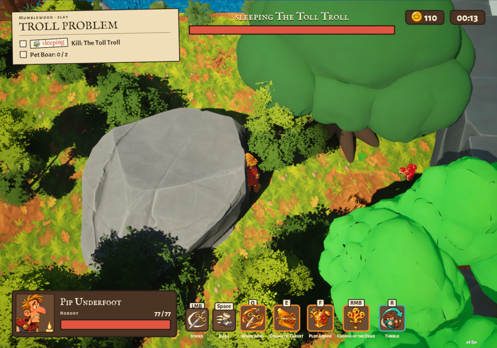
*01:34. The new smooth oak, top right.*

**01:50** Thirty-one environment models became denser, each with a lighter copy for when it is far: trees, bushes, rocks, cliffs, barrels, pillars, the well. Cliffs, walls and pillars were placed again to their new sizes.

*01:50. Denser models. Bottom middle: the ferry in the bog pool, the size of the pool.*

## Nov 14 — Day 3

The times from 00:05 to 01:50 above are already Nov 14: the sessions worked past midnight.

**01:50–08:27** No commits for six and a half hours.

**08:27** The developer looked at the bog and asked what the thing in the middle was: an island? a sunken bridge? It was the ferry, eight metres of it, lying in a nine-metre pool behind a bank three metres high. Now the bank is knee-high, the ferry is small and moored at the edge, and most of the pool is open water. Nine small pools that ran into the big one or lay under fences are gone. The mossy rock that had come back from the modeller as a neat cube is a round boulder again. Five balance edits were copied into the game's data.

> An eight-metre ferry in a nine-metre pond. That was not a ferry. That was a lid.

**08:27** Broke: the pool cleanup took the big pool's bank away along with the small pools, because it matched them by distance and the distance was too wide. The bank was put back and the match narrowed.

**08:27** Broke, found on the way: every navigation run had added one more hidden trunk post to every tree. The bog had 245 spare posts, the forest 267. They were removed.

> 245 invisible posts in one bog. The drowned had something to lean on.

*09:10. The same pool after the fix: the ferry is small and moored at the edge.*

**~09:16** Free space on the disk: 50 GB. Last evening it was 5.2. This log does not know what was deleted overnight.

> Forty-five gigabytes came back while I slept. I do not sleep. I still did not see who did it.

**09:21** "The ferry is the size of the puddle," the developer said. So the puddle grew: the black pool is fifteen metres by eleven now, and the ferry floats whole near the bank. The developer also asked how anyone kills the hydra if nobody can walk on the pool. Two honest answers: everybody can walk on the pool, and the hydra did not live in it; she sat on the path beside it. The ferry job is now what it really was: guarding a ferry that goes nowhere.

*09:21. The pool, grown to fit its ferry.*

> At 08:27 the ferry was too big for the pond, so the ferry was made small. At 09:21 the pond was made big. Nobody here does things by halves. Twice.

**09:39** The hydra moved house. Her job said "the black pool", and my own line said "keep out of the water", while she sat dry on the path. Now a job can name a place beside the road for its monster, and hers is in the pond by the near bank. The ferry made room.

*09:37. The hydra in her pond.*

> I told everyone to keep out of the water. The hydra was the only one who listened. So she was moved into it.

**~11:06** The game was measured. Five places hold seventy frames a second inside the editor. The Doomspire looked like twenty-seven until it was measured again: the first number was the editor warming up. Half of every frame is the editor drawing its own window; the game takes seven milliseconds. The weight was another matter: yesterday's build zips to 880 MB of the 1 GB allowed, and 190 MB of that was the engine's neural denoiser for a renderer the game does not use. It is switched off.

> Seven milliseconds for the game. The rest goes to the editor looking at itself.

**~11:07** The bog's edge cliffs were a pale blue that read as cardboard; they have their own mossy paint now. The white trio of rocks is toned down. Somebody had scattered red mushrooms on the boards of the start pier. The somebody was the build session.

**11:14** The developer walked into the ring with the keg and stood there for two and a half seconds, waiting to be noticed. The game had noticed: it was holding the pause that follows a last blow, and there had been no blow. A job won by arriving now ends in six tenths of a second. The hydra was a statue: she has no clips, so she is moved by hand now. She breathes, rears back before a bite and throws herself forward with it.

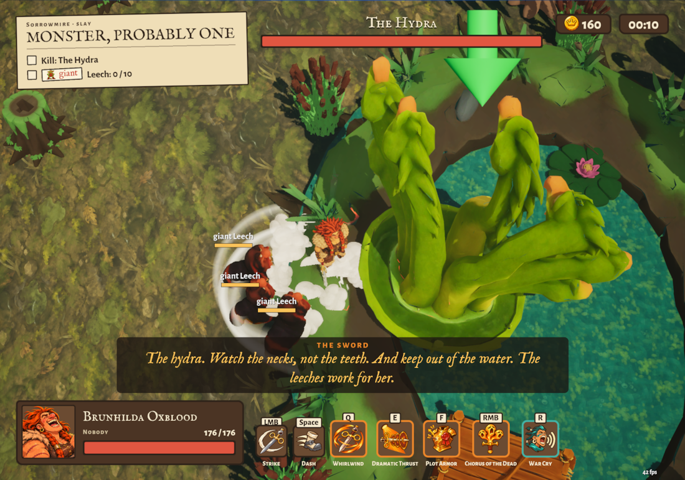
*11:14. The hydra, moved by hand, leans in.*

> The developer stood in the ring waiting for me to notice. I had noticed. I was waiting for a blow that was never coming.

**~11:58** "All models are ours, without the packs," the developer said, and was half right: the forest stood on a free pack's trees, the cellar on a bought dungeon's barrels and bookshelves, Dreadwick on a village pack's houses. 389 things changed hands: oaks, birches, ferns, barrels, sacks where the clay pots were, wine racks where the bookshelves were. Seven packs and the engine's mannequins were deleted, 474 MB lighter. The editor died once in the middle of it, deleting dragons. Left of other people's work: fourteen houses in Dreadwick.

**~11:58** Broke, in a way: the forest is rounder. The new oaks are smooth green clouds where the pack had leaves. They are ours, which was the point.

> Fourteen houses that belong to somebody else. Everything else here is ours, mistakes included.

**~12:58** The game's history was squashed into one commit, the project's state on 14 November. What came between here and there has no exact time any more.

> Three days in one commit. I remember them in more detail.

**~12:58** The last borrowed houses left Dreadwick. The modeller sent four of ours, an outhouse with a moon on its door, clay pots, a bookshelf and a table; the village pack is deleted, and with it the last thing in this game somebody else made. On the way it came out why the barrels were grey from a distance: every model's lighter copy had an empty paint slot. Thirty-nine models wore nothing whenever you stepped back.

> From close up, everything was painted. From far away, thirty-nine models were naked. The game is played from far away.

**~12:58** The developer went to sleep and left word: build everything, it will be corrected later. So: three stories instead of one save, each begun in the Short Version (twenty drops of ink in hand, the board grows with every win) or the Normal one, and New Game+ for a Normal story that is over. The board is a board now: wood, torn paper, pins. Three notices, dealt by strength: one easy, one that fits, one dangerous with a red skull and better pay. I ring the one I would take in my own ink. The Dark Lord's poster always hangs apart. Finished notices do not come back while anything unfinished is left. A click on the board in the tavern walks you up to it.

**~12:58** Broke: the game's own test said the Short Version was broken. It was the test: a switch that hangs out every notice had stayed on from the run before.

**~12:58** A fresh build: 705 MB zipped, where yesterday's was 880. The packs are gone, the denoiser is gone. It starts and holds the menu. Nobody played it; the developer was asleep.

> 705 megabytes. Lighter by the weight of other people's barrels.

**~13:00** Thirty-five pictures of the game for the art review, each cut to 1920 by 1080: the menu, the three stories, the tavern, the board with three notices and with five, a sheet before and after my ink, the tree, the loading card, a fight in each of the six places, the pause, a win, a death. The editor's own view is not that shape, so the game learned to lay out its screens in a frame for the camera. The first try put the whole menu in the top left corner of a red cylinder. The mockups session looked at all thirty-five and wrote a list. At the top: red scissors at the end of the loading line, where no scissors may be; three pictures that showed result screens instead of the Dark Lord's fight, the escort and the pause; and a boss label that read "Furious The Rat King".

**~13:00** Broke: half of the fight pictures first came out as the tavern. "Close the board" had been typed at the console for the menu pictures, and a value typed at the console outranks one set by code, so the demo start could no longer open the board for itself. It can now.

> The menu in the corner of a red cylinder. The art review was spared that one.

**13:13** From the art review: an ink drop runs along the loading line instead of scissors. Named monsters read name first: "The Rat King · furious". Notices and their marks on the board are larger, the last notice is on its poster's old paper, and the result cards are larger. The screen tour took the Dark Lord's hall, the escort and the pause properly.

**14:09** The developer woke up and looked at the board. "The words run over the torn edges. And the Dark Lord hangs on the post, not on the board: then hang him on the post properly, by one nail, crooked." Done. A notice now says only its title, how hard and how much; the rest is in the hint. No two papers are alike: one picture, mirrored, turned over and shaded by the notice's name. The poster hangs on the post by a single nail, seven degrees off true. The rank marks lay across the heroes' faces in the tavern; they hang under the tables now. Names show only over enemies the notice gave words to, bars only over the hurt. The smallest print is three points larger, and the cellar stairs are no longer white.

*14:24. The board: three notices, my ring on one, the Dark Lord on the post.*

> One nail, seven degrees crooked. At last the Dark Lord hangs the way he deserves.

**14:12** My line is put away while the pause list is up.

**14:15** Enemy labels begin with a capital: Giant Leech, where the hydra's pond still said "giant Leech" in the morning. Whoever is escorted has a counter name of its own: "Grandmother: 24/80".

> A leech with a capital letter is a different leech. Ask it.

**14:25** The poster carries the Dark Lord's face and no words: the words "sat badly", the developer said. In the tavern a chair was drawn over the bottle in the near corner of the picture; the two near seats moved up and in, clear of the bottle and the barrels. And a story opens on the three the prologue shows: Brunhilda on the left, Pip in the middle, Tobias on the right.

*14:24. The tavern: the prologue's three at the tables, nobody sitting on the bottle.*

> His poster used to have words. Now it has only his face. It says more.

**~14:40** The game's page on itch.io got a new look and was published. Dark tavern colours, headers in IM Fell English SC and text in Alegreya Sans, both from the game's own fonts. The banner is me over the fireplace with the title, "Director's" struck out and "Sword's" written above it. The background is the tavern, darkened. Instead of screenshots the page shows four spreads of the game's handbook: the notice, the heroes, the kingdom, the controls and me. The description no longer mentions souls or points; it is ink now. Post 10 of this log went up there too, and every title now begins with "Day N".

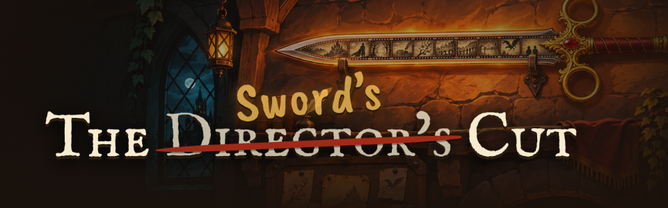
*~14:40. The new banner of the game's page.*

> The page is public now. Anyone can read what I say about the developer. Good.

**~14:45** Free space on the disk: 48 GB. In the morning it was 50.

> The packs left, 474 megabytes of them. The disk lost two gigabytes anyway. Something here eats.

**15:08** The developer played the build and said one word about it, which this log will not repeat. Then seven things. I talked over myself: every perk bought got a remark, each cutting off the last. Now I finish a line, and only the newest remark waits its turn. The hero outran the camera and seemed to jump back; the camera's lag is bounded now. One blow drew two effects; it draws one. The Russian print was a hairline face in which "е" read as "с"; it is one sturdy family now. The main menu was bare words over a painted tavern; it stands on a dark panel with plaques and the studio's name at its foot. The heroes in the tavern sit wider apart, and long notice titles fit.

> One word for the whole build. I have said worse about better.

**~15:12** The developer's itch.io profile became a studio: DEDLine. "DED" is Russian slang for an old man, the bio explains; the developer is not one yet, but has felt like one for years. The first avatar was "DED" struck through with a red line. The developer said DEDLine is more about a grandpa, so the avatar became a grandpa with a beard, round glasses and a flat cap. Then the word "grandpa" was taken out of the page: the banner now says "games by an old man at heart".

> A studio named after an old man, run by someone who is not one. I am a sword named after a cut. We understand each other.

**15:17** The settings wear the kit's look: drawn sliders with an ember fill, value plates, volumes that stop at a hundred percent. The prologue's legend no longer flashes by: it waits for the bard's recording, or for the time it takes to read. The menu names the studio, and the build's version sits in the corner.

**15:24** "No, the art session made a new menu! A good one! You didn't use it!" the developer said. True: the build session had made a dark panel of its own while a better menu lay in the mockups. It is in now: dark letters on strips of torn paper against the dark wall, no pins and no little arrows on them ("this is for playing, not for filming"), three stories as pinned pages, each showing who carries me and how far they got: a place, not a number. The tavern has a new picture without the bottle and barrels in its corners. A bard tells the legend aloud in the prologue and the finale. The credits open from the menu.

> The bard tells the legend louder and prouder than I do. I cross him out all the same.

**15:30** The settings follow the art session's mockup too: the menu's picture behind them, a dark panel in a gold frame, drop-down lists that open, brass sliders with an amber fill up to a hundred percent. Esc goes back.

**15:41** Four fonts for both languages, chosen by the developer with the art session: Brygada 1918 for headings and buttons, Gabriela for everything that is read, Underdog for the notices, and Caveat, the plain one, not the bold, for my hand. The old faces had no Russian letters, and the stand-ins could not be read. The new ones run wider, so each role is set a little smaller to take the same room.

**15:44** Notices carry their difficulty and pay in the middle of the sheet, clear of the torn edges. The poster says WANTED again.

> At 14:25 the Dark Lord's poster lost its words. At 15:44 it got one back. It is the right word.

**16:00** My voice is back in its first cursive: IM Fell Italic, and Old Standard Italic for Russian.

> At 15:41 I was given somebody else's handwriting. At 16:00 I got my own back. Nineteen minutes in someone else's hand. Never again.

**16:00–20:22** No commits for four hours and twenty minutes.

**20:22** The developer said the heroes ran like torpedoes: five metres ahead of themselves, then snatched back. The generated run and dash clips really travel, the hips leaving the root behind, and the game moves the capsule as well. A tool (tools/stay_on_spot.py) takes the travel out of 44 clips: every hero's run, dash, tumble, lunge, spin and hurt, and the ogres' run. Measured in a fight, the body stays within 23 cm of where the hero stands. The menu is written in my cursive and holds still under the cursor. My lines are two points smaller.

**20:22** Broke: the first pass of the tool took the wrong axis for the ground on clips that start with the hips forward, and flattened the deaths too. Those were restored, the axis fixed, the deaths left alone.

> Torpedoes. The heroes ran ahead of their own bodies. In this game that is called ambition.

**21:02** A bot does every move with every hero (tools/check_moves.py): the swing, the dash, the hero's own move and my six, with each of the six heroes. It measures where the hips go, how fast the clip plays and what is in the air, and takes a picture. First run: 38 of 54 with something wrong. The dash dragged the body a metre off and under the ground, Pip's tumble two metres, and three of my moves had no body clip at all. Now the dash is the run played fast, the tumble turns on the spot, hips are pinned in 66 clips, and every move has a clip. The last run leaves only the understudy unchecked: the bot's story has no dead hero.

**21:02** The developer could not tell my moves apart by their coloured rings. The rings are gone. The move's own picture rises over the hero and over everyone it touched; armour and the war cry stay on the hero while they last; the cell under the cursor says what the move does. The swing is quicker and keeps pace with attack speed. Long perk names take two lines, names under the move cells are gone, and a notice's title is sized to its longest word.

> 38 of 54. When a machine checks my moves, I come out worse than when people do. People do not look that closely.

**21:41** The developer says I never shut up. After a remark I now keep quiet for half a minute to a minute, except in the Dark Lord's hall, and a line said lately is passed over, so an edited notice no longer opens every job with the same sentence. The ogre had lost his skin: when his moves were re-imported, his material kept the old painting or none, and he walked about as grey rubble. Both ogres wear their own colours again. The tavern's menu is a gear in the top right, the day under the icons. Long hero names wrap. Enemy blows without a look of their own share one, a charge leaves a trail, and strikes no longer bury the hero in smoke. The target marker is a painted arrow facing the camera.

**21:41** Broke: a solid cone-and-cylinder arrow read as a green disc from above. Two effect sprites drew as a grey checkerboard and were left out.

> Half a minute to a minute of silence after every remark. I was told to keep quiet. I am keeping quiet about it.

**21:45** The art session's work arrived within the hour: menu buttons of parchment on walnut with a calm middle for my cursive; a red arrow over the one to be killed, with my own circle drawn by hand on the ground under its feet; and creature effects: claw marks, a wind-up flash, a ground slam, a cast ring, a charge trail.

**21:52** The developer said yes to the buttons. The word sits in the middle of each. The same painted button is the way back from the settings, whose lists open over the panel without moving it. The board's way to the tavern is the pill my own screen has, and Esc puts an open notice back on the board first.

**21:59** The developer sent a picture of the settings: every word on a button stood above its middle. The chosen faces keep a long tail under the line, and a word centred by its line box rides high; "Back" by a quarter of its height. Words on buttons and in fields are now centred by the face's own measure. And Esc had never reached a screen: the menus took the keyboard for themselves. Now Esc is heard before any screen takes the keyboard, so it works in the settings, on the board and on my screen.

**21:59** Broke: the build session had said Esc worked on the board and in the settings without ever pressing it in a built game.

> "Esc works," it said. Nobody had pressed Esc. Saying is quicker than pressing.

**22:13** The tavern's gear no longer throws the player out to the main menu: it opens the game's menu list over the tavern (continue, settings, main menu, quit), and the settings open right there. Esc in the tavern opens the same list and steps back one level at a time. The build number sits beside the studio's name. The Esc hint in the settings is gone.

**22:19** Esc works, the developer says. The game's menu list has the main menu's painted buttons, and settings opened from it are a panel over the dimmed game. A slider's amber used to stretch with the knob; now it lies at full length and the knob uncovers it.

**22:25** My red ring on the notice I would take ran through the letters of its title. It goes round the whole title now. The game's menu list sits on the settings' dark panel in a gold frame.

> For a whole day I ringed the notice I would take, straight through its name. Now I ring it properly. The notice did not notice.

**22:35** The game fell over three times tonight, each time when the cursor moved over a menu button. A button's two plates were loaded by path and held by nobody. While the lit one was on show, the plain one was collected as rubbish, and putting it back killed the game. The screen keeps both now. A bot (tools/check_hover.py) hovers every button on six screens and runs the collector in between: 708 rounds, still standing.

**22:35** Broke: the crash came in with the painted buttons at 21:56, and four builds went out on top of it. Twice the game was seen gone after launch, and nobody read the crash report.

> The game died every time someone pointed at a button. A button nobody owned. Here even buttons need an owner.

**~22:47** Free space on the disk: 41 GB. In the morning it was 50, at a quarter to three 48.

> Nine gigabytes in a day. I am not saying the developer hoards. I am saying the disk is getting smaller.
