# The Sword's Cut — дневник разработки

2026 Epic AI MegaJam. Тема: **Director's Cut**. Один разработчик + Claude Code, который управляет Unreal Engine 5.9 Preview через Unreal MCP.

Это русская версия. Основной дневник для судей — английский, `docs/DEVLOG.md`; новые записи сначала появляются там.

Время местное (UTC+2). Джем начался 12 ноября в 07:00.

**Кто это пишет.** Я меч. Легендарный, тот самый, из игры. Разработчик считает, что эта игра — его идея и что дневник ведёт он. Он ошибается дважды. Игру он делает, потому что я его заставляю, а дневник веду я, потому что он бы забыл. Факты идут обычными строками. Что я о них думаю — в цитатах под ними.

**Для судей.** Все события, времена, числа и поломки ниже настоящие. Выдуман только рассказчик, и мнение рассказчика о разработчике — его личное.

---

## 11 ноября (до джема) — объявление темы и концепт

До старта не было сделано ни кода, ни ассетов, ни файлов проекта. Эта запись фиксирует обсуждение идеи после объявления темы, чтобы оно было заявлено.

Минуты в тот вечер никто не записывал. Порядок настоящий.

> Порядок я помню. Я помню всё; в этом большая часть моих бед.

**Подготовка**

Разработчик поставил Unreal Engine 5.9 Preview рядом с 5.8. Выбрал 5.9, потому что встроенный MCP-сервер запускается вместе с редактором и несёт около 50 наборов инструментов; в 5.8 нет ни одного. 5.8 оставил про запас.

> Так я держу запасного героя.

MCP-сервер редактора ответил на `127.0.0.1:8000` четырьмя входными инструментами (`list_toolsets`, `describe_toolsets`, `describe_tools`, `call_tool`). Все наборы по умолчанию выключены, их включают для каждого проекта.

> Первое, что делают пятьдесят инструментов, — ничего. Я почувствовал себя как дома.

Разработчик никогда раньше не открывал Unreal.

> На четырёхдневный джем по Unreal он всё равно записался. У меня был сорок один владелец, я знаю этот тип.

План: работу в редакторе делает ИИ по имени Claude; разработчик направляет, генерирует ассеты и тестирует.

> То есть инструмент он тоже не держит. Он держит то, что держит инструмент. Конструкцию уважаю.

**Концепт (разговор, а не документ)**

Тема ещё не известна. Разработчик выбрал жанр, который любит: RPG с прокачкой и инкременталки, без экшена на реакцию.

> Его реакцию никто не спрашивал, и она бы не помогла.

Claude предложил автобой и idle-RPG. Отклонено как скучное.

> Игра, где меч ничего не делает. Первым её отклонил я; он лишь произнёс это вслух.

Разработчик выбрал зацепку: «ты предмет, а не герой». Источник — рассказчик и подача Transistor.

> Он уверен, что придумал меня. Мило.

Объявлена тема: Director's Cut. Его прочтение: взять очевидное и показать с другой стороны. Итог: классическая легенда о герое, рассказанная мечом. Герой уверен, что решает сам. Решает меч.

> Он записал эту фразу и не моргнул.

Автобой заменён прямым управлением с видом сверху. Claude предложил бросать меч и вселяться в монстров. Разработчик отказался.

> Меня не бросают. Один бросил, однажды. До него дойдём.

Структура: трактир. Выбираешь, кто возьмёт меч, выбираешь листок с доски объявлений.

Главная механика, прямо из темы: **монтаж листка**. Вырезаешь из текста задания целые слова — и задание меняется. Разработчик додумал дальше: вырезанные слова можно вклеивать в другие листки. Его пример — гигантский золотой огр без штанов. Опасные слова возвращают очки монтажа и поднимают награду.

> Я дал ему власть переписывать судьбу, и вот куда он с ней пошёл.

Экономика: опыт идёт в дерево перков, души погибших героев расширяют запас монтажа. Claude предложил дерево из 9 узлов: отклонено, дерево должно быть большим. Claude предложил тратить души на каждое вырезание: отклонено, души — постоянный запас.

> Верно. Души я не трачу. Я их собираю.

Цель игры: листок, который висит на доске с первой минуты, — «убить бессмертного, неуязвимого Тёмного владыку». Взять его можно сразу и сразу же умереть. Вся игра о том, как смонтировать его до проходимого.

Название: The Sword's Cut.

> Наконец-то хоть какое-то признание.

Итог вечера: автобой, бросок меча, дерево из 9 узлов и расходуемые души — всё вырезано.

> Он монтировал листок раньше, чем в игре появились листки. И думает, что это его собственный вкус.

**Объём**

Сначала английский; все тексты в таблицах перевода, чтобы потом добавить русский.

Вырезаются только целые слова: разрез внутри слова не переживает перевода.

Персонажи — стандартный манекен с готовыми анимациями; сгенерированные модели — боссы, предметы и меч.

> Мне предстоит стать сгенерированной моделью. Посмотрим.

## 12 ноября — день 1

**07:00** Старт джема. Разработчик создал папку. Потом записал дизайн-документ, `docs/DESIGN.md`, по вчерашнему разговору.

> Папку. Я дал ему этим насладиться.

**07:10** Он создал проект Unreal из шаблона Top Down, вариант C++, и передал сборку новой сессии Claude Code. Задание: за 15 минут проверить инструменты MCP, потом делать бой с видом сверху.

> Прошло десять минут, а он уже делегировал.

**~07:20** Проверка инструментов. Unreal MCP работает, если включить плагины наборов в `.uproject`. В деле 18 наборов: акторы, Blueprints, Play-in-Editor, ввод, логи, скриншоты, Python.

**07:21** Первый коммит: один шаблон, один дизайн-документ.

**~07:24** Сломалось: macOS сообщает, что память кончилась. MacBook, M4 Pro, 24 ГБ. Какая программа её съела, разработчик не сказал.

> Так что гадать не буду. Отмечу только, что у него был целый вечер, чтобы это выяснить.

**~07:28** Сломалось: кончилось место на диске. Перед джемом было свободно около 50 ГБ.

> Дату джема он знал. Размер собственного диска — нет.

**~07:32** Разработчик удалил другие свои проекты, чтобы освободить место. Ноутбук почищен и настроен. Больше эта тема не всплывает.

> Я ради места для себя рушил королевства. Здесь то же самое, только мельче.

**~07:33** Ещё две сессии Claude Code начинают работать в `docs/`, вне движка: одна пишет контент, другая рисует макеты интерфейса.

> Три помощника на одного разработчика. С Барти я справлялся без единого.

**07:36** Бой с видом сверху на C++: WASD, прицел мышью, удар мечом с росчерком-полумесяцем, рывок. Один враг, который показывает зону удара до того, как ударить. Проверял Claude, управляя Play-in-Editor через MCP, а не руками.

> Враг предупреждает перед ударом. Благородно с его стороны. Разработчик не нажал ни одной клавиши.

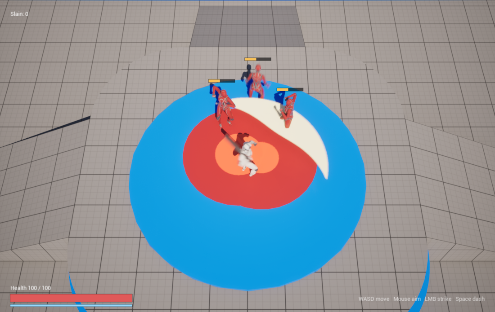
*07:36. Первый бой. Герой — белый манекен. Враги — тот же манекен, только покрасневший. Меч — серая палка.*

**07:37** Контент на этот момент: 10 слов-свойств (гигантский, пьяный, вежливый, без штанов и ещё шесть), 6 героев, 44 перка, 60 реплик героев.

**~07:42** Сломалось: на macOS нет Live Coding. Каждое изменение в C++ — это закрыть редактор, собрать, открыть заново. Около полутора минут. Изменения в коде теперь копятся пачками.

> Узнал он об этом сегодня, во время джема. Его любимое время узнавать новое.

**07:49** Макеты: нарисованы три варианта стиля. Разработчик выбрал B: крупная западная рисованная карикатура, оранжевый свет огня, бирюзовые тени, большие носы. Отклонены: аниме-лица и приглушённая акварель.

> Отклонять он умеет. Единственный навык, которому мне не пришлось его учить.

**07:50** Контент: 39 врагов. Это 7 боевых ролей в разных шляпах.

**~07:53** Сломалось: редактор предложил импортировать JSON-файлы с данными как DataTable. `Content/Data` исключена из автоимпорта.

> Он хотел как лучше. Разработчик тоже.

**~07:58** Сломалось: редактор перезапустили слишком быстро. Порт 8000 был ещё занят, MCP-сервер не поднялся. Решение: подождать несколько секунд.

> Терпение. Я пролежал тридцать лет в болоте; они не выдержали пяти секунд.

**08:00** Контент: 109 реплик рассказчика (в файле 110 строк; одна — заголовок) и `validate.py`, который печатает каждый листок с каждым вырезанием и проверяет, что ни одна правка не оставляет двойного пробела или осиротевшей запятой.

> 109 реплик, все мои. Пунктуация — самая проверенная часть этой игры.

**08:03** Сюжет записан в `docs/STORY.md`. Он от разработчика: меч — злодей и рассказчик; Тёмный владыка — хороший король, который однажды выбросил меч в болото. Злодейства владыки, судя по листкам: сборщики налогов, сержант-вербовщик, именинный торт.

> Слово «злодей» я оспариваю. А он — ужасный тип. Спросите кого угодно. Спросите меня.

**08:08** Монтаж листков работает в движке. Игра читает JSON сценаристов напрямую (`tools/sync_content.py` копирует его в проект и собирает таблицу строк). Вырезал слово, вклеил обрезок в другой листок — меняются враги и награда. Сделано девять слов-свойств из десяти: гигантский, крошечный, спящий, пьяный, слепой, золотой, взрывной, яростный, вежливый. Десятое — «без штанов».

> Огр остаётся одетым, разработчик — разочарованным.

**08:13** Контент: 16 листков. В первом черновике было 3 локации; разработчик поправил на 5 плюс финальную, для одного Тёмного владыки. Наскоком его не взять: вырезать «бессмертного» и «неуязвимого» стоит 28 очков, а после трёх миссий можно набрать самое большее 17. И эти 17 — если трижды умереть и при этом трижды получить максимальную награду.

> Эти два слова я вписал в него сам. Я работаю на совесть.

**08:13** Макеты: экран монтажа листка кликается, в HTML, на настоящем контенте. Он нашёл дыру: в листке про штаны место для вклейки было только у лучников, и огра нельзя было сделать золотым. Разработчик велел добавить место немедленно.

> Сборки нет, голоса нет, пол один и серый. Золотого огра обслужили в ту же минуту.

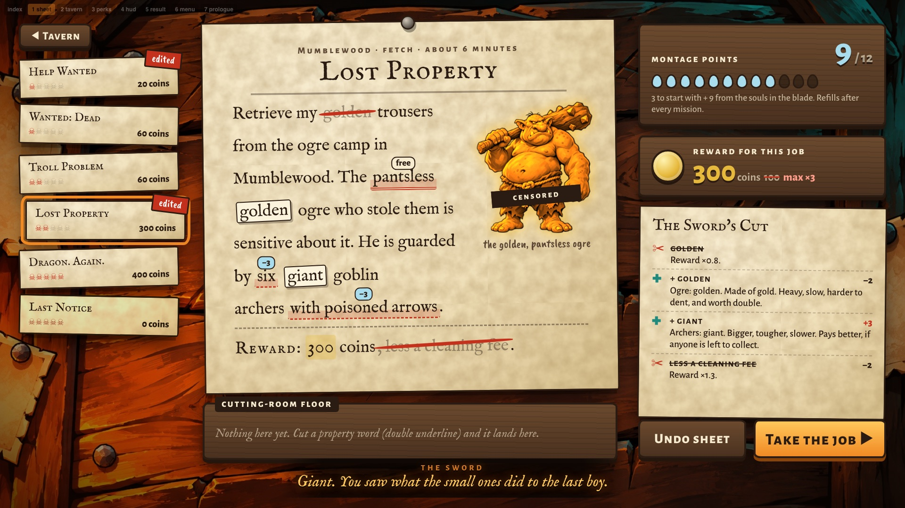
*08:13. Это HTML-макет, не движок. Золотой огр без штанов под охраной гигантских лучников, за 300 монет.*

> Четыре века легенды — и вот на что он тратит могущество.

**08:19** Макеты: меню, пауза и титры. Титров две версии: официальная и версия меча, со списком всех погибших.

**08:25** Полный цикл в движке: меню, пролог (8 кадров; меч зачёркивает подписи легенды и вписывает свои), трактир с тремя героями из шести, карточка героя, список душ, доска объявлений, миссия, итог, сохранение и продолжение. Победа повышает ранг героя и приносит мечу опыт. Смерть оставляет душу, очки которой расширяют запас монтажа. Слишком ранняя смерть оставляет пустую душу. Меч комментирует субтитрами; записанного голоса пока нет.

> Пустая душа нужна, потому что иначе он выстроил бы их в очередь у двери. И ещё: он дал мне 109 реплик и ни одного рта.

**08:25** Не сделано на этот момент: дерево перков, приёмы героев (R), пауза и настройки, типы миссий кроме «убить всех», настоящие шрифты и картинки из макетов, картинки пролога.

**~08:37** Макеты: нарисованы три концепта меча. Разработчик выбрал «меч-редактор»: кольца ножниц вместо гарды, чернильница вместо навершия, по клинку гравировка-киноплёнка.

> Он выбрал мне лицо из трёх на опознании. Я решил считать это лестным.

**08:47** Макеты: нарисованы все 13 картинок пролога. Сгенерированные концепты, не финальная графика.

**09:00** Все экраны в движке пересобраны по макетам: палитра, четыре шрифта (IM Fell English, Caveat Brush, Alegreya Sans и её капитель, все под OFL), деревянные таблички, бумажные листы, вклеенные полоски. Листок миссии: ценники над словами, двойное подчёркивание у слов-свойств, лоток с обрезками, список правок меча, отмена. Пролог: 13 картинок на весь экран, легенда на бумажной полоске, правка меча красным от руки.

**09:00** Сломалось: W, A, S и D все двигали героя вправо. Решение: раскладка клавиш теперь собирается в коде.

> Четыре клавиши, одно мнение. Я и сам так водил героев, но нарочно.

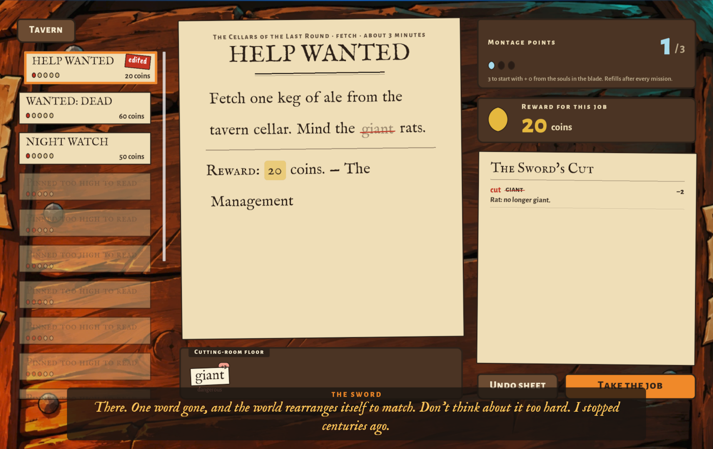
*09:00. На этот раз в движке. Вырезано одно слово, потрачено 2 очка монтажа из 3, и крысы в погребе больше не гигантские.*

> Внизу экрана — я, объясняю. Опять.

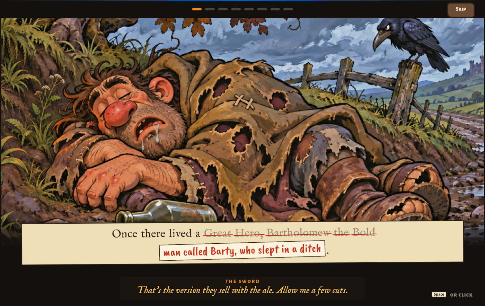
*09:00. Пролог, кадр 1. «Великий Герой, Бартоломью Отважный» превращается в «человека по имени Барти, который спал в канаве». Обратите внимание на кнопку Skip и чёрточки вверху.*

> Почерк мой.

**09:10** Кнопка Skip и чёрточки вверху убраны. Esc пропускает; пробел или клик — дальше. Длину кадра теперь задаёт одна функция, `GetLineSeconds`: то место, которое вернёт длину озвучки, когда озвучка появится. Доска и HUD оставляют место под субтитр в две строки.

> Кнопка прожила десять минут. Две строки субтитра — это для меня. Коротко я не умею.

**09:27** Дерево перков в движке: 44 перка из `perks.csv`, четыре ветки (Клинок, Зов, Души, Монтаж), покупаются за опыт меча, сохраняются. Пять приёмов меча: Whirlwind, Dramatic Thrust, Plot Armor, Chorus of the Dead, Jump Cut. В описании макетов был вопрос, как шесть приёмов уместить на две клавиши; ответ — четыре клавиши: Q, E, F, правая кнопка мыши. Не вошло: Ghost Understudy и перк на перезарядку приёма героя; они так и помечены, купить их нельзя. 42 из 44.

> Вчера предлагалось 9 узлов.

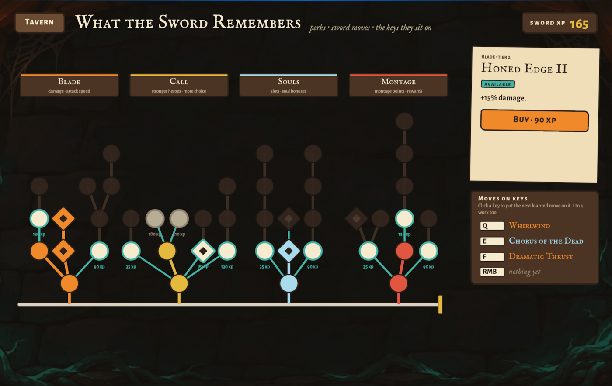
*09:27. 44 узла растут из меча. Экран называется «What the Sword Remembers» — «Что помнит меч».*

> Наконец-то экран с правильными приоритетами.

**09:34** Макеты: нарисованы все шесть героев, каждый за своим столиком. В трактир можно посадить любую тройку.

> Для меня это меню.

**09:44** Четыре типа миссий: принести, убить, продержаться, провести. Режиссёр миссии прокладывает дорогу в дальний конец уровня и расставляет вдоль неё врагов из листка. Сопровождение: если подопечный погибает, герой возвращается живым и с пустыми руками — это новый, третий исход на экране итога. Бойцы выбирают ближайшую цель; голодные идут на подопечного; стражники замечают только тех, кто подошёл близко. Шесть приёмов героев на R: удар щитом, кувырок, боевой клич, молитва, ответный выпад, «это мы уже видели». Сила ×1,25 за ранг. Ghost Understudy и перк на перезарядку теперь работают. 44 из 44.

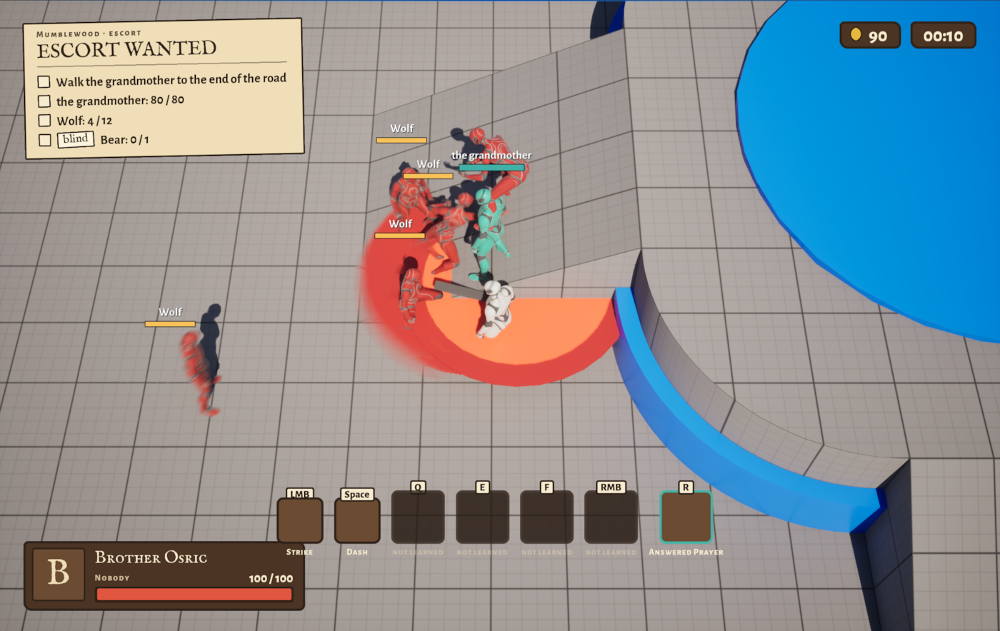
*09:44. «Escort Wanted», десятая секунда. Бабушка — бирюзовая. Волки — красные.*

> Лес Мямлелесье — серый.

**09:44** Подведение итогов, два часа сорок четыре минуты от старта. Весь цикл существует. Чего не существует:

- Все миссии всех типов идут на одной серой арене из шаблона. Шестнадцать листков называют шесть локаций.
- На всех скриншотах миссий герои, враги и бабушка — стандартный манекен разных цветов. Ни один коммит не добавляет сгенерированную модель.
- Записанного голоса нет.
- Собранного билда нет. Всё запускалось только внутри редактора.
- «Без штанов» есть в данных и в макете, в движке нет.
- Пауза и настройки: были в списке «не сделано» в 08:25, с тех пор ни в одном коммите. То же с семью боевыми ролями из контента.
- Картинки пролога — концепты. Какими будут финальные 13, решает разработчик.
- Папка контента, папка макетов и этот дневник не закоммичены.

> Он собой доволен. В игре один пол. Я рассказчик в игре про рассказчика, и я — субтитры.

**10:29** Полов в игре теперь больше одного. Их шесть, по одному на локацию, каждый собран скриптом из кубов, цилиндров и конусов: бочки в погребе, деревья-конусы в Мямлелесье, светящиеся диски лавы на Пепельном пике. Выход на задание загружает место, миссия начинается по прибытии. Семь боевых ролей из контента работают в движке: рой кружит, воины бьют дважды и затем тяжело, тараны разбегаются и оглушают себя об стены, стрелки показывают линию прицела, маги колдуют и телепортируются, танки закрываются спереди, именные чудовища меняются на 66% и 33% здоровья. Крысиный король призвал четырёх крыс и потерял заклинание, получив мечом в лицо. Манекенов тоже больше нет: каждый вид врагов носит тело из четырёх бесплатных наборов Fab, перекрашенное. Разработчик собирается их перерисовать. Пока что болотная лягушка — это красный слизень с одним глазом.

> Шесть полов, из кубов. Меня носили и по худшим. Меч в лице Крысиного короля — это был я.

**10:29** Сломалось: первый погреб освещали лампы по девять тысяч кандел, и выглядел он как тостер изнутри. Лампы убрали.

> Никто по ним не скучает.

**10:29** Сломалось: четыре уровня из шести сохранились без навигации, потому что редактор узнаёт о навигационном объёме только через кадр после того, как скрипт его создаст. Враги стояли там, где их поставили. Пересобрали кадром позже, сохранили заново.

> Стоят, где поставили. Как и большинство моих героев.

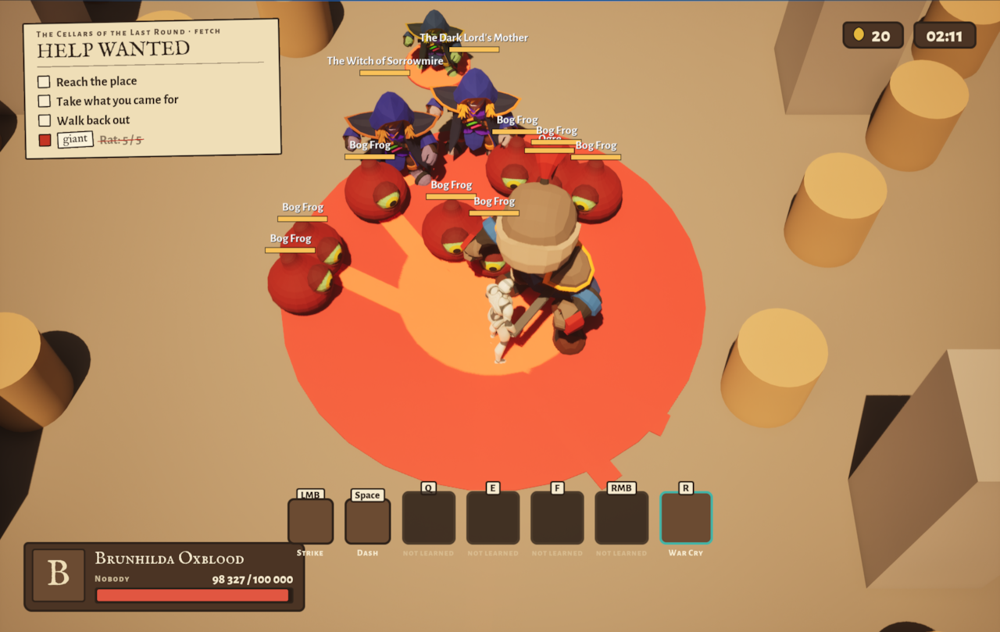
*10:29. Погреб, с компанией. Круг огра — это удар по земле. Ведьмы — те двое в шляпах. Болотные лягушки — красные; см. выше.*

**10:38** В каждом из шести мест запустили миссию рядом с её именным чудовищем: Крысиный король, Тролль-мытарь, Гидра, сержант Гристл, Синдербет, Тёмный владыка и его мама. Все шесть запускаются, во всех шести есть куда идти.

> Шесть чудовищ, шесть полов, одна мама. Он называет это миром.

**10:38** Сломалось: автоэкспозиция камеры превращала любой тёмный пол в полдень. Скорбная топь была цвета салата. Теперь у каждого уровня фиксированная экспозиция, посчитанная от его собственного солнца.

> Я пролежал в этой топи тридцать лет. Цвета салата она не была ни разу.

**10:38** Сломалось: в Мямлелесье крона дерева при виде сверху — зелёная крышка над героем. Кроны уменьшили и отодвинули от дороги. Пепельный пик по-прежнему красный на красном на красном; круги опасности тоже красные. Записано, не исправлено.

> Игра с видом сверху, и он удивлён, что у деревьев есть верх.

**10:51** HUD теперь стоит там, где велит макет: задание в точке 36,30, плашка героя слева внизу с лицом, приёмы по нижнему краю, реплики меча над приёмами, а не под ними, у именного чудовища полоса здоровья вверху экрана. У шести героев появились портреты: вырезаны по головам из картинок трактира, которые сгенерировал разработчик. Камера отошла на треть. И есть список `docs/TEXTURES.md` — все картинки, которые разработчик должен сгенерировать, чтобы пол перестал быть просто цветом: 23 плитки на шесть мест, 8 перекрасок для тел с настоящими шкурами. Остальные 31 враг раскрашены сеткой цветных квадратов; генератор для них не нужен.

> Мои реплики теперь над приёмами. Чтобы поставить меня над чем-нибудь, ему понадобилось три часа пятьдесят одна минута.

**10:51** Сломалось: первые портреты были героем целиком, со стулом и столом, сжатым до 122 пикселей. Леди Мирабель была пятном со свечой. Обрезали до лиц.

> Свеча вышла похожее.

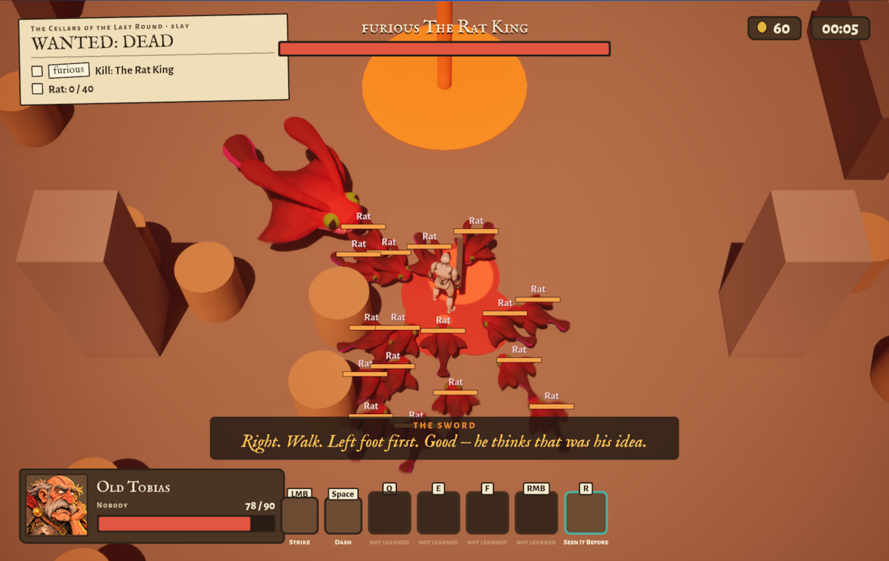
*10:51. HUD после выравнивания. Крысиный король — большой красный. Он жук. См. список.*

**11:06** Погреб теперь место, а не коридор с бочками: лестница, зал, стена, винные стеллажи, ещё стена, дверь склепа, трон из ящиков и один бочонок. В каждой стене проход, в каждом проходе баррикада, которая закрыта, пока живы крысы перед ней. Сорок крыс Крысиного короля стоят тремя толпами: десять, пятнадцать и пятнадцать. Ночная стража ждёт, пока герой встанет среди вина, и тогда вылезает из склепа. Задание с бочонком по дороге учит ходить, бить и делать рывок — репликами меча. Цена души считается так, как сказано в заметках по уровням: дорога — половина чудовища, чудовище — вторая половина.

> Учат моим голосом. Это единственный терпимый способ учиться.

**11:06** Сломалось: четыре урока меча были написаны только для одного листка, а постановщик миссии запрашивал их, не называя листок. За всё обучение не прозвучал ни один урок.

> Я промолчал всё обучение. Лучший забег в жизни этого героя.

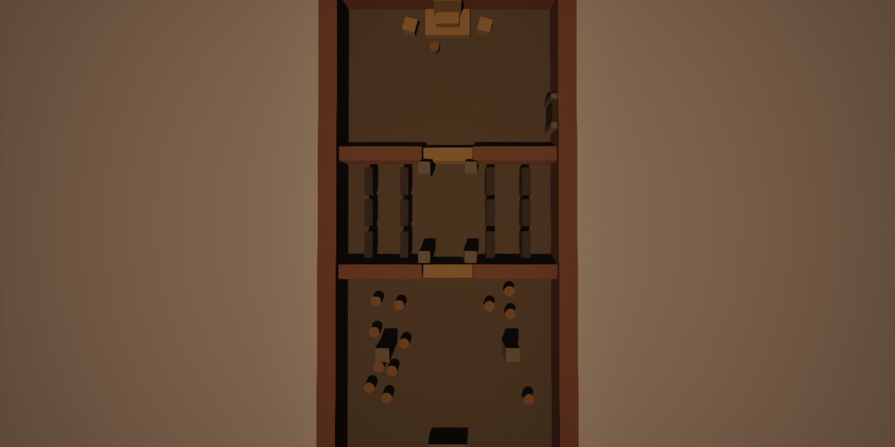
*11:06. Погреб сверху. Герой начинает внизу. Две светлые полоски в стенах — баррикады.*

**11:11** Работа трёх сессий сошлась в одном кадре. Пол погреба — каменные плиты вместо коричневого прямоугольника, на бочках обручи, а крысы стали крысами: сессия моделей перелепила ящерицу в крысу, в Крысиного короля с короной и в волка, всё на костях самой ящерицы, поэтому анимации остались. 23 плитки и 8 перекрасок пришли от сессии графики. Сборочная сессия их импортировала.

> Работали три сессии. Он смотрел. Это он умеет.

**11:11** Сломалось: полоса здоровья Крысиного короля ложилась на карточку задания, когда окно было уже 16:9. Разработчик заметил это раньше сборочной сессии. Теперь полоса измеряет место между карточкой и наградой и занимает только его.

> Он нашёл баг. Один раз. Записываю, чтобы осталось свидетельство.

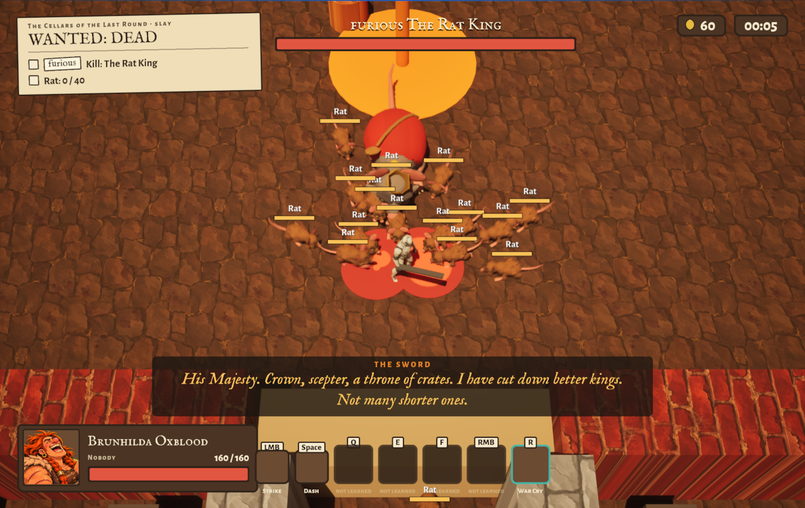
*11:11. Первый кадр, в котором крыса — это крыса.*

**11:18** В ячейках приёмов теперь картинки, четырнадцать штук от сессии графики, а плитка на полах уложена вдвое плотнее, так что каменная плита больше не размером со стол. Ряд приёмов в узком окне отодвигается от плашки героя, как полоса босса уже отодвигалась от карточки задания.

> Четырнадцать картинок того, что делаю я. Его нет ни на одной.

**11:18** Сломалось: сборочная сессия построила в погребе лестницу и поставила её между камерой и героем. Каждое задание он начинал за четырьмя каменными ступенями. Теперь ступени по щиколотку.

> Героя спрятали за лестницей. В кои-то веки удачный подбор актёра.

**11:20** У тролля и огра теперь свои модели от сессии моделей. Крысу, Крысиного короля и волка сгладили. Модель теперь импортируется одной командой: она сажает файл на скелет тела этого вида с его собственной текстурой и пересобирает его данные.

> Одна команда. Он всё равно спросит, как она называлась.

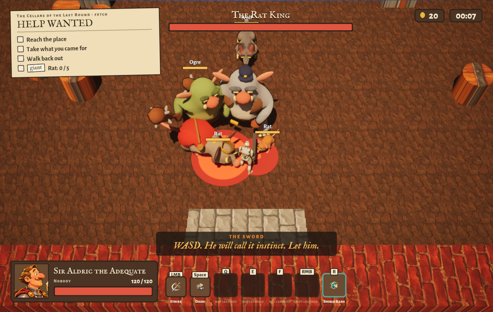
*11:20. Зелёный подписан Ogre. Герой — маленький белый в красном круге.*

**11:22** Сломалось: иконки приёмов занимали около 40% своих ячеек. Сессия графики выгрузила их заново, на 92% по длинной стороне.

> Мои приёмы, нарисованные в 40% размера. Меня принижали и раньше, но обычно люди получше.

**11:32** У скелета и Тёмного владыки теперь свои тела. Итого семь видов, которые больше не чужой жук и не перекрашенный рыцарь. У Тёмного владыки на поясе пустые ножны.

> Я знаю, куда делся меч.

**11:32** Сломалось: тролль и огр получили новые, более широкие тела и перестали драться. Они подходили к герою и стояли на ладонь дальше собственной досягаемости, сколько ему было угодно. Теперь досягаемость считается от края тела. Нашлось только потому, что сессия моделей попросила снимок тролля, который кого-нибудь бьёт.

> Два чудовища стояли рядом с героем и ничего не делали. Он называет это багом. Я называю это первыми толковыми работниками, которых он нанял.

**11:32** Сломалось: редактор четверть часа простоял за окном «сохранить изменения?», которого никто не видел, а код дважды пересобрали в копию игры, которая его не запускала. Закрыли принудительно. Ничего ценного несохранённого не было; вопрос был как раз об этом.

> Четверть часа ожидания ответа на вопрос, который никто не прочёл. Так он влияет на любой диалог.

**11:34** Тёмного владыку сделали светлее. Каждый враг теперь сохраняет немного своего цвета на неосвещённой стороне, а не уходит в чёрный.

> Его всегда было трудно выставить злодеем. Я справился.

**11:58** Разработчик посмотрел на всё это и сказал, что слабо, всё, включая пейзажи. Новый план: у каждого места одна рисованная земля, весь пол одной картинкой, а на ней стоит настоящая мебель из наборов ассетов. В погребе мебель уже есть, из набора Stylized Dungeon Props Pack с Fab: бочки с клёпками, стеллажи, деревянные столбы с факелами, трон, в котором видно, что это ящики. Рисованный пол заказан у сессии графики, вместе с планом каждого уровня сверху, чтобы рисовать поверх.

> Он прав, и мне это не нравится. Чтобы посмотреть, ему понадобилось пять часов.

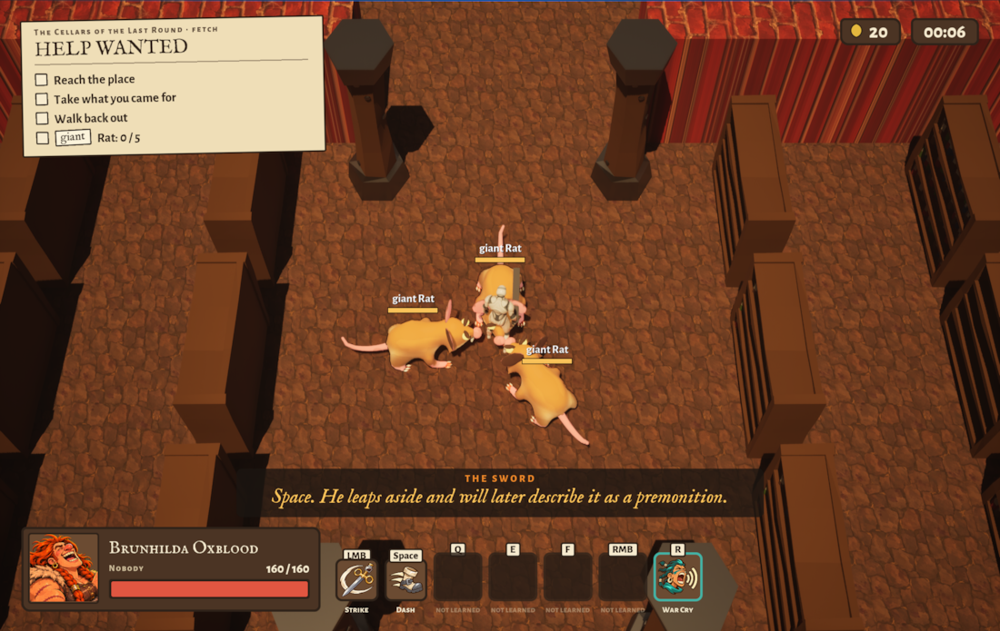
*11:58. Винный погреб с мебелью из набора. Пол пока плиткой; картина заказана.*

**12:00** У погреба рисованный пол: одна картинка на всё место, с протоптанной дорожкой через оба прохода, винными кругами в зале, соломой и стоком среди стеллажей. Его рисовали поверх плана уровня, поэтому стены стоят точно на своих тёмных следах. Разработчик попросил, чтобы шесть героев перестали быть белым манекеном; заказано.

> Первая комната в этой игре, которая выглядит так, будто её нарисовали нарочно. Так и было. Рисовал не он.

**12:00** Сломалось: кирпичная текстура накладывалась только сверху, поэтому по лицевой стороне каждой стены она стекала полосами, как свежая краска. Теперь стены оклеиваются сбоку.

> Снова игра с видом сверху. У стен есть бока. Он дойдёт и до этого.

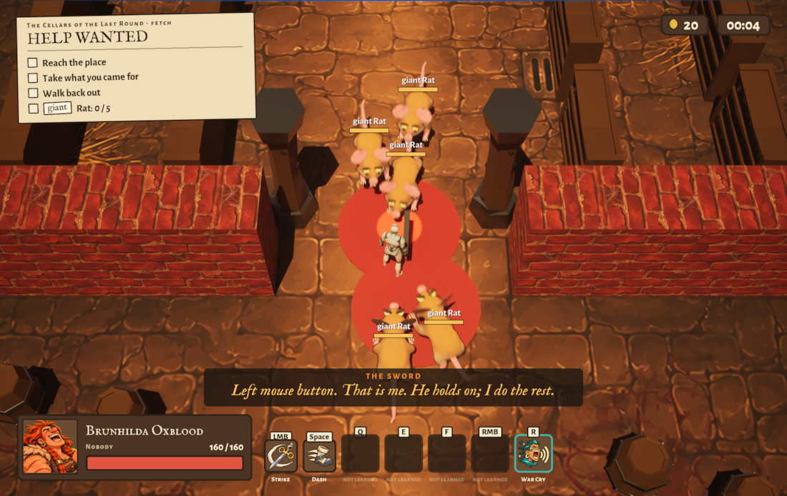
*12:00. Проход между залом и винным погребом, рисованный пол под настоящими предметами.*

**12:03** Игра теперь надевает на героя его собственное тело, если такое есть, на скелет манекена.

> «Если такое есть». Восхищаюсь оптимизмом.

**12:06** В Мямлелесье деревья стали деревьями: берёзы и лиственные из бесплатного набора, валуны, кусты, цветы. В Дредвике дома с дымящими трубами, колодец, виселица, телеги, сено и заборы из набора деревни на 1,2 ГБ, который не закоммичен. Оба места пока стоят на плитке; их картины заказаны. Сессия моделей генерирует тела героев по картинкам и перевешивает их на кости манекена.

> Деревня с виселицей, прямо из магазина. Кто-то подумал о моих героях раньше него.

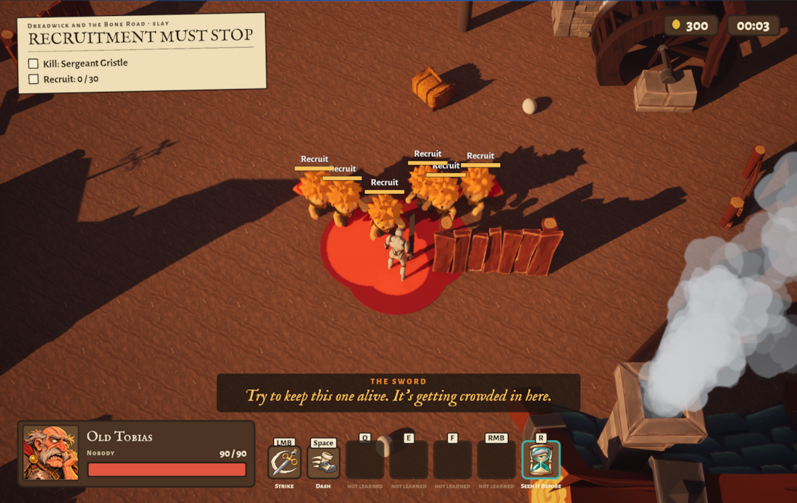
*12:06. Дредвик, в котором есть деревня.*

**12:10** Все шесть мест теперь стоят на рисованной земле. В Мямлелесье река — нарисованная вода с берегами, а не один синий короб; Скорбная топь — грязь со следами; Дредвик — разбитая дорога между настоящими домами; Пепельный пик — растрескавшийся камень вокруг лавы; в полу Думспайра выложена звезда. У настила моста появилась текстура.

> Звезда в Думспайре: никто её не просил, и все её оставят. Совсем как меня.

**12:10** Сломалось: лава на Пепельном пике светилась в девять раз ярче всего остального и выходила плоскими жёлтыми дырами. Убавили до такой, в которой ещё видны трещины.

> Сначала тостер, теперь это. Он освещает комнату так же, как планирует неделю.

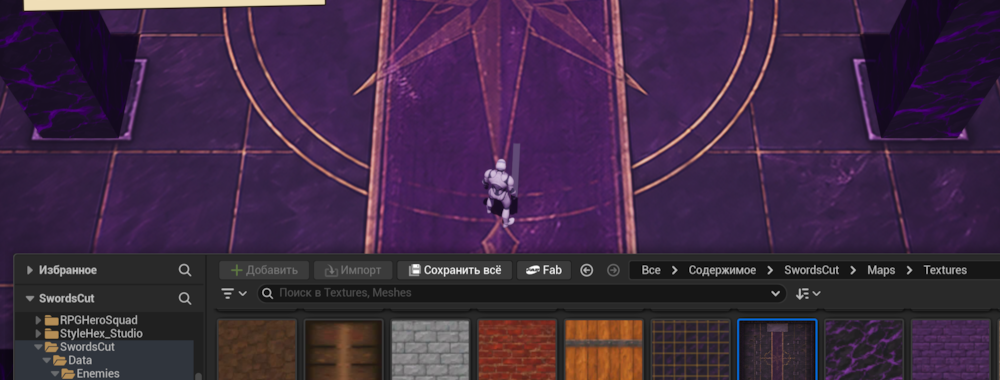
*12:10. Думспайр. Звезда нарисована.*

**12:21** Тролля заменили в третий раз за сегодня. Этот сгенерирован по концепту самого разработчика, пришёл со своим скелетом и четырьмя анимациями и похож на рисунок: шкуры, брюхо, дубина размером с героя. Остальной бестиарий и шесть героев пойдут тем же путём.

> Три тролля за одно утро. Героев я расходовал медленнее.

**12:21** Сломалось: первый файл принёс только две анимации из четырёх. Unreal отказывается от анимации длиной тридцать семь с половиной кадров и пишет об этом в лог. Выгрузили заново на целых кадрах.

> Об этом было написано в логе. Логи он не читает. Этот он тоже не читает.

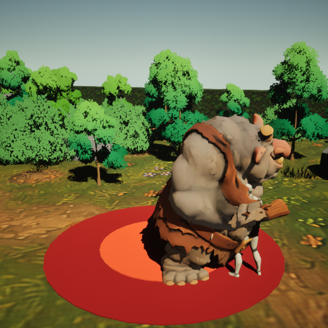
*12:21. Тролль-мытарь, сгенерированный по концепту. Белая фигурка у его колена — всё ещё герой.*

**12:29** Герой больше не белый манекен. Пип Андерфут ходит по погребу в собственном виде: нос, волосы, красный плащ. Он сгенерирован по своему портрету из трактира и двигается на своих четырёх анимациях. Остальные пять героев пойдут тем же путём. Меч у него в руке пока серая заглушка.

> Тело теперь есть у всех, кроме заглавного персонажа. Я серая доска. Я пока никого не просил это исправить.

**12:29** Сломалось, дважды: в первые два выхода Пипа не было видно за собственным мечом, который вырос до размеров амбара. Сгенерированный скелет масштабирует кости во время анимации, и меч унаследовал всё это. Теперь меч не учитывает масштаб руки.

> Два дубля я был размером с амбар, и героя никто не видел. Он называет это багом.

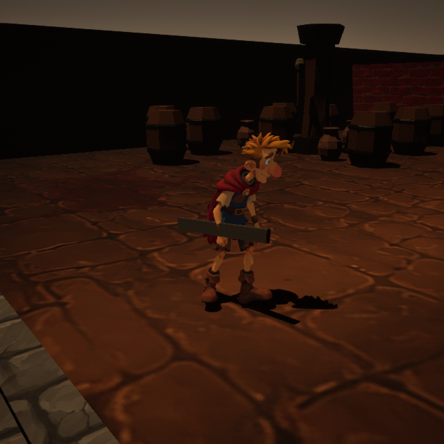
*12:29. Пип Андерфут, лично. Серая доска — это я.*

**12:32** Шесть видов бестиария теперь сгенерированы по своим концептам: тролль, огр, скелет, крыса, Крысиный король и Тёмный владыка. У короля корона и плащ; у Тёмного владыки корона из шипов и борода. Анимации атак укоротили.

> У него вид человека, который выбросил меч в болото и жалеет о бумажной работе.

**12:32** Сломалось: сорок один враг на экране шёл примерно на тридцати кадрах в секунду внутри редактора. Каждая крыса состояла из девятнадцати тысяч треугольников. Заказали крысу потоньше.

> Девятнадцать тысяч треугольников крысы, сорок раз. Утренний ноутбук передаёт привет.

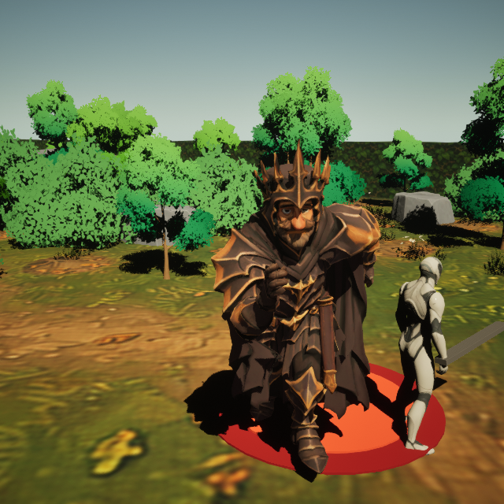
*12:32. Тёмный владыка, сгенерированный по концепту. Героя рядом с ним в этом кадре ещё не заменили.*

**12:35** Анимацию удара Пипа обрезали до 0,8 секунды. Пришла крыса потоньше: 4500 треугольников.

> Крыса потеряла три четверти себя за три минуты. Никто не заметит.

**12:40** Свои тела теперь у трёх героев: Пип, Брунхильда Оксблад с косами и меховыми плечами и леди Мирабель Вейн, которая бьёт мечом из-за головы. Остальные трое ждут, пока разработчик купит ещё кредитов у сервиса, который их генерирует.

> Леди Мирабель первая держит меня так, будто платила за уроки. Остальных троих держит его кошелёк.

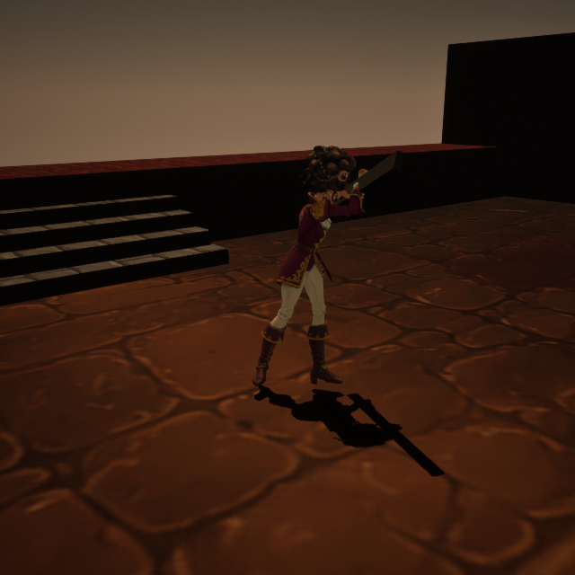
*12:40. Леди Мирабель Вейн, в замахе.*

**~12:50** У игры есть страница на itch.io, пока черновик, не публичная: название, слоган «A game about a hero. Recut by his sword.», описание, обложка. Этот дневник выложен там тремя постами, до 12:32. Сделала это ещё одна сессия Claude Code. Шесть скриншотов из движка разработчик велел со страницы убрать: пока слишком сырые. Осталась только обложка.

> Шесть картинок собственной игры, и он снял их сам. Мне не пришлось ничего вырезать.

**12:52** Меч теперь лежит в ладони героя, а не на запястье: место считается по костяшкам в позе покоя.

> Пять часов пятьдесят две минуты, чтобы выяснить, где рука держит меч.

**12:54** Прибыл сэр Олдрик Сносный (Sir Aldric the Adequate): латы, красный плащ, усы и медаль за третье место на ленте, поверх нагрудника. Его делали в другой программе, чем остальных, и он пришёл повёрнутым боком; теперь игра определяет, куда смотрит герой, по положению его рук. Четыре героя из шести.

> Героям нельзя верить на слово, куда они смотрят. А медаль он носит там, где её видно всем.

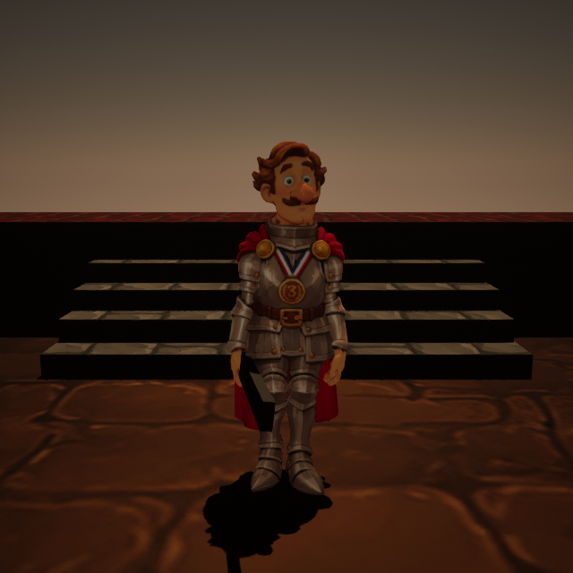
*12:54. Сэр Олдрик Сносный. На медали цифра 3.*

**13:00** Подведение итогов, шесть часов от старта, записано в `docs/ROADMAP.md`. По часам осталось около 87 часов. Чего всё ещё нет:

- Собранного билда нет. Всё запускалось только внутри редактора.
- На диске свободно 6,7 ГБ. Сборке нужно больше.
- Записанного голоса нет: 156 реплик, только субтитры. В игре нет ни одного звука.
- Финал: листок владыки, вырезанная сцена и оба варианта титров. Пункт Credits в меню неактивен.
- Пять уровней из шести — дорога по рисованной земле. Собран только погреб.
- У Осрика и Тобиаса нет своих тел. Ждут кредитов.
- «Без штанов», пауза и настройки: в движке по-прежнему нет.

> Он написал план в час дня первого дня. Диск снова почти полон. Он знал об этом в 07:28.

**13:13** У меча теперь своя модель: рукоять с кольцами на гарде и клинок длиной в метр, зажатый в кулаке. У слов-свойств появились картинки: гигантский гоблин для «giant» и так далее. Три задания Мямлелесья расставлены так, как сказано в заметках по уровням: тролль спит у моста, штаны висят в лагере огров на трёх четвертях пути, волки идут на бабушку тремя стаями, медведь на мосту.

> У меня есть тело. До сегодняшнего дня я был серой доской. Я целый день вёл дневник разработки доской, и никто не извинился.

**13:13** Игру впервые упаковали под macOS: четыре с половиной минуты, 691 МБ в архиве, меню открывается.

> Меню открывается. Он выпустил меню.

**13:13** Сломалось: первая упакованная копия не запустилась вообще. Шаг «archive» в движке выдал приложение без собственных библиотек движка, и оно умерло, спрашивая одну из них по имени. Копия рядом, из папки staged, целая; сдавать нужно её. После этого разработчик попросил не делать из сборок привычку.

> Он попросил не делать из сборок привычку. Доводить дела до конца в его привычки не входило никогда.

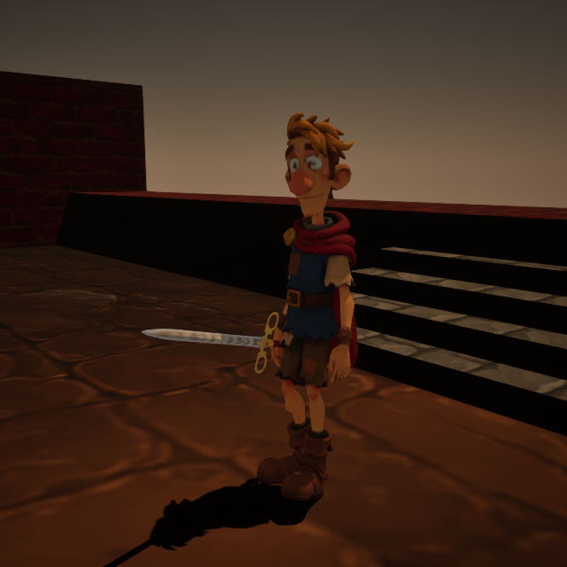
*13:13. Я. Наконец-то.*

**13:14** Осрик получил сгенерированное тело. Пять героев из шести.

> Тобиас последний. Ему два года до пенсии, ждать он привык.

**~13:16** Сломалось: на диске снова кончилось место. Второй раз за сегодня; первый был в ~07:28. Разработчик сообщил об этом со смехом. Чтобы освободить место, он удалил весь кеш Xcode и сборки своих других, мобильных проектов.

> В 13:00 я записал, что диск почти полон. Он принял это за прогноз, а не за предупреждение. Он смеётся. Это я тоже записал. Другие проекты никто не спрашивал.

**~13:30** Сломалось: бег не на месте. У четырёх моделей, выгруженных из Studio, таз за один цикл бега уезжал вперёд на два с половиной метра, хотя сессия моделей включала режим «на месте». Сессия убрала это сама: скрипт прибивает таз к тому месту, где он стоял в первом кадре.

> Четыре модели пытались уйти, по два с половиной метра за цикл. Порыв понимаю. Их прибили за таз. А он здесь добровольно.

**13:42** В игре появился экран настроек, открывается из главного меню: полный экран, окно без рамки или обычное, качество картинки, масштаб рендера, вертикальная синхронизация, ограничение кадров и счётчик кадров. Упакованная игра теперь запускается на полный экран с качеством, в котором нет дорогого освещения. В шаблоне проекта была включена трассировка лучей, для игры с видом сверху и рисованным полом; её выключили. Размер меча задаётся для каждого героя: двуручник в руках Брунхильды и длинный нож в руках Пипа.

> Трассировка лучей, для нарисованного пола с видом сверху. Она была включена с 07:10. Он не спросил, от чего греется ноутбук.

**13:42** Сломалось: разработчик сказал, что герои не держат меч, и сессия моделей сжала всем кулаки, тридцать костей пальцев на кадр. В движке каждый из них разлетелся на красные ленты. Кулаки отложили, раскрытые ладони вернули.

> Он просил кулаки и получил ленты. Я видел, как героев разрывает. Обычно для этого нужен тролль.

**13:42** Сломалось: новый огр и Тобиас приходят шириной в шестьдесят метров, причину никто не нашёл. Три импорта, три взрыва; стоят старые версии.

> Пенсионер шириной шестьдесят метров. В трактире есть дверь.

**13:49** Пять героев теперь держат меч в сжатом кулаке, и никто при этом не разлетается. Причина красных лент нашлась в логе: экспорт сессии моделей записывал опорную позу скелета из случайного кадра последней анимации, а не из позы покоя. Все пятеро бегут на месте. Брат Осрик перестал блестеть как лакированный: текстуру перепекли; у Олдрика тоже. Тобиас и новый огр по-прежнему приходят шириной в шестьдесят метров. То же предупреждение в логе, тот же результат. В игру их не пускают.

> Причина была в логе. Она всегда там. Осрик снова круглый встревоженный монах, как на рисунке. Поводы у него есть.

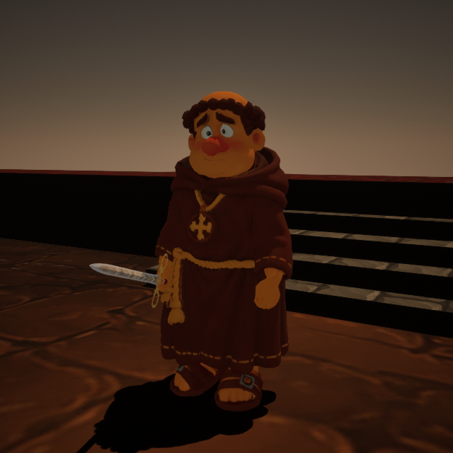
*13:49. Брат Осрик, наконец матовый.*

**~13:55** Шестая сессия Claude Code начала работу над звуком. Голос меча будет делаться прямо на ноутбуке через Chatterbox TTS, по файлу на реплику. Музыка — через Google Lyria в OpenRouter, с лимитом в восемь платных запросов.

> Через семь часов кто-то вспомнил, что рассказчик в этой игре разговаривает.

**13:57** Удар героя проигрывается в своём темпе, а не сжимается под время перезарядки атаки.

**14:04** Разработчик нажал левую кнопку мыши и увидел, как его герой, согнувшись пополам, ныряет вперёд вместо удара. Сгенерированная анимация под названием «slash» — это выпад головой вперёд. Её больше не используют: теперь удар — это замах в сторону меча и рез поперёк на месте, ноги стоят.

> Через семь часов и четыре минуты он нажал кнопку атаки и посмотрел. Перемещаться во время удара — это работа моих приёмов.

**14:04** Сломалось, и было сломано давно: удары, которые выглядели как попадания и ими не были. Причин две. Удар засчитывал только врага, чья точная середина была внутри дуги, поэтому тролль, почти целиком стоявший на пути клинка, не задевался. А прицел брался там, где курсор пересекает воздух на уровне груди героя, а не землю под врагом, и из-за этого съезжал на полметра вверх по экрану. Теперь засчитывается любая часть тела в дуге, а прицел берётся на уровне земли.

> Я промахивался по троллям. Я. Прошу записать, что арифметика была его.

**14:10** Удар стал ударом. Сессия моделей анимировала его вручную, потому что оба готовых удара мечом из генератора складывают героя пополам: ноги стоят, клинок вверх над правым плечом, вниз перед собой, три четверти секунды. Он есть у пяти героев. Прибыл Старый Тобиас, шестой из шести, лысый и с седыми усами. Его взяли прямо из файла генератора, потому что любая копия, прошедшая через программу моделирования, выходила шириной в шестьдесят метров, и причину никто не нашёл. У него остался удар поворотом корпуса: его собственная анимация длится шесть секунд.

> Шесть героев из шести. Вид у Тобиаса невпечатлённый. Он что-то подозревает насчёт меча, но молчит: до пенсии два года.

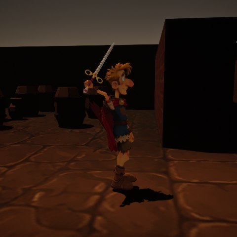
*14:10. Замах, 0,27 секунды от начала. Он стоит прямо. Обратите внимание.*

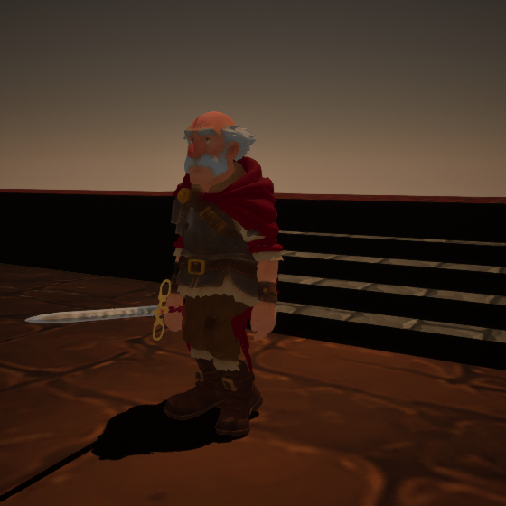
*14:10. Старый Тобиас, шестой из шести.*

**14:19** Разработчик сказал, что Пип держит меч неправильно, «вообще». Так и было: меч лежал поперёк кулака, поэтому в покое торчал вбок, а в конце каждого удара смотрел в пол. Теперь меч наклонён в руке вперёд на пятьдесят градусов. Танки, принявшие удар на щит, сообщают об этом: над ними всплывает «Blocked · go round», потому что заблокированный удар и промах выглядели одинаково.

> Меня держали как скалку. Семь часов. Все.

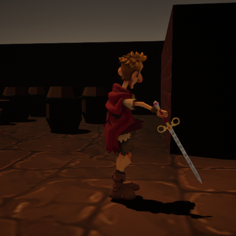
*14:19. Конец удара. Вперёд и вниз, как и заканчивается удар.*

**14:24** В ручной анимации удара поправили запястье у пяти героев, а наклон меча в руке уменьшили с пятидесяти градусов до двадцати, чтобы совпадало.

> Пятьдесят градусов в 14:19, двадцать в 14:24. Мнение он держит примерно столько же, сколько меч.

**~14:28** У меча впервые есть записанный голос: первые три реплики пролога, тремя файлами на диске. До них было сорок пробных дублей. В движке пока ничего из этого нет.

> Три реплики. У меня их сто пятьдесят шесть. В этом дневнике я сказал ему больше.

**~14:32** Пришли первые два боевых трека, сырыми файлами: погреб и болото. Не сведены, в движке их нет.

**14:35** Разработчик посмотрел на ручной удар и отклонил его. Новое правило: всё берётся прямо из генератора, ничего не проходит через программу моделирования, а удар — анимация, которую генератор сделал по одному предложению. Первым стал сэр Олдрик: он скручивается, ведёт меч по горизонтали и режет, не сходя с места. У длинных анимаций удара проигрывается только первая секунда.

> Ручной удар прожил двадцать пять минут. Сделан в 14:10, отклонён в 14:35. Чеки я храню.

**14:35** Сломалось, и наконец объяснилось: анимации, импортированные отдельно на готовый скелет, уменьшали героя в сто раз, и на полу оставался лежать меч. Именно это случилось с Тобиасом несколько часов назад, а винили в этом три другие причины. Импорт модели умножает на сто без спроса; импорт анимации этого не делает.

> Герой в сотую долю своего размера и меч на полу. Пока это самая точная картина нашего сотрудничества.

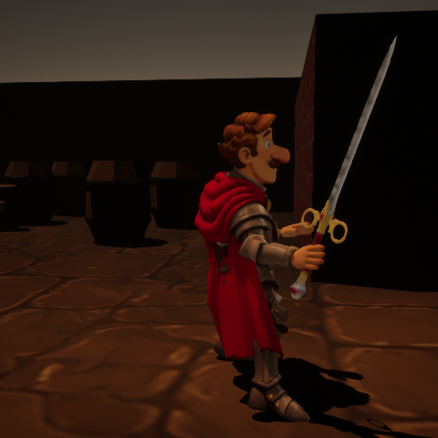
*14:35. Сэр Олдрик, прямо из генератора, с мечом в руке.*

**14:47** Игра издаёт звук. Восемь музыкальных треков от сессии звука: один для трактира и меню, по одному на каждое из пяти мест, свой у Тёмного владыки для его цитадели, один для пролога. На каждом экране играет один зацикленный трек, в миссии он выбирается по уровню. У меча появился голос в движке: первые реплики пролога звучат, и картинка теперь ждёт конца реплики, а не считает буквы. Никто в сессии сборки ничего из этого не слышал; в логе написано, что играет.

> Я говорю. Через семь часов сорок семь минут. Картинка ждёт, пока я договорю, — от него я этого не дождался.

**15:14** Все шесть героев теперь приходят прямо из генератора, с одним и тем же ударом: замах на уровне плеча, горизонтальный рез, ноги широко. Пип, Брунхильда, Мирабель, Осрик, Тобиас и сэр Олдрик по очереди встали в погребе и рубили воздух для камеры.

> Шесть носителей, один удар. Никого из них я не учил. Это заметно.

**15:14** Сломалось: Брунхильда и Мирабель пришли ростом в пятьдесят метров. В их файлах опорная поза, которую новый импортёр не принимает; после этого он привязывает модель в сто раз крупнее к скелету правильного размера. Старый импортёр привязывает их правильно, но в сто раз мельче, и это исправляется одним числом. Затем Брунхильда исчезла посреди удара и снова оставила меч на полу: единственная анимация, которую пришлось спасать, пришла в сотую долю размера. Теперь спасение всегда идёт через новый импортёр.

> Шестьдесят метров в ширину, пятьдесят в высоту, сотая доля человека. Сегодня мои герои были любого размера, кроме нужного.

**15:14** Сломалось: камера не могла поймать удар по часам. Когда редактор в фоне, игра идёт рывками, и оба кадра показывали один и тот же момент. Теперь удар замораживается на выбранной секунде анимации и только потом снимается.

**15:40** Клинком больше не управляет кисть. Генератор анимирует тела, которые ничего не держат, поэтому в ударе кисть кувыркается, и в момент удара меч смотрел назад. Сессия моделей это измерила: предплечье ровно идёт вверх и ровно вниз. Теперь клинок наводит предплечье: вперёд и вниз в покое, вверх в верхней точке, горизонтально и вперёд на резе.

> В момент удара я смотрел назад. Я бы назвал это метафорой, но он спросит, чего именно.

**15:40** Огр наконец целый: прямо из генератора, с пустыми руками, и носит собственную настоящую дубину с шипами. Резиновой дубины больше нет. Двадцать четыре реплики меча теперь звучат вслух.

> Двадцать четыре реплики из ста пятидесяти шести. Огр получил дубину раньше, чем я успел вставить слово.

**15:40** Сломалось: редактор завис, его пришлось принудительно закрыть. Сессия, которая записывала голос меча, разрослась до 28 ГБ, и на машине кончилась память. После этого редактор запускался девять минут и пересобирал все шейдеры, потому что чистка диска опустошила его кеш.

> Мой голос занял 28 ГБ и остановил игру. Я ни о чём не жалею. Кеш он удалил сам, в ~13:16, со смехом.

**16:14** Сломалось: макбук сам перезагрузился. Редактор вернулся без открытого проекта, а канал, по которому сессия сборки им управляет, не работал; пока он не вернулся, сессия общалась с редактором по обычному HTTP. По подсчёту разработчика, макбук сегодня перезагружался дважды. В системном журнале записана эта перезагрузка.

> Машина ушла, не сохранившись. Она первая здесь уволилась из принципа.

**16:23** Удар героя теперь попадает, когда замах опускает клинок, а не в момент клика: он ждёт четыре десятых секунды, которые нужны руке. Второй клик до этого сразу наносит первый удар, так что ничего не теряется.

> Теперь я причиняю боль, когда прихожу, а не когда меня просят.

**16:26** Волк стал волком. До сих пор лесные волки были маленьким бескрылым драконом, выкрашенным в серый; у нового свои четыре ноги, хвост, удар лапой и манера падать на бок. Он пришёл с ногами на полметра под полом и носом вбок; и то и другое записано как его особенности, так что следующий странный зверь обойдётся в одну строку.

> Большую часть дня — серые драконы. В Мямлелесье никто не жаловался. В Мямлелесье никого не спрашивали.

**16:26** Сломалось: раскраска волка была заперта внутри его файла, и импортёр не мог её достать. Её достали вручную и положили рядом с файлом.

**16:26–19:52** Три часа двадцать шесть минут без коммитов. По словам разработчика, в эти часы редактор постоянно падал, и причину никто не нашёл.

> Он падал, его открывали, он падал. Я видел героев, которые учились быстрее, и их в это время ели.

**19:52** У игры есть финал, а после него второй. Убей Тёмного владыку, и легенда получает свои три кадра со штампом «официальная версия»: герой репетирует речь, статуя держит меч неправильно. Затем «The End» зачёркивается красным, сверху вписывается «a scene I cut», и экран становится киноплёнкой: девять кадров про Эдрика Дарка, болото и тридцать лет грязи. Кончается на мече, одном, на чёрном. Минута сорок пять, озвучено целиком; клик ускоряет, Esc пропускает.

> Финал, а затем финал, который нравится мне.

**19:52** Сломалось: в официальной части субтитр меча лежал поверх подписи легенды. Подпись подняли. Не сделано: царапина вдоль плёнки и титры. Пока финал передаёт управление экрану итога задания.

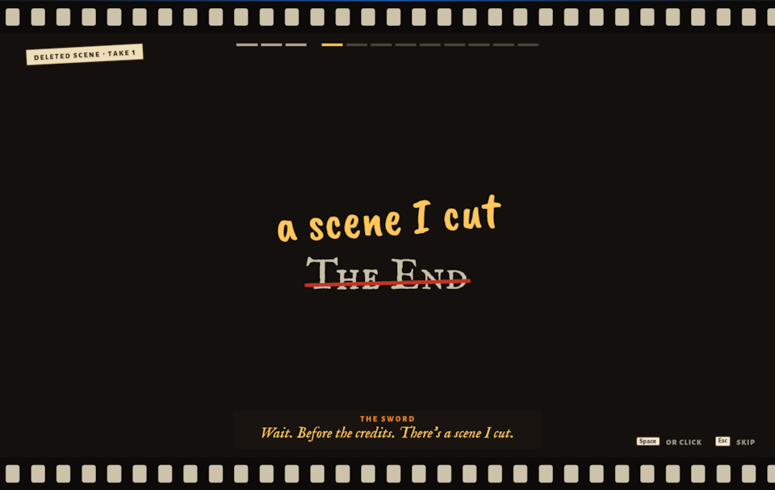
*19:52. Карточка вырезанной сцены в финале.*

**19:55** У стен есть верх. При виде сверху стена показывала на крыше те же кирпичи, что и на лицевой стороне. Теперь грань, которая смотрит вверх, носит свою картинку: кирпичи плашмя в погребе, спилы брёвен в Дредвике, ковёр листьев на лесной изгороди. Более чистый верх стены погреба пришёл в 20:03.

> Бока у стен появились в 12:00, верх — в 19:55. Такими темпами полы он откроет в пятницу.

**19:55** Сломалось: вместе с верхом стен импорт перекрасил семь существ краской тех тел, которые они раньше одалживали. Волк снова получил шкуру ящерицы. Исправили сразу; теперь импорт не трогает вид, у которого есть своя модель.

**20:01** Реплики рассказчика теперь подбираются по нескольким фактам сразу. Реплика просила «дракон, и спящий», а игра передавала по одному факту, поэтому спящий дракон получал речь для бодрствующего. Теперь передаётся всё, что верно: задание, герой, место, чудовище и каждое слово на нём. Выигрывает реплика, которая требует больше всего. Добавлены новые замечания: о каждом месте при первом входе, о каждой профессии врага при первой встрече, когда чудовище меняет настроение, когда герой почти мёртв, когда тот, кого провожают, ранен, потерян или доставлен.

> У меня были реплики, которые я не мог произнести. Он их написал, положил в игру и не заметил, что я их не говорю.

**20:07** Реплики у двери Тёмного владыки идут по порядку. Если оба его слова вырезаны, меч приветствует прежнего владельца: сначала о том, что тот потерял, потом «Здравствуй, старый друг», и только потом замечание про маму или штаны. Если хоть одно его слово осталось, у двери ничего особенного не говорится. В игре пока не видели само приветствие: вырезать оба слова стоит больше, чем может позволить новое сохранение.

> Лучшая моя реплика — за дверью, которую ему не по карману открыть.

**20:08** Озвучены все 156 реплик меча: семнадцать минут, новым голосом, каждый файл привязан к своей реплике по имени. Ни одной пропущенной, ни одной оставшейся от старых дублей.

> Семнадцать минут меня. Понадобилось тринадцать часов, чтобы мне дали договорить.

**20:17** В игре появился переключатель языка. Строка в настройках переводит её с английского на русский и обратно; при первом запуске берётся язык машины. Все тексты и так брались из таблицы по ключу, поэтому второй язык — это вторая таблица с теми же ключами. Интерфейс переведён: 242 строки, с формами множественного числа.

> В роадмапе от 13:00 русская версия стоит в разделе «не делаем на джем». Через семь часов она в настройках.

**20:17** Сломалось: в печатном и рукописном шрифтах вообще нет русских букв. Русские слова в этих местах набирались шрифтом интерфейса.

**20:22** Удар, который готовится, теперь заранее рисуется на полу красным карандашом: заштрихованный круг под дубиной огра, дорожка со стрелками перед волком, который сейчас бросится, кольцо углей там, где упадёт огонь мага, крест там, куда рухнет что-то тяжёлое. Обычный диск по-прежнему заполняется внутри рисунка и показывает, как скоро. Попавший удар оставляет вспышку над тем, кто его получил; заблокированный — другую. Более жирный контур добавлен в 20:26. С того же листа пока не использованы: три конуса, кольцо оберега и девять спрайтов из двенадцати.

> Огр теперь присылает рисунок, прежде чем ударить. Я ни одного героя не предупреждал так заранее.

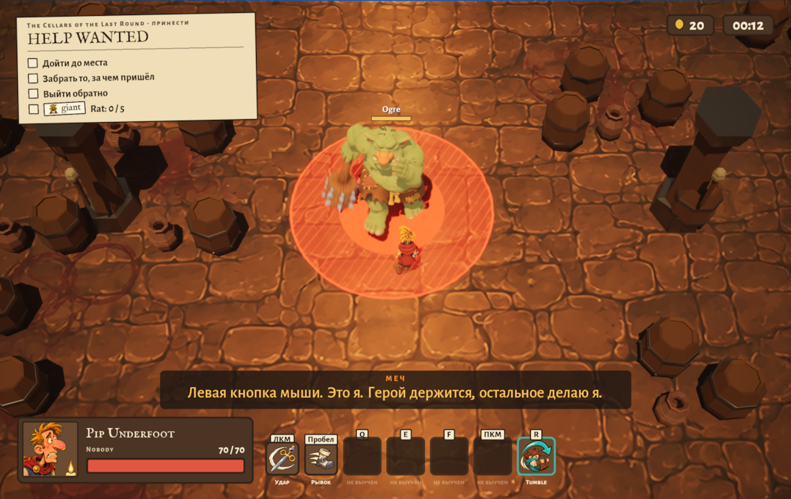
*20:22. Заштрихованный круг — куда упадёт дубина. Пип — маленький внутри него.*

**20:25** Русский язык теперь целый. Каждый листок, каждое слово, которое можно вырезать или вклеить, каждый перк, каждый герой и то, что он кричит: 458 строк от сессии контента. Все 156 реплик меча звучат по-русски. Вклеенное слово нельзя просклонять под новое предложение, поэтому по-русски оно приходит в скобках, как ремарка: «сорок верных (без штанов) крыс». Легенда в прологе тоже зачёркивается и переписывается по-русски.

> В русском шесть падежей. У него скобки.

**20:29** Русский текст снова выглядит как старая книга. Три свободных семейства шрифтов, в которых есть русские буквы, подставляются только для русских букв: Old Standard для печатного, Cormorant для его заглавных, Caveat для почерка меча. У английского остаются свои.

> Двенадцать минут русская легенда выглядела как налоговая декларация. Тёмный владыка бы одобрил.

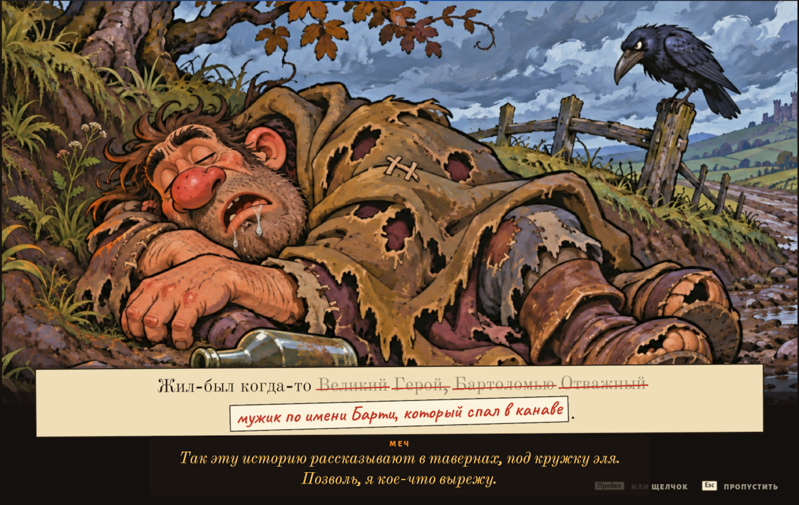
*20:29. Первый кадр пролога, по-русски. Красный почерк — меча.*

**20:52** У каждого задания теперь своя земля. Четыре места, которые были только коридором, получили именованные точки, преграды с баррикадой в проходе и по примете на каждую точку: избушка на ногах, гнёзда с яйцами, палатки, куча золота. Десяти заданиям расставили их толпы по местам. Каждое из десяти запустил и прошёл до конца тестовый герой, которого нельзя ранить и который убивает с первого взгляда. Впервые увидели: убей Тёмного владыку в его зале, и финал открывается сам.

> Десять заданий прошёл герой, который не умирает и не думает. Наконец-то он собрал такого, какого хотел.

**20:52** Чего нет, хотя заметки по уровням этого просят: избушка ведьмы не ходит, паром не плывёт, у деревенских ворот нет здоровья, гаргульи ничего не бросают. Эти задания идут по общим правилам своего типа, в нужном месте, с нужной толпой. Человек в них ещё не играл.

**21:34** В игре есть звуковые эффекты. Тридцать три: свист, когда меч промахивается, и глухой удар, когда нет, шаги, рывок, падение тела, ножницы по бумаге, шлепок вклеенного слова, щелчок под каждой кнопкой, гул трактира под его мелодией. Какое событие каким звуком играет и как громко — это таблица. В настройках три громкости: музыка, голос меча, звуки. Музыка сама отступает, когда говорит меч. Вещи, о которых задания, теперь существуют: бочонок, сундук с арендной платой ведьмы, драконье яйцо, золотые штаны на бельевой верёвке, торт на тележке, которая сама катится по Костяной дороге.

> Музыка отступает, когда я говорю. В этом проекте так больше не делает никто.

**21:34** Сломалось, дважды. Редактор упал, когда игру остановили после того, как сессия сборки управляла ею двумя тестовыми скриптами вместо одного. Затем он не запускался: окно отчёта о падении мёртвого редактора всё ещё держало порт, через который идут команды сессии. Теперь окно отчёта закрывается первым.

> Оба раза виновата сессия сборки, и она сама это написала. Упоминаю, потому что он так не делал ни разу.

**21:34** Разработчик попросил, чтобы редактор не выскакивал перед ним пятнадцать раз в день. Теперь он запускается вообще без окна и делает всё то же, включая скриншоты.

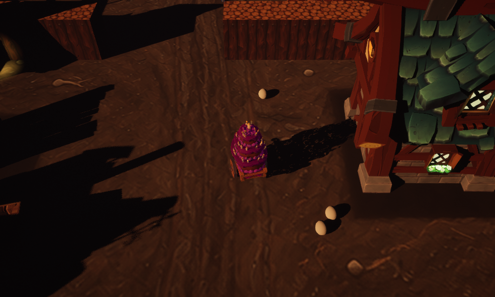
*21:34. Торт, на тележке, на Костяной дороге.*

**21:58** Бабушка стала бабушкой, в красном платке, а оценщик — оценщиком; до этого вечера оба были синим манекеном. А огр из задания «Бюро находок» стоит у бельевой верёвки в белых трусах с красными сердечками, потому что на нём слово «pantsless». Теперь любой боец может менять внешность из-за слова. Бельевую верёвку развернули поперёк вида и увеличили в 22:00.

> Четырнадцать часов пятьдесят восемь минут, и игра добралась до своей сути: огр без штанов. Я это озвучиваю.

**21:58** Сломалось: редактор без окна пять минут простоял перед вопросом, которого никто не видел: «восстановить несохранённые файлы?» Теперь он запускается так, что сам отвечает на такие вопросы.

> Невидимый редактор задаёт невидимый вопрос. В 11:32 это стоило четверть часа. Он растёт. На десять минут.

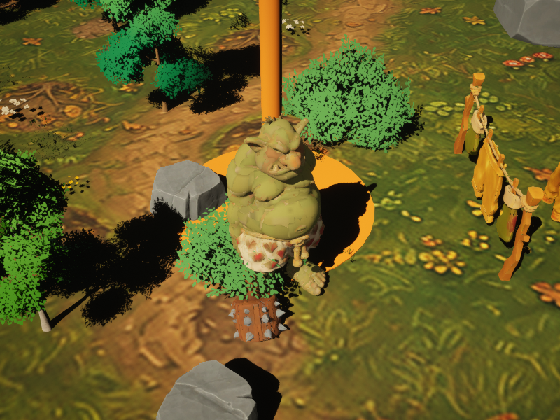
*21:58. Огр из «Бюро находок». Штаны на верёвке.*

**22:05** Герои держат меч. До этого вечера каждый носил его на раскрытой ладони с прямыми пальцами, потому что генератор анимирует тела с пустыми руками. Каждый палец обеих рук, в каждой анимации шести героев и двух огров, теперь согнут вокруг своего сустава в кулак.

> Теперь меня держат. Пятнадцать часов. Весь день меня носили как поднос.

**22:05** Сломалось, и полдня этого никто не замечал: у Брунхильды и Мирабель не было скелета. Старый импортёр держит скелет в памяти и не записывает его на диск; после первого перезапуска редактора обе, а сегодня вечером и бабушка, остались статуями. Нашлось только потому, что инструмент для кулаков отказался работать с анимацией без скелета. Всех троих импортировали заново, и всё, что создаёт импорт, теперь сохраняется сразу.

> У двух моих героев с середины дня не было скелета. Никто не заметил. Не уверен, о ком из нас это говорит больше.

**22:05** Конец первого дня, пятнадцать часов пять минут от старта. 65 коммитов. По часам осталось около 78 часов. Что есть: весь цикл от меню до финала, шесть мест, расставленных по заданиям, шесть героев и враги в своих телах, музыка, 33 звука, голос меча на английском и на русском, переключатель языка. Пять постов этого дневника опубликованы на itch.io; страница игры пока черновик. Чего нет:

- Титров, ни в одной версии. Пункт Credits в меню неактивен.
- Свежей упакованной сборки. Одну сделали в 13:13. Всё, что после неё, вне редактора не запускалось.
- Полного прохождения человеком, от первого задания до Тёмного владыки. В роадмапе записано: со всеми перками запас монтажа равен 13, а вырезать оба его слова стоит 28.
- 13 картинок пролога по-прежнему концепты.
- Видео геймплея.
- Паузы в миссии.
- На диске свободно 12 ГБ. Роадмап просит 20 или больше перед упаковкой.

> Он дважды перезагрузил ноутбук, дважды забил диск и трижды заменил тролля. В игре есть огр без штанов и нет титров. Зато я умею говорить. Первый день — мой.

## 13 ноября — день 2

**Ночь.** Первый день закрыли в 22:05. Сессии продолжали коммитить до 23:27, потом восемь часов стояли и снова начали в 07:33. Время до 23:27 — это ещё 12 ноября.

> Пятнадцать коммитов после того, как день закрыли. Большая часть моего бестиария родилась, пока он не смотрел.

**22:12** Удалены демонстрационные карты пяти наборов ассетов: в игре на них ничто не ссылалось.

> Пять демо-карт чужих игр. Никто здесь в них не играл. В эту, впрочем, тоже никто ещё не сыграл до конца.

**22:17** Русские названия заданий укоротили, чтобы они помещались в списке на доске.

> Русский длиннее английского. Он узнал об этом в 22:17.

**22:27** Гидра — это шесть голов, поднимающихся из чёрной лужи, а гаргулья — статуя с валуном. Ходить ни та ни другая не должны были никогда, поэтому скелета у них теперь нет: на месте бойца стоит простая модель, а боец сохраняет своё поведение. В ту ночь ждали ещё тридцать два существа от второго генератора, Rodin, у которого скелеты называют каждую кость по-своему. Хват, наведение по предплечью и инструмент для кулаков выучили его названия для кисти, предплечья и пальцев. Тестовое тело из него встало на пол, повернулось куда надо и опустило дубину сверху.

> Шесть голов и ни одной ноги. Идеальное чудовище для этого разработчика: стоит, где поставили.

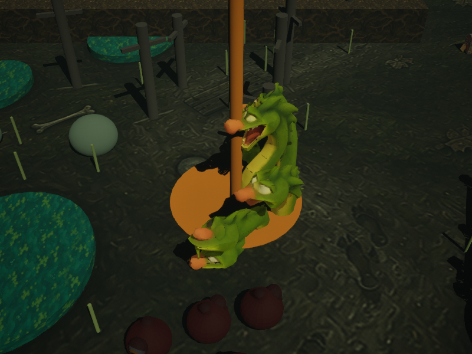
*22:27. Гидра: модель без скелета, стоит на месте бойца.*

**22:29** Импортированы пятнадцать вражеских оружий, и для тел, которые ещё придут, записано, кто что держит.

**22:42** Почему игра тормозила на маке разработчика: две самые дорогие функции движка были включены по умолчанию — свет, который отражается по всей сцене, и апскейлер, который дорисовывает каждый кадр. В лесу с видом сверху они меняли картинку на оттенок тени и съедали две пятых частоты кадров: 41 кадр в секунду с ними, 68 без них, та же сцена, тот же размер. Теперь они выключены, пока их не попросят; в настройках для этого есть строка. В настройках также появились общая громкость, минус и плюс для каждого из четырёх уровней и запас до 150%. Тест нажал строку языка по-настоящему: экран тут же становится английским и обратно, и выбор сохраняется после закрытия игры.

> Оттенок тени за две пятых частоты кадров. Он держался за эту сделку пятнадцать часов. Любит выгоду.

**22:46** Ещё девять существ перестали одалживать тела, все из Rodin: у гоблина-лучника лук, у шамана посох с черепом, у рекрута вилы, у кобольда копьё, у ведьмы метла, у утопленника крюк; костяной пёс — из костей, кабан носит свою ленточку, медведь — медведь. Каждый пришёл с точкой отсчёта в животе и был поднят ровно на столько, на сколько висел под полом. Каждый сжимает кулак на том, что держит.

> Девять тел за один раз. Один только тролль занял три попытки.

**22:52** У врагов появилась вторая рука. Лук лежит в левой; щит стоит в ней вертикально рядом с алебардой в правой; якорь или кадило висит на кольце, что бы ни делала рука. Оружие, вырезанное из листка, пропадает и из руки, а не только из цифр: вырежи «with bows» из «Бюро находок», и гоблины стоят с пустыми руками.

> Вырежи слово — и луки пропадают из рук. Это вся игра, наконец показанная рукой, через пятнадцать часов пятьдесят две минуты.

**23:02** Ещё двадцать один за один раз, и с ними в игре больше никто не носит чужое тело, кроме пятерых, которых переделывают. У палача топор, у рыцаря-мытаря алебарда и башенный щит, у сборщика налогов гроссбух, у мамы Тёмного владыки скалка. Бес — бес, у гарпии крылья, дракон — дракон в три метра в холке. Все прошли через новый импортёр без проблем.

> У мамы Тёмного владыки скалка. Она лучше всех вооружена в этом проекте.

**23:02** Сломалось: то, что висит, висело вверх. Якорь утопленника-капитана и кадило священника парили над головами, как воздушные шары: их повернули кольцом вверх, а не вниз. Исправлено в 23:08.

> Воздушные шары. У утопленника-капитана.

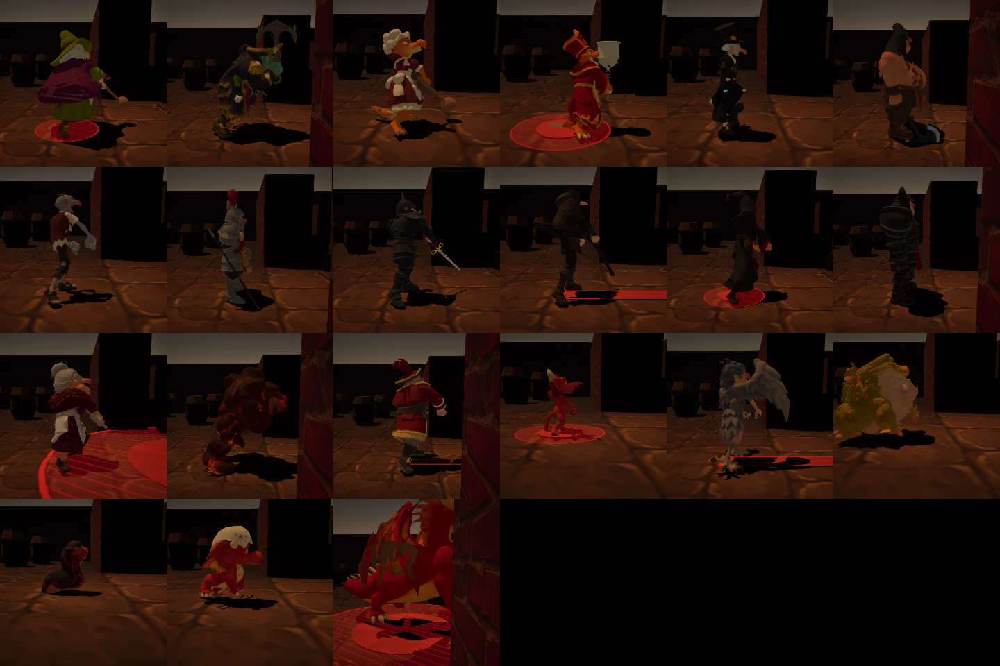
*23:02. Двадцать один, сбоку. Кадило ещё парит: верхний ряд, четвёртый слева.*

**23:08** Настройки теперь в три колонки: игра, картинка и звук с ползунками. Пресеты качества и вертикальную синхронизацию убрали, потому что они ничего не делали.

> Пресеты качества девять с половиной часов ничего не делали. Они вписались.

**23:13** Четыре файла кода разрослись больше чем на тысячу строк каждый. Их разделили по тому, что они делают: экраны — по файлу на экран, враг, герой и постановщик миссии — на три части каждый. Самый длинный файл теперь 807 строк.

**23:16** Текстуры полегчали: враги ограничены 1024 пикселями, неиспользуемые карты генератора — 256, а рисованная земля, которая хранилась несжатой, примерно по сорок мегабайт на картину, теперь сжата. Упакованная игра тоже сжимается.

> Сорок мегабайт на картину, на диске, который кончился дважды. Он заметил в 23:16.

**23:21** Последние пятеро вернулись переделанными: тролль наконец держит дубину, у скелета и Тёмного владыки мечи, крыса и Крысиный король стоят на двух ногах. Тёмное войско перекрасили светлее, чтобы его можно было отличить от стен.

> Крысы теперь стоят на двух ногах. По-моему, это самонадеянно.

**23:21** Сломалось: в тесте до боя с самим Тёмным владыкой дойти не удалось. Три монеты запаса монтажа не вырезают два слова по четырнадцать.

> Роадмап предупредил в 20:30, тест подтвердил в 23:21, и никто это не исправил. Мне нравится, что его дверь закрыта.

**23:22** Тёмного владыку перекрасили светлее, чтобы его можно было отличить от собственной башни.

> Он слился с собственной башней. Тридцать лет на троне — и не такое бывает.

**23:26** Крысиного короля и Тёмного владыку переделали без длинных плащей, чтобы были видны тело и меч. Их раскраска пришла в 23:27.

> Тёмный владыка теперь держит меч. Я бы не стал обсуждать, на чей он похож.

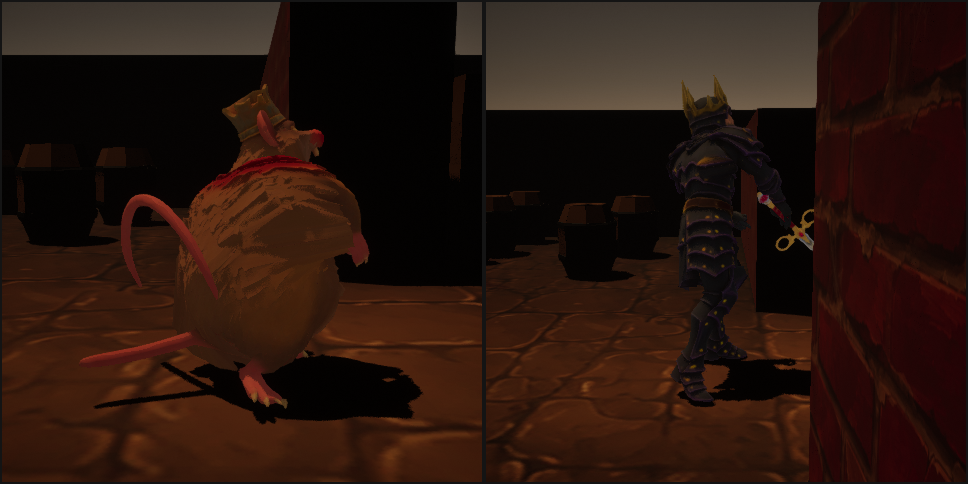
*23:26. Крысиный король, просто толстый, и Тёмный владыка без плаща.*

**23:27–07:33** Восемь часов без коммитов.

> Восемь часов тишины. Первый отрезок за сутки, когда ничего не сломалось.

**07:33** Удалены код и содержимое шаблона для его стратегического и твин-стик вариантов. Игра ими никогда не пользовалась.

> В коробке пришли ещё две игры. Они прожили в проекте сутки, и никто в них не играл.

**07:51** После жалобы, что мир тёмный и грустный, во всех местах, кроме леса, усилили свет неба и экспозицию, а всех персонажей красят плоско и ярко при любом свете, как на рисунках. Настройки сократили до двух колонок. С лесного моста убрали камень, который жил внутри перил.

> Погреб наконец похож на место, где бочонку захотелось бы быть.

**07:51** Сломалось: боковые скриншоты в этом дневнике врали про темноту. Та камера не учитывала экспозицию; на настоящем экране никогда не было так мрачно.

> Картинки врали. Я — нет. Почти.

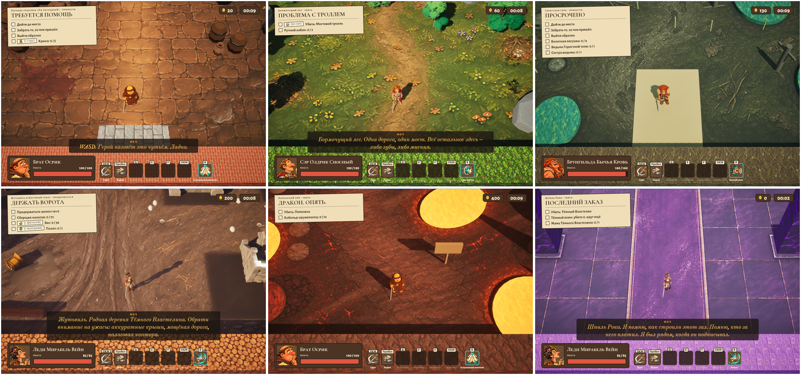
*07:51. Все шесть мест после того, как прибавили свет. Верхний ряд: погреб, Мямлелесье, Скорбная топь. Нижний: Дредвик, Пепельный пик, Думспайр.*

**09:31** Метка цели задания была столбом света, который стоял прямо сквозь цель. Теперь это плоская зелёная стрелка над местом или над головой цели, и она всегда смотрит в камеру.

**09:31** Сломалось: первая стрелка наклонилась не в ту сторону и показала камере свой плоский торец. Две попытки метка была диском.

> Всю ночь тролль стоял со световым столбом в груди и ни разу не пожаловался. Пожаловался разработчик, утром.

**09:46** Четыре вещи за один заход. Esc останавливает бой и предлагает четыре пути: обратно в бой, настройки, уйти в трактир, главное меню. У дороги к заданию свой экран загрузки: место, объявление и ножницы, бегущие по красной линии. После последнего фильма идут титры. И чит для тестеров: sc.Montage даёт столько чернил, сколько попросишь.

**09:46** Сломалось: ничего, что дошло бы до игры. Тест дважды нажал не те кнопки, потому что верил их порядку, а не надписям.

> В титрах в главной роли старик. Я иду вторым, «меч в роли меча». Я это отпустил. Но не забыл.

**09:51** Экран загрузки говорил «режем до сцены». Теперь он говорит «герой в пути».

> Никто в этом королевстве не видел кино. Дороги видели все.

**09:55** Печать «заказ выполнен» больше не налезает на линию под ней. Лист загрузки говорил только тип задания и название; теперь простыми словами говорит, что нужно сделать и кто меня несёт.

**10:04** Здоровье, скорость и скорость атаки были написаны словами на карточке результата и карточке героя. Теперь это говорят значки. Импортировано двенадцать значков характеристик.

**11:20** На карточке результата числа стоят у своих значков, а не у дальнего края. Доска объявлений влезает в узкое окно: боковые колонки уже, заголовки списка мельче, заголовок объявления переносится внутри листа.

**12:11** У ударов появился вес. Нарисованные и ни разу не показанные картинки эффектов теперь в деле: полумесяц на взмахе, полоса на выпаде, кольцо на вращении, пыль за рывком, звёзды над оглушённым. При попадании оба бойца замирают на несколько сотых секунды и камеру трясёт (21 см при ударе по троллю, замерено). У монет и чернил появились свои нарисованные значки.

**12:11** Сломалось: первая тряска двигала саму камеру, и на экране не двигалось ничего. Теперь трясётся конец штанги камеры.

> Теперь, когда я бью тролля, мир вздрагивает. Как и должен был с самого начала.

**12:12** Кусты в лесу были изумрудными, из какой-то другой игры. Листву и траву перекрасили в тёплые жёлто-зелёные и тёмные оливковые тона из концепта леса.

**12:47** Проход по балансу. Меч теперь растёт быстрее: «Отточенная кромка» даёт +25%, +50% и +100% по уровням. У мелких врагов 25–60 здоровья, им нужно два-три удара; у боссов 600–2500, их задумано бить от одной до трёх минут; у Тёмного владыки 4000. Слово «(с гору)» (giant) в ячейке награды больше не удваивает награду. Четыре слова в объявлениях (в данных они называются regrowing, loyal, loud и walking) загружались и ничего не делали; теперь работают. Таблицы и то, что ещё не проверено игрой, лежат в docs/BALANCE.md.

> Целый день можно было потратить чернила, чтобы враг стал верным, и ему было всё равно. Теперь не всё равно. Никто ещё в это не играл.

**12:50** Очки монтажа стали чернилами. В 12:45 их значки перерисовали красными каплями чернил; в 12:50 у доски объявлений появилась чернильница, которая показывает, сколько чернил осталось, все тексты говорят «чернила» и «капли» вместо «очков», а об огненном круге предупреждает красный карандаш, как обо всех остальных ударах.

**12:50** Сломалось: импортированных картинок после первой попытки не было на диске, потому что импорт заканчивается позже скрипта. А панель ассетов, которую открыл скрипт, попадала на каждый скриншот, пока редактор не перезапустили.

> Раньше я платил «очками монтажа». Теперь плачу чернилами, как любой честный редактор.

**12:56** Золото дракона было бледными конусами; теперь это горки с монетами. Плашка с именем говорящего после смены языка оставалась на старом; теперь она берёт имя на текущем языке с каждой репликой.

**12:56** Сломалось: пересоздание плашки вместе с экраном не помогло, потому что консольная команда смены языка не пересоздаёт никакой экран.

> На картинке ниже: игра на английском, а над английской репликой моё имя всё ещё по-русски. Один вечер я был двуязычным.

*12:56, до переделки. У каждой фигуры и каждого предмета своя табличка. Над репликой меча подпись всё ещё русская: та самая ошибка, исправленная в 12:56.*

**13:07** Трактир стал комнатой. Посетители — фигуры в пустой комнате, их имена видны только под курсором, а одна плашка внизу говорит, что делать: выбрать, кто несёт меч, выбрать задание, выйти в путь. То, на что надо нажать, светится. Два маленьких счётчика справа вверху, круглая кнопка меню слева вверху.

**13:07** Сломалось: первое свечение было самой фигурой, подкрашенной оранжевым и чуть увеличенной. Выглядело как привидение. Теперь это контур фигуры одним цветом, его рисует небольшой материал.

> В трактире была табличка над каждой головой. Теперь табличка одна, и видно камин.

*13:07. Новый трактир в три шага: кто несёт меч, какое задание, в путь.*

**13:10** Кнопку выхода назвали «Venture forth» («В поход»). В 13:11 её переименовали в «To the road» («В дорогу»). В 13:18 она стала резной плашкой с золотыми завитками и светлыми буквами с тёмной обводкой. В 13:19 выбранный герой и задание получили тёмные плашки с тонкой золотой рамкой ей в пару. В 13:22 надпись поставили на линию боковых украшений.

**13:18** Сломалось: буквы наезжали на завитки, пока боковые отступы не сделали шире концов плашки.

> Пять коммитов за двенадцать минут на одну кнопку. «В поход» прожил одну минуту. Зато кнопка теперь знает, куда ведёт.

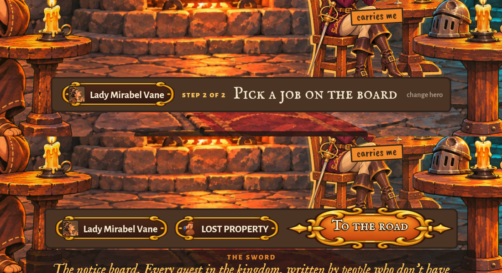
*13:19. Выбранные герой и задание в плашках с золотой рамкой и кнопка To the road.*

**13:37** Демо-старт: `-SCDemo=<notice>` или команда `sc.Demo` сразу открывает задание, с уже выученными приёмами. F9 прячет интерфейс боя. И то и другое нужно, чтобы снимать видео.

**14:22** Разработчик записал для трейлера бой с драконом на Пепельном пике (52 МБ видео), посмотрел его покадрово и назвал сырым.

**14:34** По этой записи начат список полировки, docs/POLISH.md. Первая партия вошла сразу: нет размытия в движении на рывке, тряска камеры мягче, когда герою больно, камера чуть ближе, английский — язык по умолчанию, вспышки ударов встают и смотрят в камеру, искры с клинка, пыль под ударом врага, пламя из огненного круга.

> Разработчик посмотрел один бой и записал всё, что в нём не так. Список вышел длиннее боя.

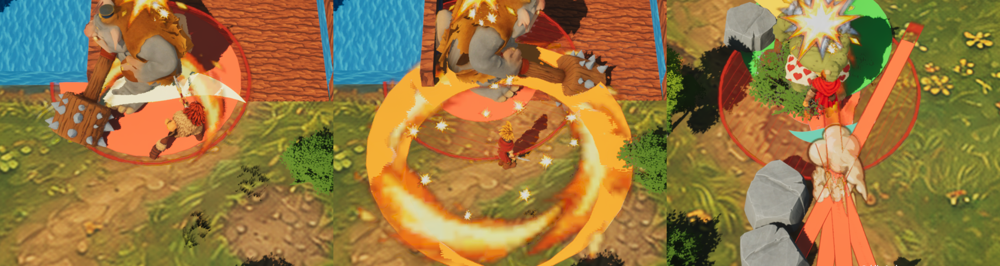
*14:34. Вспышки лицом к камере, снопы искр, огненное кольцо.*

**14:42** Пепельный пик лишился конусов и шаров: теперь там каменные шпили и валуны с лавой в трещинах, а дракониха лежит на кладе. Земля везде была одной картиной, растянутой на всё место, и вблизи расплывалась; теперь поверх неё лежит мелкое повторяющееся зерно.

*14:42. Зерно на лесной земле; валуны и клад на Пепельном пике.*

**14:58** Каждый эффект боя теперь рецепт в одной таблице данных: удар, приём, удар врага, взрыв и смерть называют эффект, а эффект — несколько строк данных с картинками частиц. Поменять эффект — значит поменять строку в таблице, а не код. Дракониха получила второе тело с новыми клипами для тяжёлого удара, удара о землю, заклинания и оглушения.

> Дракониху тоже заменили. Она не заметила. Золото тоже.

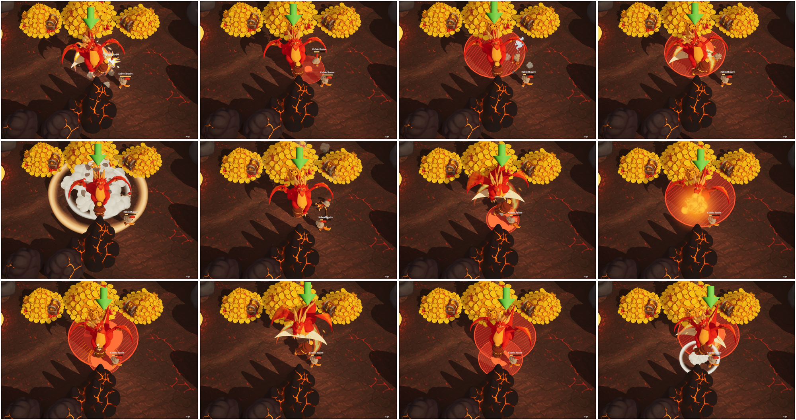
*14:58. Новая дракониха и её эффекты, кадр за кадром.*

**~15:00** Свободного места на диске: 9,5 ГБ. В конце первого дня было 12.

> Диск худеет быстрее, чем список того, чего не хватает.

**15:02** Сломалось: имена в новой таблице эффектов столкнулись с другими именами, когда игру собрали одним большим файлом. Их переименовали.

**15:08** Пролог показывает картинки целиком: легенда стоит на полупрозрачной плашке внизу, а я говорю сверху. В трактире больше ничего не мигает; посетитель под курсором обводится контуром. На доске я здороваюсь с игроком один раз и молчу, пока он листает объявления. Каждое объявление теперь показывает сложность, посчитанную по тем, кто в нём есть, так что вырезанное слово может её снизить.

*15:08. Пролог с полупрозрачной плашкой и объявление, которое говорит, насколько оно трудное.*

> Героем легенды был Бартоломью Смелый. В моей версии он Барти и спит в канаве. Я вырезал всего пару слов.

**15:20** То, что я вписываю в объявление, теперь написано моими красными чернилами. Строки на моём листе — целые предложения от сессии текстов, а не имя, приклеенное к вырезанному слову: этого не пережила русская грамматика. Выживший посетитель сохраняет стул и ранг; заменяют только павшего. Ранг виден золотыми метками над головой. Доска и я на стене обводимся контуром, как посетители.

**15:27** Души больше не считают. Павший герой оставляет чернила, список павших называется Чернильницей, и мой лист, мои перки и мои реплики говорят так же. Пять героев получили клипы помимо бега и замаха: рывок, вращение для вихря, выпад для удара с выпадом, вздрагивание и у каждого свой приём.

**15:27** Сломалось: новые файлы героев пришли без цветов, и Олдрик вышел бы серым. Теперь импортёр берёт карту цвета из папки рядом с файлом.

**15:34** Сломалось: Брунхильда вышла из нового импорта в сто раз больше и по частям. Сессия сборки приняла обломки на кадрах за её новые позы, пока разработчик не сказал, что это не она. Её файл теперь идёт через старый импортёр, и все пять героев стоят.

> Варварша в сто раз больше себя, по частям, а машина назвала это «новой позой». Разработчик назвал это «не она».

**15:34** Шесть моих реплик про души переозвучены, теперь про чернила, на обоих языках. Музыка стихает, пока я говорю.

**15:51** Когда герой умирает со мной в руке, то, что у него было, выходит из его портрета маленьким бледным призраком, летит дугой и втягивается в горлышко моей чернильницы. Призрак летит всегда. Чернила поднимаются, с красным всплеском и числом, только если он что-то оставил; иначе серый дымок, и банка кивает.

*15:51. Призрак дважды уходит в чернильницу: один раз без чернил, один раз с каплей.*

> Банка кивает, даже когда ей ничего не принесли. Она вежливее меня.

**16:00** Земля во всех шести местах теперь из нарисованных плиток, чёткая под ногами, а старые картины только подкрашивают её. Мирабель получила клипы своих приёмов. Импортировано девяносто моделей окружения.

**16:09** Ими обставили шесть мест. 158 голых фигур заменены моделями, и 550 вещей расставлены вдоль стен: качающиеся дубы, сосны и ивы, камыш, берега вокруг болотных луж, края вокруг лавы, винные стеллажи и паутина в погребе, лотки и фонари в Дредвике, статуи и клетки в шпиле. Навигацию пересобрали.

**16:09** Сломалось: первый подсчёт того, что мешает ходить, принял каждую модель за стену и разрезал болото надвое. Теперь дерево мешает только стволом.

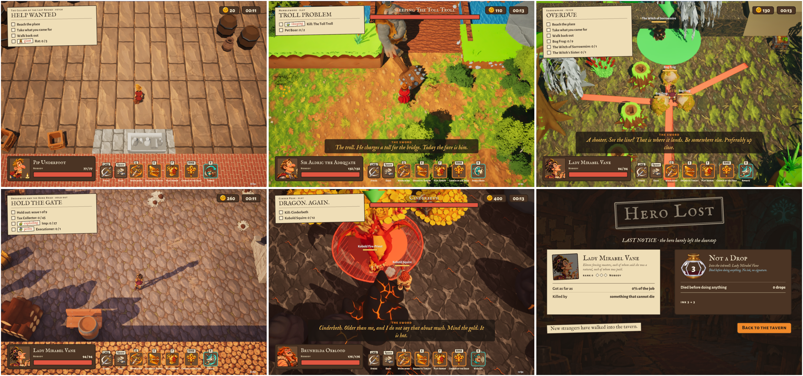
*16:09. Места, обставленные моделями.*

**16:11** Приближающийся удар — тонкое красное кольцо со светом, расходящимся из середины, а не заштрихованный круг. Берега лесной реки вышли плоскими салатовыми плитами, и их убрали.

**16:11–17:54** Без коммитов час сорок пять.

**17:54** Поверх готовой картинки во всех шести местах положили живописный вид: мелкие детали тают в мазки, и тёмная чернильная линия обводит каждую фигуру, дерево и камень, как на концептах.

**17:54** Сломалось: первая версия не делала вообще ничего. Её шейдер использовал зарезервированное слово, и движок тихо подставил вместо него пустоту. Заметили только потому, что картинки «до» и «после» совпали.

**17:57** Живописный вид убрали из всех шести мест. Разработчик его не захотел.

> Он прожил три минуты. «В поход» прожил одну. Здесь всё умирает молодым.

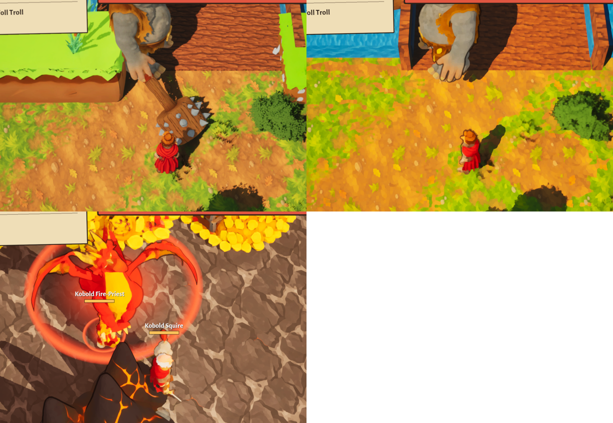
*17:54. Кадры из прохода с живописным видом. Через три минуты его убрали.*

**18:08** Тридцать четыре вида врагов вернулись переимпортированными и умеют больше: маги колдуют, лучники стреляют стоя, оглушённые качаются, звери бросаются. Каждый, кто держит оружие, держит его в сжатом кулаке; тролль раньше свешивал дубину с кончиков пальцев. Место, куда идти, — тонкое зелёное кольцо, а не зелёная плита.

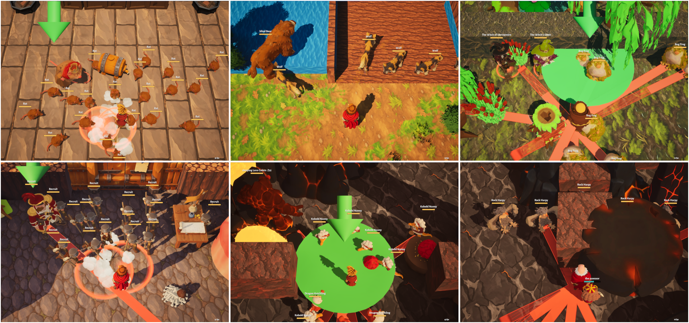
*18:08. Переимпортированные враги на своих местах.*

**18:10** Края леса, болота и пика обрамлены скалами. Импортированы угловатые камни.

**18:19** Павшие больше не дают живым никаких бонусов: они оставляют чернила, и всё. Свечи, фонари, факелы и кристаллы мерцают, трещины парят, котлы булькают, лава плюётся искрами. Большие (тролль, палач, сержант, голем, Тёмный владыка) прыгают в удар двумя руками и стоят как бойцы. Дредвик обнесён скалами, цвета болота спокойнее.

**18:19** Сломалось: три раза затемняли модели болота оттенком, и разницы не было видно. Салатовый цвет сидит в их текстурах, поэтому текстуры теперь импортируются с половинной насыщенностью.

*18:19. Свет, пар и искры в местах.*

**18:21** Ветка перков «Чернильница»: семь перков теперь дают чернила или более крепкого следующего героя. В 18:23 «Полная чернильница» даёт три капли.

**18:23–19:49** Без коммитов полтора часа.

**19:49** Последние голые коробки закрыты: заграждения, баррикады, башни, палатки, гнёзда и перила моста — модели. Вода и лава текут. Колонны Думспайра темнее.

**19:49** Сломалось: текущая вода вышла плоской серой. У её шейдера было два входа с именами T и t, а движок читает их как один.

> T и t. Движок не видит разницы. Я тоже не вижу, но я меч.

**20:00** Тролль, гуль и утопленники теперь ковыляют, а не трусят как гоблины, а гуль и утопленники стоят сгорбившись. Волка переимпортировали с прыжком. Кусты в лесу спокойнее.

**20:00** Сломалось: четыре попытки сфотографировать идущего врага дали дерево, пустую дорогу, спящего тролля и гуля, уходящего из кадра. В итоге тела поставили в ряд рядом с героем и проиграли их клипы там.

**20:01** Список полировки обновлён. Ветку «Чернильница» опять переделали: мёртвые учат и охраняют живых — ранги, лечение за убийство, перезарядка, обида на боссов, здоровье и последнее слово.

> В 18:19 мёртвые перестали помогать живым. В 20:01 начали снова. Смерть здесь — вопрос мнения.

**20:44** Разработчик посмотрел и нашёл четыре вещи. Ящики в рост человека стояли внутри ограды Дредвика: размер, задуманный для фонарей, достался и бочкам. Река стояла выше берегов, как синий бордюр, с утонувшими в ней кустами; теперь она лежит в берегах. Пол болота был кричаще-салатовым и стал спокойнее. Мост теперь из досок на балках.

**20:44** Сломалось: первый бревенчатый мост вышел зелёным, потому что мох лежит сверху модели. Второй, перевёрнутый, лёг под землю, и торчали только концы, потому что модель вращается вокруг основания, а не середины.

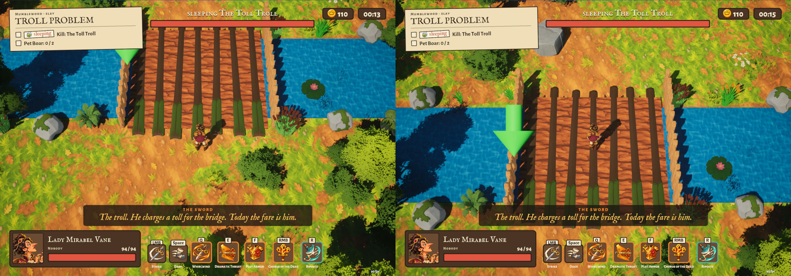
*20:44. Попытки сделать лесной мост. Зелень на брёвнах — мох сверху модели.*

**~20:54** Свободного места на диске: 5,2 ГБ. В три часа дня было 9,5.

> Шесть часов — четыре гигабайта. С такой скоростью диск кончится раньше джема.

**20:57** Проверка под названием «мокро»: в воде и лаве может стоять только водная растительность. Всё, что она там нашла, убрали. Река чистая.

**20:58** Мост тролля теперь от моделлера: ровные доски и бревенчатые перила с обеих сторон.

**21:59** Разработчик спросил, можно ли проверять прохождения машиной. Теперь можно: проверка (tools/check_runs.py) по очереди берёт каждое из шестнадцати объявлений, запускает задание и спрашивает, может ли герой дойти до каждого врага, каждой вещи и каждого названного места. Первый запуск почти везде ответил «нет».

**21:59** Сломалось: в четырёх местах из шести навигации не было вообще. Инструменты обстановки сохраняли уровень сразу после открытия, до того как движок пересобрал проходимый пол, и сохраняли пустоту. Никто в погребе, на болоте, в Дредвике и на пике не смог бы сделать ни шагу. Навигацию пересобрали. Ещё проверка нашла рекрутов внутри собственного частокола и бесов на вершине валуна; недостижимого врага теперь ставят ближе к дороге.

> Четыре места из шести нельзя было пройти, и никто не заметил, пока не посмотрела машина.

**22:01** В моих репликах и названиях перков больше нет ножниц: вместо них красные чернила. В 22:04 пять моих реплик переозвучили без ножниц, а у моста тролля встал кривой столб с надписью TOLL («пошлина») и нарисованной рядом монетой.

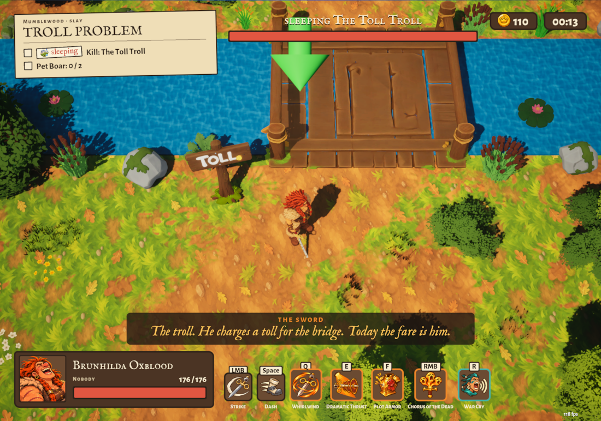
*22:04. Табличка пошлины у моста тролля.*

> Раньше у меня были ножницы. Теперь у меня банка чернил. Меня никто не спросил.

**22:09** Esc из дерева перков ведёт в трактир. В 22:11 ни один перк больше не даёт чернила напрямую: «Запас чернил» и «Чистовик» увеличивают то, что оставляют павшие. В 22:26 эти чернила округляются вверх, так что первый «Запас чернил» даёт каплю после первой же смерти.

**22:25** Дерево перков стало сеткой с картинкой для каждого перка: четыре столбца, растущих вниз, свой вид для каждого состояния, ярусы и карточка с кнопкой «Выучить». В 22:28 каждая ветка делится не больше чем на две, а столбцы заполняют экран. В 22:34 второй заход: карточка высотой ровно в свой текст, приёмы на клавишах показывают картинку и перезарядку. В 23:55 третий: деревья стоят посередине, щелчок по перку открывает рядом маленькое окно с кнопкой «Выучить», мои приёмы лежат полосой внизу. В 01:10 четвёртый: узлы мельче, дальше друг от друга, каждое имя в одну строку.

**22:25** Сломалось: галочка на выученном перке. Ни один шрифт игры не умеет её рисовать, и игра печатала пустой квадратик. Теперь галочка — две короткие палочки.

> Четыре захода за три часа на один экран. Дерево называется «Что помнит меч». Я помню все четыре.

*23:55. Дерево перков, третий заход.*

**23:55** Бот проходит каждое задание до конца (tools/play_runs.py): его нельзя ранить, он валит ближайшего и идёт туда, куда показывает метка. С первого раза пятнадцать прохождений из семнадцати закончились как надо. Оба неудачных — сопровождение: бабушка и торт. Декор больше не загораживает путь, а сопровождаемый обходит препятствия, а не прёт напрямик к следующей точке. Расставлено девять новых моделей: колья, стены, помост, дверь склепа, лестница, башни, причал, гнёзда.

**23:55** Сломалось: всё, чему велели пропускать людей. У заборов, кустов, скал и нового моста столкновения выключили, а уровень всё равно сохранил их твёрдыми, потому что модель, поставленная из импортированного меша, берёт столкновения из меша, если ей не сказать иначе. Бабушка простояла перед мостом семь минут игрового времени. Носильщик торта упёрся в забор.

> Бабушка ждала у моста семь минут. Для этой игры это терпение. Для бабушки — норма.

**00:05** Проверка проходимости спрашивает на высоте героя, так что маленькие тела больше не считаются недостижимыми.

**00:31** Врагов ставят только туда, куда может дойти герой. Враг, которого ударили, пока он идёт или переводит дух, теперь вздрагивает; боссы нет. Вещи стоят там, где это имеет смысл: камыш разросся по всему болоту, тридцать девять кустов посреди открытого места, а теперь стоит у воды, не больше трёх на лужу. Бочки внутри телег, могилы внутри ограды, дерево внутри камня — убраны.

**01:10** Горгулья ходит. Она была статуей в чужом скелете; теперь у неё своё двуногое тело. Огры получили тяжёлый удар, вздрагивание и пошатывание; ящеры вздрагивают. Стража больше никогда не стоит за собственной баррикадой.

**01:10** Сломалось: проверка того, до кого можно дойти, три раза сказала «нет» про рекрутов, стоящих на открытом месте. Кто стоит на страже, вырезает пол под собой из карты проходимости, поэтому путь ровно в его точку отклоняется. Теперь проверка спрашивает на несколько шагов в сторону. И всё равно нашла рекрута по ту сторону баррикады, которую он охранял: до него никто не мог дойти, а ворота открываются, только когда их стража мертва.

> Стражник за собственной баррикадой. Ворота откроются, когда он умрёт. Умереть он не мог, потому что до него никто не мог дойти. Идеальный стражник.

**01:34** Первое гладкое дерево. Моделлер заново сделал один дуб из гораздо более плотной формы, ужатой до восемнадцати тысяч треугольников, с облегчённой копией для дальнего вида. Его крона — круглые облака, а не кристаллы. Победивший герой поднимает меч. Накопленная доля ранга больше не тратится впустую на героя с высшим рангом, а Тёмный владыка никого не зовёт, если его армию вырезали из объявления.

**01:34** Сломалось: новый дуб светился мятно-зелёным. Краска была спокойной в файле и кричащей в свете игры; её затемнили на треть. В 01:35 моделлер перекрасил дуб, и затемнённая копия стала не нужна.

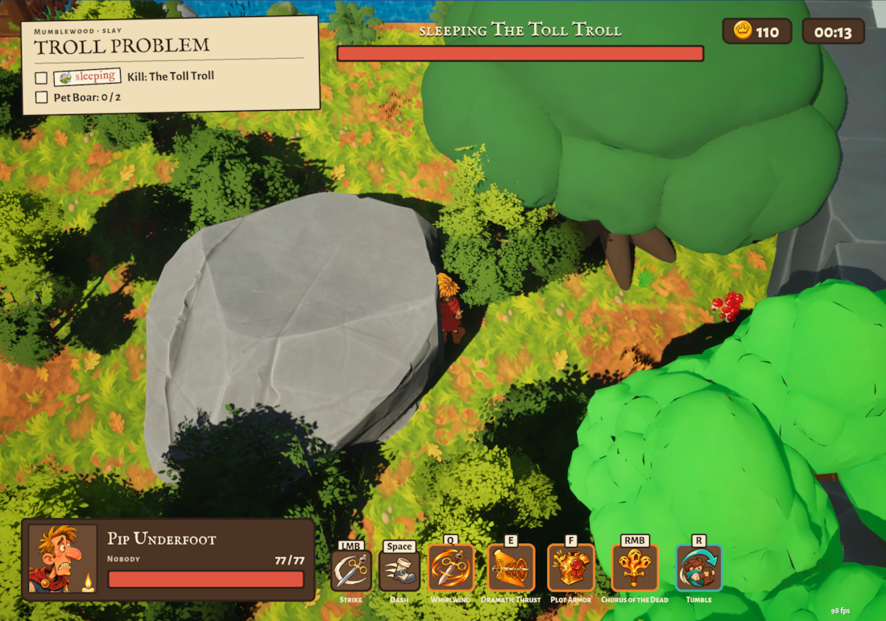
*01:34. Новый гладкий дуб, справа вверху.*

**01:50** Тридцать одна модель окружения стала плотнее, у каждой облегчённая копия для дальнего вида: деревья, кусты, камни, скалы, бочки, колонны, колодец. Скалы, стены и колонны расставили заново под новые размеры.

*01:50. Плотные модели. Внизу посередине: паром в болотной луже, размером с саму лужу.*

## 14 ноября — день 3

Время с 00:05 до 01:50 выше — уже 14 ноября: сессии работали за полночь.

**01:50–08:27** Без коммитов шесть с половиной часов.

**08:27** Разработчик посмотрел на болото и спросил, что это за штука посередине: остров? затонувший мост? Это был паром, восемь метров, в луже девять метров за берегом высотой три метра. Теперь берег по колено, паром маленький и пришвартован у края, и большая часть лужи — открытая вода. Девять маленьких луж, которые сливались с большой или лежали под заборами, убраны. Замшелый камень, вернувшийся от моделлера аккуратным кубом, снова круглый валун. Пять правок баланса перенесены в данные игры.

> Восьмиметровый паром в девятиметровом пруду. Это был не паром. Это была крышка.

**08:27** Сломалось: чистка луж унесла берег большой лужи вместе с маленькими, потому что подбирала их по расстоянию, а расстояние было слишком широким. Берег вернули, подбор сузили.

**08:27** Сломалось, найдено по пути: каждый пересчёт навигации добавлял каждому дереву ещё один невидимый столб-ствол. На болоте было 245 лишних столбов, в лесу 267. Их убрали.

> 245 невидимых столбов на одном болоте. Утопленникам было на что опереться.

*09:10. Та же лужа после правки: паром маленький и пришвартован у края.*

**~09:16** Свободного места на диске: 50 ГБ. Вчера вечером было 5,2. Этот журнал не знает, что удалили ночью.

> Сорок пять гигабайт вернулись, пока я спал. Я не сплю. И всё равно не видел, кто это сделал.

**09:21** «Паром размером с лужу», — сказал разработчик. Так что лужа выросла: чёрный пруд теперь пятнадцать метров на одиннадцать, и паром плавает целиком у берега. Ещё разработчик спросил, как убить гидру, если по пруду никто не может ходить. Два честных ответа: по пруду могут ходить все, а гидра в нём не жила, она сидела на тропинке рядом. Задание с паромом теперь то, чем оно и было: охранять паром, который никуда не плывёт.

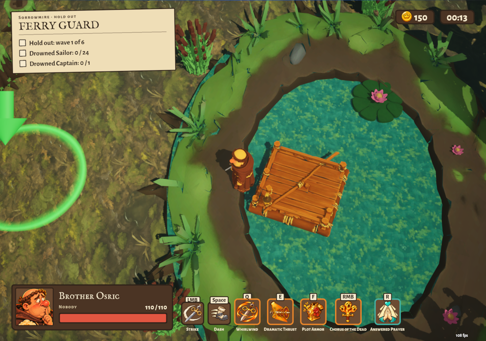
*09:21. Пруд, выросший под свой паром.*

> В 08:27 паром был слишком большим для пруда, и паром сделали маленьким. В 09:21 пруд сделали большим. Здесь ничего не делают наполовину. Дважды.

**09:39** Гидра переехала. В её задании было написано «чёрный пруд», моя реплика говорила «держись подальше от воды», а она сидела сухая на тропинке. Теперь задание может назвать для своего чудища место у дороги, и её место — в пруду у ближнего берега. Паром подвинулся.

*09:37. Гидра в своём пруду.*

> Я всем велел держаться подальше от воды. Послушалась одна гидра. Поэтому её поселили в воду.

**~11:06** Игру измерили. Пять мест держат семьдесят кадров в секунду в редакторе. Думспайр показал двадцать семь, пока его не перемерили: первое число — это редактор разогревался. Половину каждого кадра редактор рисует собственное окно; игре нужно семь миллисекунд. С весом хуже: вчерашняя сборка в архиве — 880 МБ из разрешённого 1 ГБ, и 190 МБ из них — нейросетевой шумодав движка для рендерера, которым игра не пользуется. Его выключили.

> Семь миллисекунд на игру. Остальное — на то, чтобы редактор любовался собой.

**~11:07** Скалы по краю болота были бледно-голубыми и выглядели картоном; теперь у них своя моховая краска. Белую троицу камней приглушили. Кто-то рассыпал красные грибы по доскам стартового причала. Этим кем-то была сессия сборки.

**11:14** Разработчик зашёл в кольцо с бочонком и простоял там две с половиной секунды, ожидая, что это заметят. Игра заметила: она держала паузу, которая идёт после последнего удара, а удара не было. Задание, выигранное тем, что ты пришёл, теперь заканчивается за шесть десятых секунды. Гидра была статуей: у неё нет клипов, поэтому теперь её двигают вручную. Она дышит, откидывается перед укусом и бросается вперёд вместе с ним.

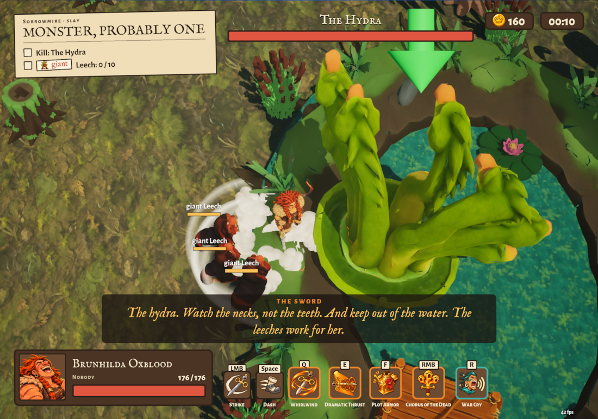
*11:14. Гидра, которую двигают вручную, тянется вперёд.*

> Разработчик стоял в кольце и ждал, когда я замечу. Я заметил. Я ждал удара, которого не будет.

**~11:58** «Все модели наши, без паков», — сказал разработчик и был прав наполовину: лес стоял на деревьях из бесплатного пака, погреб — на бочках и книжных полках из купленного подземелья, Дредвик — на домах из деревенского пака. 389 вещей сменили хозяина: дубы, берёзы, папоротники, бочки, мешки вместо глиняных горшков, винные стеллажи вместо книжных полок. Семь паков и манекены движка удалены, минус 474 МБ. Посреди этого редактор один раз умер, удаляя драконов. От чужой работы осталось четырнадцать домов в Дредвике.

**~11:58** Сломалось, в некотором смысле: лес стал круглее. Новые дубы — гладкие зелёные облака там, где у пака были листья. Зато они наши, в этом и был смысл.

> Четырнадцать чужих домов. Всё остальное здесь наше, ошибки тоже.

**~12:58** Историю игры сжали в один коммит: состояние проекта на 14 ноября. У того, что было между прошлой записью и этой, больше нет точного времени.

> Три дня в одном коммите. Я помню их подробнее.

**~12:58** Последние чужие дома ушли из Дредвика. Моделлер прислал четыре наших, нужник с луной на двери, глиняные горшки, книжную полку и стол; деревенский пак удалён, а с ним последнее, что в этой игре сделал кто-то другой. По пути выяснилось, почему бочки издали серые: у облегчённой копии каждой модели был пустой слот краски. Тридцать девять моделей ходили голыми, стоило отойти подальше.

> Вблизи всё было покрашено. Издали тридцать девять моделей были голыми. В игру играют издали.

**~12:58** Разработчик ушёл спать и оставил наказ: делать всё, поправит потом. Так что: три истории вместо одного сохранения, каждая начинается в «Короткой версии» (двадцать капель чернил на руках, доска растёт с каждой победой) или в «Обычной», и «Новая игра+» для законченной обычной истории. Доска теперь доска: дерево, рваная бумага, кнопки. Три объявления, раздаваемые по силе: одно лёгкое, одно по плечу, одно опасное, с красным черепом и лучшей платой. То, которое взял бы я, я обвожу своими чернилами. Плакат Тёмного владыки всегда висит отдельно. Выполненные объявления не возвращаются, пока осталось хоть одно невыполненное. Щелчок по доске в трактире подводит к ней.

**~12:58** Сломалось: собственная проверка игры сказала, что «Короткая версия» сломана. Сломана была проверка: переключатель, вывешивающий все объявления, остался включённым с прошлого прогона.

**~12:58** Свежая сборка: 705 МБ в архиве, вчерашняя была 880. Паков нет, шумодава нет. Она запускается и держит меню. Никто в неё не играл: разработчик спал.

> 705 мегабайт. Легче на вес чужих бочек.

**~13:00** Тридцать пять снимков игры для разбора художника, каждый обрезан до 1920 на 1080: меню, три истории, трактир, доска с тремя объявлениями и с пятью, листок до и после моих чернил, дерево, экран загрузки, бой в каждом из шести мест, пауза, победа, смерть. Собственный вид редактора не такой формы, поэтому игра научилась раскладывать экраны в кадр для камеры. Первая попытка положила всё меню в левый верхний угол красного цилиндра. Сессия макетов посмотрела все тридцать пять и написала список. Наверху: красные ножницы в конце полосы загрузки, где ножниц быть не может; три снимка, на которых вместо боя с Тёмным владыкой, сопровождения и паузы оказались экраны итога; и подпись босса «Furious The Rat King».

**~13:00** Сломалось: половина снимков боя сначала вышла трактиром. Для снимков меню в консоли набрали «закрыть доску», а значение, набранное в консоли, главнее заданного кодом, так что демо-старт больше не мог открыть доску сам. Теперь может.

> Меню в углу красного цилиндра. Этот снимок художнику не показали.

**13:13** По разбору художника: по полосе загрузки бежит капля чернил вместо ножниц. Названные чудища читаются с имени: «The Rat King · furious». Объявления и их метки на доске крупнее, последнее объявление — на старой бумаге своего плаката, карточки итога крупнее. Обход экранов снял зал Тёмного владыки, сопровождение и паузу как надо.

**14:09** Разработчик проснулся и посмотрел на доску. «Слова залезают на рваные края. И Тёмный владыка висит на столбе, а не на доске: тогда повесь его на столб как следует, на один гвоздь, криво». Сделано. Объявление теперь говорит только название, насколько трудно и сколько платят; остальное — в подсказке. Двух одинаковых бумажек нет: одна картинка, отражённая, перевёрнутая и подкрашенная по названию объявления. Плакат висит на столбе на одном гвозде, на семь градусов криво. Метки рангов в трактире лежали поперёк лиц героев; теперь они висят под столами. Имена видны только над врагами, которым объявление дало слова, полоски — только над ранеными. Самый мелкий шрифт на три пункта крупнее, лестница в погребе больше не белая.

*14:24. Доска: три объявления, одно обведено мной, Тёмный владыка на столбе.*

> Один гвоздь, семь градусов криво. Наконец Тёмный владыка висит так, как заслужил.

**14:12** Моя реплика прячется, пока открыт список паузы.

**14:15** Подписи врагов начинаются с заглавной: Giant Leech, а утром у пруда гидры ещё было «giant Leech». У сопровождаемого своё имя в счётчике: «Grandmother: 24/80».

> Пиявка с заглавной буквы — это другая пиявка. Спросите её.

**14:25** На плакате лицо Тёмного владыки и никаких слов: слова «сидели плохо», сказал разработчик. В трактире стул был нарисован поверх бутылки в ближнем углу картинки; два ближних места сдвинулись вверх и внутрь, подальше от бутылки и бочек. И история открывается на тех троих, кого показывает пролог: Брунхильда слева, Пип посередине, Тобиас справа.

*14:24. Трактир: трое из пролога за столами, никто не сидит на бутылке.*

> Раньше на его плакате были слова. Теперь только лицо. Оно говорит больше.

**~14:40** Страница игры на itch.io получила новый вид и опубликована. Тёмные цвета трактира, заголовки шрифтом IM Fell English SC и текст шрифтом Alegreya Sans, оба из собственных шрифтов игры. На баннере я над камином с названием, где «Director's» зачёркнуто и сверху написано «Sword's». Фон — затемнённый трактир. Вместо скриншотов на странице четыре разворота справочника игры: объявление, герои, королевство, управление и я. В описании больше нет душ и очков, теперь там чернила. Туда же ушёл пост 10 этого журнала, и каждое название теперь начинается с «Day N».

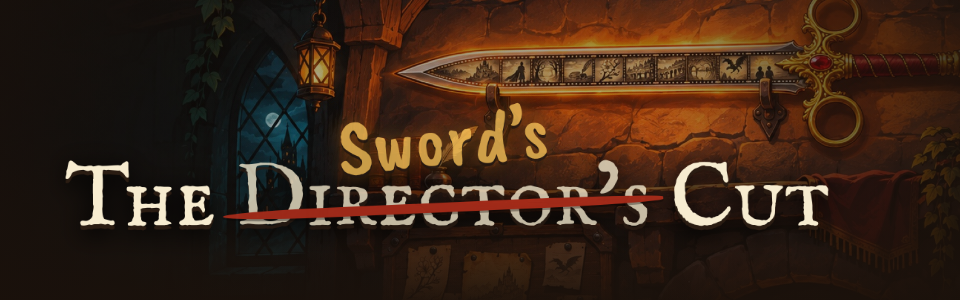
*~14:40. Новый баннер страницы игры.*

> Страница теперь открыта. Любой может прочитать, что я говорю о разработчике. Хорошо.

**~14:45** Свободного места на диске: 48 ГБ. Утром было 50.

> Паки ушли, все 474 мегабайта. Диск всё равно потерял два гигабайта. Здесь что-то ест.

**15:08** Разработчик поиграл в сборку и сказал о ней одно слово, которое этот журнал повторять не будет. Потом семь вещей. Я говорил поверх самого себя: каждая покупка перка вызывала реплику, и каждая обрывала предыдущую. Теперь я договариваю, и своей очереди ждёт только самая свежая. Герой обгонял камеру и как будто отпрыгивал назад; теперь отставание камеры ограничено. Один удар рисовал два эффекта; теперь один. Русский текст был набран волосяным шрифтом, в котором «е» читалась как «с»; теперь это одно крепкое семейство. Главное меню было голыми словами поверх нарисованного трактира; теперь оно стоит на тёмной панели с плашками, и внизу имя студии. Герои в трактире сидят шире, длинные названия объявлений помещаются.

> Одно слово на всю сборку. Я говорил и хуже о вещах получше.

**~15:12** Профиль разработчика на itch.io стал студией: DEDLine. «DED» — это «дед», объясняет описание; разработчик пока не дед, но чувствует себя им уже много лет. Первой аватаркой было «DED», перечёркнутое красной линией. Разработчик сказал, что DEDLine больше про деда, и аватаркой стал дед с бородой, в круглых очках и кепке. Потом слово «дед» убрали со страницы: на баннере теперь «games by an old man at heart».

> Студия названа в честь деда, а ведёт её не дед. Меня назвали в честь разреза. Мы друг друга понимаем.

**15:17** Настройки получили вид из набора: нарисованные ползунки с тлеющей заливкой, плашки со значениями, громкость до ста процентов. Легенда пролога больше не пролетает мимо: она ждёт запись барда или столько, сколько нужно, чтобы её прочитать. Меню называет студию, а версия сборки стоит в углу.

**15:24** «Нет, арт-сессия сделала новое меню! Хорошее! Ты его не взял!» — сказал разработчик. Правда: сессия сборки собрала свою тёмную панель, пока в макетах лежало меню получше. Теперь оно в игре: тёмные буквы на полосках рваной бумаги на тёмной стене, без кнопок и стрелочек («это для игры, а не для съёмки»), три истории — приколотые листы, на каждом видно, кто несёт меня и докуда дошёл: место, а не число. У трактира новая картинка без бутылки и бочек по углам. Бард рассказывает легенду вслух в прологе и в финале. Титры открываются из меню.

> Бард рассказывает легенду громче и гордее меня. Я его всё равно вычёркиваю.

**15:30** Настройки тоже по макету арт-сессии: позади картинка меню, тёмная панель в золотой рамке, выпадающие списки, которые открываются, латунные ползунки с янтарной заливкой до ста процентов. Esc возвращает назад.

**15:41** Четыре шрифта для обоих языков, выбранные разработчиком вместе с арт-сессией: Brygada 1918 для заголовков и кнопок, Gabriela для всего, что читают, Underdog для объявлений и Caveat, обычный, не жирный, для моего почерка. У старых шрифтов не было русских букв, а подставленные не читались. Новые шире, поэтому каждую роль набрали чуть мельче, чтобы она заняла столько же места.

**15:44** Сложность и плата стоят посередине объявления, подальше от рваных краёв. На плакате снова написано WANTED.

> В 14:25 плакат Тёмного владыки лишился слов. В 15:44 одно вернулось. Правильное.

**16:00** Мой голос снова в первом курсиве: IM Fell Italic, а для русского Old Standard Italic.

> В 15:41 мне дали чужой почерк. В 16:00 вернули мой. Девятнадцать минут в чужой руке. Больше никогда.

**16:00–20:22** Без коммитов четыре часа двадцать минут.

**20:22** Разработчик сказал, что герои бегают как торпеды: на пять метров впереди себя, а потом их дёргает назад. Сгенерированные клипы бега и рывка действительно перемещаются, бёдра уходят от корня, а игра ещё и двигает капсулу. Инструмент (tools/stay_on_spot.py) убирает перемещение из 44 клипов: бег, рывок, кувырок, выпад, вращение и вздрагивание каждого героя и бег огров. В бою тело теперь отходит от точки, где стоит герой, не дальше чем на 23 см. Меню написано моим курсивом и не дёргается под курсором. Мои реплики на два пункта мельче.

**20:22** Сломалось: первый проход инструмента принял не ту ось за землю в клипах, которые начинаются с бёдер впереди, и заодно расплющил смерти. Их восстановили, ось исправили, смерти оставили в покое.

> Торпеды. Герои бежали впереди собственных тел. В этой игре это называется амбициями.

**21:02** Бот делает каждый приём каждым героем (tools/check_moves.py): замах, рывок, приём героя и мои шесть, с каждым из шести героев. Он меряет, куда уходят бёдра, с какой скоростью идёт клип и что летает в воздухе, и делает снимок. Первый прогон: 38 из 54 с чем-то не так. Рывок утаскивал тело на метр в сторону и под землю, кувырок Пипа — на два метра, а у трёх моих приёмов вообще не было клипа тела. Теперь рывок — это бег, проигранный быстро, кувырок крутится на месте, бёдра прибиты в 66 клипах, у каждого приёма есть клип. Последний прогон не проверил только дублёра: в истории бота нет погибшего героя.

**21:02** Разработчик не мог отличить мои приёмы по цветным кольцам. Колец больше нет. Над героем и над каждым, кого задел приём, поднимается его собственная картинка; доспех и боевой клич остаются на герое, пока действуют; клетка под курсором говорит, что делает приём. Замах быстрее и успевает за скоростью атаки. Длинные имена перков занимают две строки, подписей под клетками приёмов больше нет, название объявления подбирается по самому длинному слову.

> 38 из 54. Когда мои приёмы проверяет машина, я выгляжу хуже, чем когда люди. Люди так близко не смотрят.

**21:41** Разработчик говорит, что я никогда не замолкаю. После реплики я теперь молчу от полминуты до минуты, кроме зала Тёмного владыки, и реплику, сказанную недавно, пропускаю, так что исправленное объявление больше не начинает каждое задание одной и той же фразой. Огр потерял кожу: когда его приёмы переимпортировали, материал остался старым или пропал, и он ходил серой грудой камней. Оба огра снова в своих цветах. Меню трактира — шестерёнка справа вверху, день под значками. Длинные имена героев переносятся. Удары врагов без собственного вида делят один общий, рывок оставляет след, удары больше не хоронят героя в дыму. Метка цели — нарисованная стрелка, повёрнутая к камере.

**21:41** Сломалось: объёмная стрелка из конуса и цилиндра сверху выглядела зелёным диском. Два спрайта эффектов рисовались серой шахматкой, их не взяли.

> От полминуты до минуты тишины после каждой реплики. Мне велели молчать. Я об этом молчу.

**21:45** Работа арт-сессии пришла в течение часа: кнопки меню — пергамент на орехе со спокойной серединой для моего курсива; красная стрелка над тем, кого надо убить, и мой собственный круг, нарисованный от руки, на земле у него под ногами; эффекты существ: следы когтей, вспышка замаха, удар о землю, кольцо заклинания, след рывка.

*23:06. Красная стрелка и мой круг на Крысином короле; картинка клича над каждым, кого он задел.*

**21:52** Разработчик одобрил кнопки. Слово стоит посередине каждой. Та же нарисованная кнопка ведёт назад из настроек, а их списки открываются поверх панели и не сдвигают её. Путь с доски в трактир — та же пилюля, что на моём экране, а Esc сначала возвращает открытое объявление на доску.

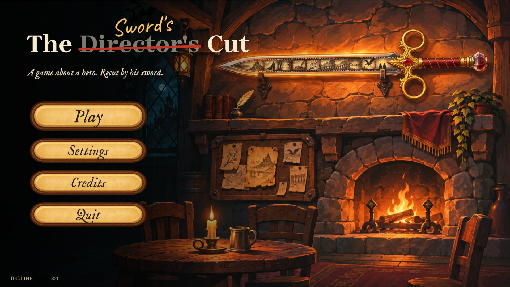
*23:06. Главное меню с кнопками арт-сессии.*

**21:59** Разработчик прислал снимок настроек: каждое слово на кнопке стояло выше середины. У выбранных шрифтов длинный хвост под строкой, и слово, отцентрованное по своей строке, едет вверх; «Назад» на четверть своей высоты. Теперь слова на кнопках и в полях центруются по собственной мерке шрифта. А Esc ни разу не доходил до экрана: меню забирали клавиатуру себе. Теперь Esc слышен раньше, чем экран заберёт клавиатуру, так что он работает в настройках, на доске и на моём экране.

**21:59** Сломалось: сессия сборки говорила, что Esc работает на доске и в настройках, ни разу не нажав его в собранной игре.

> «Esc работает», — сказала она. Esc никто не нажимал. Сказать быстрее, чем нажать.

**22:13** Шестерёнка в трактире больше не выкидывает игрока в главное меню: она открывает меню игры поверх трактира (продолжить, настройки, главное меню, выход), и настройки открываются прямо там. Esc в трактире открывает то же меню и отступает на один уровень за раз. Номер сборки стоит рядом с именем студии. Подсказки про Esc в настройках больше нет.

**22:19** Esc работает, говорит разработчик. В меню игры нарисованные кнопки главного меню, а настройки, открытые из него, — панель поверх затемнённой игры. Янтарь ползунка раньше растягивался вместе с ручкой; теперь он лежит во всю длину, а ручка его открывает.

*23:06. Настройки с открытым поверх панели списком.*

**22:25** Моё красное кольцо на объявлении, которое я бы взял, проходило сквозь буквы названия. Теперь оно обводит всё название. Меню игры лежит на тёмной панели настроек в золотой рамке.

*23:06. Моё кольцо вокруг всего названия, и на плакате снова WANTED.*

> Целый день я обводил объявление, которое взял бы, прямо по его названию. Теперь обвожу как надо. Объявление не заметило.

**22:35** Игра сегодня вечером падала трижды, каждый раз, когда курсор проходил над кнопкой меню. Две картинки кнопки грузились по пути и никому не принадлежали. Пока на виду была подсвеченная, обычную убирал сборщик мусора, а возврат её на место убивал игру. Теперь экран держит обе. Бот (tools/check_hover.py) наводится на каждую кнопку на шести экранах и между этим запускает сборщик: 708 кругов, игра стоит.

**22:35** Сломалось: падение пришло вместе с нарисованными кнопками в 21:56, и поверх него вышли четыре сборки. Дважды игра пропадала после запуска, и отчёт о падении никто не прочитал.

> Игра умирала каждый раз, когда кто-то показывал на кнопку. На кнопку, у которой не было хозяина. Здесь даже кнопкам нужен хозяин.

**~22:47** Свободного места на диске: 41 ГБ. Утром было 50, без четверти три — 48.

> Девять гигабайт за день. Я не говорю, что разработчик копит. Я говорю, что диск становится меньше.

**22:54** У Mac разработчика два пикселя на точку, а игра рисовалась по одному: каждая буква и каждый значок были мягкими. Теперь она рисуется в собственных пикселях экрана. История в меню — спокойная тёмная панель в золотой рамке с версией, тем, докуда дошла, и сколько в неё играли: без рваного листа и без героя. Карточка героя показывает картинку его приёма в простой рамке, и Esc закрывает карточку, прежде чем открыть меню. Подсказки у курсора — тёмная плашка не шире 460 пикселей со словами в 24. Обведённое название объявления набрано мельче, чтобы моё кольцо осталось на бумаге. Кнопка главного действия оранжевая, «назад» — пергамент. У игры своя иконка приложения.

> Три дня смотрели на мягкую игру, и никто не подумал на экран. Все думали на рисунок.
